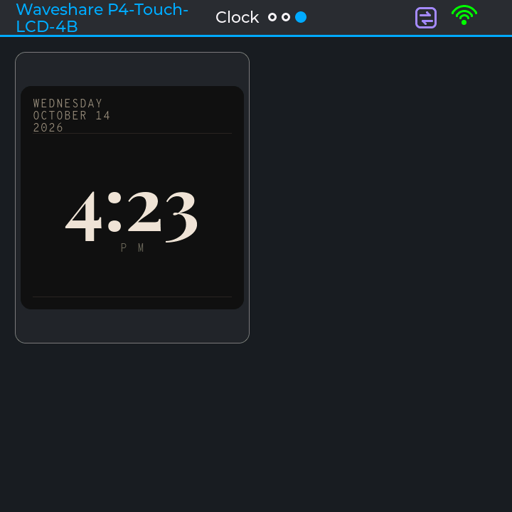
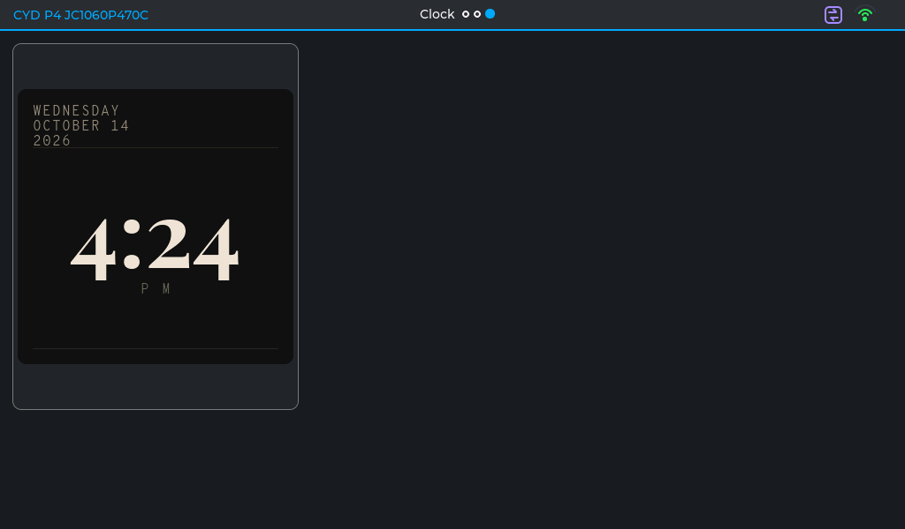

# TEST - #100: NINA's clock as a dashboard card (a prototype)

Branch `feat/100-nina-clock` (off `main` at `v0.2.13`, not off `feat/ui-followups`). Its own PR; it
edits no shared doc (HANDOFF, ROADMAP, DECISIONS) - its notes are here and in the PR.

**What it is.** NINA's Classic clock face (ESP32-P4-NINA-Display, used non-commercially with the
author's permission - every file taken carries the credit and the condition), **time and date
only**, as a card two cells by two (four units each way) pinned at the top left of **a new third
page, "Clock"**, after House and Fleet - nothing on those pages moves. Drawn into the largest square
inside the card on each board; its colours are the face's own (a picture, not chrome). The time
comes from the C library, which TimeService sets (SNTP, `FLEET_TZ`); until it is set the face says
"--:--". 2.11's hero region is where it belongs; this is the flow engine doing what it can today.

## What was built

| Part | Where |
|---|---|
| The dial maths, ported as it is (for the round faces' forecast arcs, later) and the face's words | `include/Clock/ClockMath.h`, `src/Clock/ClockMath.cpp` - pure, tested on the PC |
| The tests: NINA's own dial cases (all 28 checks), the words, the square, the face pick | `host-tests/test/test_clock` - **10 tests, 0 failures** (WSL's g++); `test_layout` 10/10, `test_timeformat` 8/8 |
| The Classic palette, as data in one file (allowed colour literals) | `src/Clock/ClockPalettes.cpp`, `scripts/structure_check.py` `COLOUR_OK` |
| The card | `include/Cards/ClockCard.h`, `src/Cards/ClockCard.cpp` |
| How a spec asks for it | `CardSpec::type` (`CardSpecType::SPEC_CLOCK`), `cardForSpecType()`, one branch in `CardPage::applySpec()` |
| The page | `include/Dashboards/Dashboard_Clock.h` (id 3, slug `clock`), one entry in `GUIManager.cpp`'s page list |
| A layout fix it needed | `Layout::rowsWanted()` asks for at least the tallest item's rows: a lone 2 x 2-cell card on a 6-column page had the area of one row and came out half its height. No card before it asked for more than one cell of height, so no other page changes (a host test pins it) |
| The faces | `scripts/gen_clock_fonts.py`: Playfair Display 700 digits at 80 / 104 / 132 px, Overpass Mono 300 labels at 16 / 22 px, from the foundry's OFL files in `assets/fonts/` (NINA's `.c` faces not taken). **+62 KB of flash** on the P4_5 |

## Checked

- **WS_P4_4B and CYD_P4_1060 on glass, by screenshot** (the P4_5 was left on PR #101 for the owner):
  the clock page, the card 2 x 2 cells at the top left, the date top left, the time in the middle.
  On the 1060 (six columns, rows not fixed) the card keeps its full height - the layout fix.

  

  

- **House and Fleet unchanged** on the 4B against `v0.2.13` (the harness's page trees): the cards
  identical; only the header's page dots, now three.
- Builds: WS_P4_5, WS_P4_4B, CYD_P4_1060 and WS_S3_TOUCH_LCD_4B (the S3 check) - **all
  SUCCESS** (flash 42.3 / 40.5 / 38.3 / 35.4 %). Not the all-nine gate.
- Structure check: `ClockCard.cpp` adds 9 style calls (540 in 27 files, 531 in 26 at `v0.2.13`) -
  the face's own look, a card not yet on the kit; no colour literal outside its palette file.

## Tests for you

| # | Do this | PASS if |
|---|---|---|
| C1 | Swipe to the third page | "Clock": the card at the top left, two cells by two, today's day, date and year, the time and A M / P M |
| C2 | Watch it cross a minute | The time changes on the minute, nothing else on the page redraws |
| C3 | Reboot with the network off, then on | "--:--" until the clock is set, then the time |
| C4 | Swipe House and Fleet | As before; three dots in the header |

## Questions for you

- **Q1. How a dashboard asks for a card with no entity.** Built: **a card-type override in
  `CardSpec`** (`type = SPEC_CLOCK`), its default the old behaviour - one enum, one factory, one
  branch, nothing else changes. The alternative: **a system "clock" entity** (a provider ticking
  each minute, `EntityKind::CLOCK`, `cardForKind()`), so the clock is a card like any other and the
  binder redraws it - but it adds a kind every switch must list, and HA's publisher would offer it
  as a sensor. Recommended: the override for now; an entity if the clock should ever appear in HA.
- **Q2. Lining figures?** Playfair Display draws old-style figures (the 3, 4, 5, 7 and 9 drop below
  the line); NINA's Classic uses lining ones from a modified copy. Lining figures need the font's
  `lnum` applied before converting - fontTools (`pip install fonttools`), an install. Recommended:
  look on glass first; if lining, the install and one script change.
- **Q3. The layout fix** (`rowsWanted()` counting the tallest item) is in this branch because the
  clock needs it; it could go on its own. Recommended: keep it here.
- **Q4. Flash: three digit sizes** are linked on every board (+62 KB). Recommended: fine for a
  prototype; per-board sizes (as `UITypeScale.h` does) when it is built properly.

## What is left (not done tonight)

- The weather half of the face (temperature, condition, high/low, the stats strip, the forecast
  bars) - waits for an HA weather entity; `dialBlocks()` is ready for the round faces' arcs.
- The other six faces (Console 92 next); the round faces need the hero region and a centre/radius
  instead of NINA's whole-panel geometry.
- 2.11's hero region to place it; a long press or tap action for the card (it has none - it opens
  no window).

## Your results

(empty)
