# TEST - 2.11: group cards, clusters and the arranger

Rounds in order, each with your results under it. The design is `docs/design/group-cards.md` §6-7
(DECISIONS K88-K107, D-34, D-35); the build order you agreed on 2026-10-19 (K106): round 1 clusters
on the page, round 2 the arranger, round 3 what the glass edits (with the keyboard), round 4 the
summary card, count slots, extending a source group and group pages.

# Round 1 (2026-10-19, morning, built unattended) - clusters on the page

Branch `feat/2.11-group-cards` (off `main` at `6bd834f`: `v0.2.18` and the design). **No pull
request** - the PR comes at sign-off, after the all-nine gate. Flashed to the **P4_5** (COM15) and
the **4B** (COM7), and **once to the 1060** (COM9) for D-34. Each board's settings file was saved
first (`bench/settings/<board>/20261019-*.json`); nothing in it was changed by this round.

## What changed

| Where | Before | Now |
|---|---|---|
| **The House page** | 18 cards | **Office, Kitchen and Outside are clusters** - group cards made on the device, shown as a block of their members (K88-K92): one border, a header, the members inside as mini tiles. Garage's doors, Living's Overhead, Front's Thermo, Eric's bedroom and the garage's temperature stay cards. The doors wait for the summary card (round 4, K98) |
| **A cluster's header** | - | **one line** (K100): the group's colour as a **swatch** beside the cluster's name on the left (K102), and the header's members on the right - **Office and Kitchen: temperature, then occupancy; Outside: the deck's temperature, then its lux**. A value is its icon in its tint and the number with its unit; where there is no room the icon goes first, then the last value (K101, K104: no fixed number of slots - the page header's planner decides). **Occupancy is its own icon for each state** - the figure while someone is there, the struck-through one while clear (K101). Dashes while a value has not arrived or its source says unavailable (D-15) |
| **Mini tiles** | - | each member that is not in the header: **no border**, its hero and its entity label under it (K89). A light or switch is **the lit disc** (K100): a solid disc in the active colour - or the light's own colour - behind a dark glyph while on, the faint disc while off; a disc too small for its glyph is not drawn and the glyph takes the colour. A sensor is its number and unit (Outside's Front) |
| **Touching a cluster** | - | **a tap on a tile** is that member's own tap (a light toggles); **a long press on a tile** opens that member's own window, as a card's (K104) - Desk's is Desk's, with its scenes. **A long press on the header** opens the cluster's window on its **Members**; **a tap on the header does nothing** (K107) |
| **The members are the same cards** | - | Desk, Overhead, Sink, Table, Porch, Front and the sensors keep **their card ids**, so everything you saved on them is still theirs (Desk's tap, the history spans). Desk's custom card label "Office" does not show: a mini tile has no card label; the cluster's header names the group once (K92 rule 2) |
| **Where a cluster goes** | - | placed by today's flow engine, **as many cells as its tiles need** (`Layout::clusterSpan()`: the fewest cells holding every tile at 7.5 mm or more, wider first) - two cells across for the House page's three. A cluster that cannot fit on a board is shown as **its one card** (K92 rule 6): its lights and switches behind one tile. The arranger replaces this in round 2 |
| **A cluster's top edge** | - | in line with the cards' beside it: it keeps the room a floating tag takes above a card, with no tag in it |
| **The cards** | each set its own look | **built from the kit's roles** (`KS_CARD_*`): the surface, body, tag, badge, disc, name. **Nothing on screen changed** - the harness compared every state before and after on the P4_5 and the 4B (below). It is what lets the mini tiles and clusters share the cards' looks |
| **A header slot's panel** (D-35) | square where it met the bar, the bar's line running into it | **it lies on the bar**: its top corners turn down from the line, and **the bar's line fades out over 2.5 mm** and stops short of the panel's walls - "so the lines don't contact the panel" |
| **The halo** (D-35) | Linen's shadow; nothing on the dark schemes | **a black rim 5 mm wide at full strength, fading to clear, round every header panel (and its tab) and every window** - the card window, About, UI Tweaks. On Linen it takes the place of the old shadow. No dim |
| **The 7" boards' header words** (D-34) | 14 px (2.1 mm) on the 7B and the 1060 | **16 px (2.4 mm)** - one step up; the P4_5's are 2.25 mm and the 4B's 2.19. The tags stay 14. The 7B gets it at the next flash |

## The pictures

The House page on the P4_5 (Midnight), before and now:

The 4B (Linen) - the Outside header drops the lux icon to fit, as planned:

The page panel lying on the bar, with its halo (P4_5, then the 4B on Linen):

A window with its halo (Desk's, from its mini tile):

The 1060 with the 7" header words at 16 px:

## Tests for you

To try the cluster settings that round 3 will put on the glass, from the PC (each takes effect when
the page is next built - swipe away and back):

    curl "http://fleet-ws-p4-5/settings?card=office_261019_0500&present=card"
    curl "http://fleet-ws-p4-5/settings?card=office_261019_0500&present="
    curl "http://fleet-ws-p4-5/settings?page=house&cl_style=bar"
    curl "http://fleet-ws-p4-5/settings?page=house&cl_style="
    curl "http://fleet-ws-p4-5/settings?card=office_261008_0310b&hidden=no"
    curl "http://fleet-ws-p4-5/settings?card=office_261008_0310b&hidden="

| # | Do this | PASS if |
|---|---|---|
| T1 | Look at the House page on the P4_5 | Office, Kitchen and Outside are clusters two cells wide, their tops in line with the cards beside them; each header one line - swatch, name, values; the tiles borderless with their names under them |
| T2 | Turn a light on and off from a tile (Office's are safe, W9) | its disc fills with the active colour (or the light's own) behind a dark glyph, and empties again; nothing else in the cluster moves |
| T3 | Long-press a tile (Desk) | Desk's own window, exactly as its card's was - its controls, scenes, History, SETTINGS |
| T4 | Long-press a cluster's header | the cluster's window on its Members - every member listed with its state; a tap on one opens its view |
| T5 | Tap a cluster's header | nothing happens |
| T6 | Watch the headers for a while | the temperatures follow their sensors; occupancy shows the figure while someone is there and the struck-through one while clear |
| T7 | Swipe to Fleet and back; change scheme (UI Tweaks) | the clusters come back the same; on each scheme the swatch, rule and tiles read |
| T8 | Open each header panel (clock, temperature, House, status) | each panel's top corners turn down from the bar's line; the line outside fades out short of the panel; a black halo all round the panel and its tab, smooth - no steps or bands |
| T9 | Open a card's window; About; UI Tweaks | each window stands on the same halo; it opens as fast as before (the first frame complete) |
| T10 | The settings above from the PC: Office as a card, then back; the page's clusters as Bar, then back; Office's temperature visible as a tile, then back | Office becomes one card (its two lights behind one tile) and returns; the headers become bars in each group's colour with the words in the surface's colour; a temperature tile joins Office's tiles while it stays in the header |
| T11 | The 4B (Linen) | as T1-T9 at 720 px; the Outside header fits by dropping the lux icon |
| T12 | The 1060 | the header's words (clock, page) look as large as the P4_5's and the 4B's - not "notably smaller" |

## Choices that were mine

- **The halo is painted, not LVGL's shadow.** As LVGL's shadow (5 mm, spread 2.5 mm) it cost a full
  redraw with a window open 45 ms more on the P4_5 (129 to 175 ms) and banded into visible steps
  (black to Midnight's ground is a handful of 16-bit levels). Painted as dithered A8 images (four
  corners, four tiled edge strips, `UI/Kit/KitHalo.cpp`) it costs ~28 ms on the same frame and does
  not band - §15's own fallback (D-33's way). Numbers below.
- **The halo replaces Linen's lift** on panels and windows - one rim, not a rim and a shadow.
- **Mini tiles' labels are the TAG face** (the cards' small words), so two names fit side by side; a
  value tile's number is the small value face where it fits, else the name's.
- **Header values are the NAME face**, the name too; the icons in their tints (white on a Bar).
- **The swatch is the default** (the mock's recommendation; K102 left it open). Bar is one setting away.
- **A cluster has no state of its own**: its members show theirs - a STALE or FAILED badge and the
  long-stale diagonal on a tile, as on a card. The window's members list says which.
- **The cluster's window, opened from the PC (`/popup?card=`), starts on the controls** of its
  first member's kind - the light's, for Kitchen; on glass a long press opens Members. Round 3's
  management screen goes inside this window.
- **The line stops a quarter of the panel's corner radius short of its walls**, after its 2.5 mm fade.

## Questions for you

1. **The halo on Linen** (the 4B): black at full strength reads heavier on a light page than on
   Midnight. Keep it as chosen, or lighten it on light schemes? *Mine: look at T8 on the 4B first; if
   it is heavy, the same 5 mm at ~60% on Linen.*
2. **D-34 on the 1060**: is 16 px right, or one more step (18)? *Mine: 16.*
3. **The P4_5's tiles at 5 x 3** are about 9 mm tall under a 5 mm header - the touch minimum. Rows 2
   (UI Tweaks) gives them more; the arranger (round 2) will choose a 5 x 2 page for the House page if
   it keeps the playground's verdict. *Mine: leave it to round 2.*

## Results (mine, before you)

- **Harness A/B for the cards onto the kit** (`r1base` / `r1kit`, P4_5 all 62 states, 4B six): the
  pages' pixels all explained - **no pixel moved**; the only tree differences are fonts on labels in
  hidden status rows ("Text", never drawn). Desk's light changed between captures, so its window
  states said "capture again"; the windows' styles are untouched by this step.
- **Round 1's walk** (`r1d`, P4_5): all 58 states open; the four Deck (Outside) states are absent -
  the deck's temperature is now a value in Outside's header, not a tile.
- **LVGL's pool on the House page** (P4_5): 105.6 KB before, 102.8 KB with the cards' shared
  styles, **96.6 KB with the clusters** (435 objects, was 457).
- **Frame times**, `/bench what=full`, render ms (a full redraw - the worst case):

  | | P4_5 page | P4_5 window open | P4_5 clock panel open | 4B page | 4B window | 4B clock panel |
  |---|---|---|---|---|---|---|
  | `v0.2.18` | 89.8 | 129.3 | 105.7 | 88.1 | 127.4 | 106.3 |
  | round 1, LVGL's shadow as the halo | 71.8 | 174.6 | 143.1 | 70.2 | 145.1 | 119.4 |
  | **round 1, the painted halo** | **71.0** | **139.4** | **103.1** | **70.3** | **119.2** | **94.4** |

  The page itself got faster (fewer objects: the clusters). With a window or a panel open, the halo
  costs ~28 ms (window) and ~16 ms (panel) on a full redraw of the P4_5.
- **Host tests**: 43, all PASS - `test_cluster`'s nine new (the tile grid, the cluster's span).
- **Structure check**: two files over 1,000 lines (`GUIManager.cpp` 1,490, `Card.cpp` 1,448 - down
  from 1,468); `lv_obj_set_style_*` outside the kit **399 in 26 files** (438 at `v0.2.18`) with the
  two new files counted; colour literals 10 in 2 files, unchanged.

## Your results

**2026-10-19, afternoon** (rounds 1-3 tried together, not test by test; HA had crashed overnight, so
the morning's readings were dashes). "I like it!" The notes, in short:

- **The halo (D-35)**: "the effect itself is outstanding", but not calibrated - **too strong
  everywhere** (about 50% or lower), and on **Linen** it stops reading as a shadow and looks like a
  black border. **Its corners need work**: where a panel's top corners meet the bar (the page panel
  and the system panel on Linen, pictured in the session) the halo leaves square marks, and the
  tab's coves show dark specks.
- **Icon sizes must match**: a cluster's tile icons and a solo card's must be the same size (or very
  close), on every grid. If that is too hard, drop the disc in a tile so its icon can be a solo
  card's size, and show a tile that is on with the page's card state round the tile (Bracket, Corner
  cut or Fill) - borderless until active.
- **Cluster headers** take a cell's height and leave neighbours' icons out of proportion - bigger
  or smaller depending on the grid. **Clusters should fill their whole cells**: Float and Tag take
  room from a solo card for its label, and a cluster has no such label - let only solo cards wear
  that room. (An idea set aside by the owner: the sensors in tags of their own on the right.)
- **The grid**: clusters need more room than a solo card's cells give - more height above all.
  Use cells and sub-units to even it out (a solo card ~0.75 of the room a cluster's cell gets;
  double the grid so a card is 2x2 sub-units); aim for **tiles and cards of the same shape**, so
  clusters may need to be bigger. A thought for the arranger's logic.

# Round 2 (2026-10-19, morning, built unattended) - the arranger

The same branch, on round 1. Flashed to the P4_5 and the 4B (settings saved first); the 1060 keeps
round 1 (flashed once, for D-34). Design: `layout-engines.md` "As prototyped" and "As built"; K105.

## What changed

| Where | Before | Now |
|---|---|---|
| **Where blocks go** | the flow engine: each card or cluster at the first free place, reading order | **the arranger - Layout Playground v5, as prototyped** (K105): every tiling of the board's grid and its neighbours (a row or column either way), the cheapest page by the playground's weights - **an empty cell costs 60**, a cluster with too much room, a long thin cluster, a block out of reading order, leaving the board's grid, single cards drifting from today's size |
| **The P4_5's House page** | 5 x 3 with three cells empty at the bottom right (round 1) | **5 x 3 with none empty**: the three clusters three cells wide, the doors and the four cards around them |
| **The 4B's** | 4 x 3, full | the same 4 x 3 - it was already the cheapest |
| **When it runs** | - | **when a page's blocks change, and the answer kept** (K105) - in the settings file, `pages.<slug>.layout`, with a fingerprint of what it was arranged for (the blocks, the page's room, the weights). A build that matches uses it at once; one that does not is built as before while the arranger runs **on a task of its own**, and the page is built again when its answer is kept - so the screen never waits. Your next boot uses the kept answer straight away |
| **How long** | - | **P4_5: 150,031 steps, 414 ms** (one neighbouring grid hits the playground's 150,000-step cap); **4B: 57 steps, 1 ms**. No S3 to time (the S3_4B is locked, #69); it compiles |
| **The Fleet page** | flowed | still flowed: the arranger finds no page for its 16 cards on the board's grid or its neighbours at the playground's cell sizes (`/popup` says so). A smaller `mincell` would let it try |
| **Your Col / Row** (UI Tweaks) | obeyed | still obeyed: the arranger uses that grid (the other count the board's) |

## Tuning from the PC

Each is kept in the settings file (`system.arranger`); the page is arranged again when next built -
swipe away and back. Empty `v` puts the playground's default back.

    curl "http://fleet-ws-p4-5/settings?arranger=hole&v=40"
    curl "http://fleet-ws-p4-5/settings?arranger=hole&v="
    curl "http://fleet-ws-p4-5/settings?arranger=off&v=1"
    curl "http://fleet-ws-p4-5/settings?arranger=off&v="
    curl "http://fleet-ws-p4-5/popup"

The weights, in plain words: **hole** (60) what an empty cell costs - lower lets the arranger leave
cells empty rather than stretch a cluster; **comfy** (1.6) how roomy a cluster's tiles may be before
it pays for spare room; **loose** (25) what that spare room costs, by its square - so two clusters a
cell bigger each cost less than one two cells bigger; **long** (40) what a long thin cluster (beyond
1.8 : 1) costs; **order** (4) what moving a block ahead of an earlier one costs; **away** (6) what
each row or column away from the board's own grid costs. The sizes (mm): **maxcell** 34 and
**mincell** 14 a grid cell's size; **tilew** 12 x **tileh** 9 the smallest tile the arranger plans
for; **hdr** 5 a cluster's header. `/popup`'s second line says what the last run did and how this
page was placed. **off** = 1 lets every page flow as in round 1, to compare.

## Tests for you

| # | Do this | PASS if |
|---|---|---|
| A1 | Look at the House page on the P4_5 | no empty cell; the three clusters three cells wide; nothing overlaps |
| A2 | Reboot the P4_5 (the reset button) | the House page comes up arranged at once - no flowed page first |
| A3 | `arranger=off&v=1`, swipe away and back; then `off&v=` | round 1's flowed page; then the arranged page again, at once (its answer is kept) |
| A4 | `arranger=hole&v=40`, swipe away and back; then `hole&v=` | the page may change once the new answer is ready (a moment after the swipe back); then back |
| A5 | Office as a card (round 1's T10), swipe away and back | the page is arranged again for the new blocks, a moment after it is built |
| A6 | The 4B | its House page as before, full |

## Choices that were mine

- **A cluster always counts one member in its header** for the arranger, so it never gets a single
  headerless cell - one-cell clusters (K103, sensors only) are round 4's, and not drawn yet.
- **The page is built first and arranged after** when there is no kept answer, rather than waiting
  for the arranger: a first boot, or a change, shows the flowed page for under half a second.
- **Every page of up to 24 blocks** is arranged; a page the arranger finds no page for flows, and
  it is not tried again until its blocks or the weights change.
- **The arranger's own weights stay the playground's** - nothing tuned yet; that is yours on glass.

## Results (mine, before you)

- **Host tests**: 52, all PASS - `test_arranger`'s nine: the playground's answers for its House
  blocks on its seven boards (P4_5 5 x 2, 7B 5 x 3, both 4Bs 4 x 3, the 4880 5 x 2 and 2 x 5, none
  for the 3248), every grid, place and score to 1e-5; the same answer twice; a fixed grid obeyed.
- On the boards: as above - the kept answer is used after a reboot on both.

## Your results

(to come)

# Round 3 (2026-10-19, morning, built unattended) - what the glass edits

The same branch, on round 2: `bd88809` (the cluster's window), `751d1f5` (the keyboard), `29a93a2`
(Visibility and hidden cards), `3816fe6` (Copy / Move), `6a5bde9` (removing a copy), `96b54ba` (the
cluster's Add cards), `2275545` ("which group?"). Flashed to the P4_5 and the 4B, each board's settings saved first. **Every change
the tests made was put back** from those saved copies (`restore_settings.ps1`): the P4_5's file is
the same as at 09:39, the 4B's as at 09:28. Words on screen are the "2.11 Clusters" mock's (section
D) where it had them - proposals, K96 left the names open.

## What changed

| Where | Before | Now |
|---|---|---|
| **A cluster's window** (a long press on its header, K107) | its Members | **its management screen** (K104): HEADER - **Name** (Rename: the keyboard), **Style** (Page's / Swatch / Bar), **Sensor icons**, **Header slots** (Choose: the members, each ticked into the header or not, in the order ticked, four at most); MEMBERS - each member with **Visible** (a tile or not); **Add cards** at the foot. Changes show when the window closes |
| **The on-screen keyboard** (K95) | - | **a kit component** (`Kit::keyboard()`): over everything, the rest dimmed - a box with what the words are for, a one-line field and Cancel / **Save** (the accent), above LVGL's keys along the bottom (lower case, ABC, 1# symbols, the arrows, backspace, the hide key, the tick). **Plain ASCII only** - the keys offer nothing else and the field refuses anything else. Keys 7 mm tall: four rows take about half the P4_5's height. It goes with the window under it, unsaved |
| **Naming a cluster** | from the PC | **Rename** types its own words (`label_text` on the cluster - in its group's colour, K46); an empty field is its group's name again (shown faintly in the field). The window's title follows at once, the cluster when the window closes |
| **Card UI's Custom chips** | Entity label's Custom kept the words the card showed; Card label's Custom likewise | **a tap on Custom opens the keyboard** on the words the card shows now: Entity label - the card's name (`name`, K37, K40); Card label - its card label's words (`label_text`; none: the colour alone) |
| **SETTINGS** | Remove card, on cards added on the device | **Visibility**, on every card: a view whose choices depend on **where the card is** (K96) |
| **Visibility, a card on the page** | - | **Hide from this page** - K66's remove, now **for every card**: after the dialog ("Hide this card?"), to the page's pool with its settings (`removed`: `yes`), and the page is arranged again. **Add to a cluster** - below |
| **This page's hidden cards** | - | **listed in the page slot's panel** (tap the page's name in the header), each with **Restore**, which puts it back where it was |
| **Visibility, a mini tile** | - | **Hide from the cluster** - the window closes and the tile goes (its Visible, K104, brings it back); **Add card to dashboard** - a copy right after the cluster, in its group (K65); **Remove from the cluster** on a copy made on the glass, after a dialog - deleted, entry and all (the card it came from is untouched; the dashboard's own members only hide) |
| **Add to a cluster** (Visibility, on the page) | - | **the page's clusters as chips, "Copy - stays here" / Move** (K100: one screen, Copy first), and Add. A copy is a card of its own (`in`: the cluster's id - K106's key) **with the name the card shows** ("Thermo", not HA's "THERMOSTAT Temperature"), wearing the cluster's group (K92 rule 2). **Move** is a copy, and the card itself to the page's hidden cards. Only a card standing for one thing - not a cluster or a group card (one level, K92 rule 3) |
| **A cluster's Add cards** | greyed | **the page's cards that can join, each with a box**, then Copy / Move and Add - the same as above, several at once |
| **Add card to dashboard** (a member's own view; a tile's Visibility) | the card made at once, in its group card's group (K65) | **"Joins which group?" first** (K92 rule 9): its group card's group as the first chip, **chosen already** - Add is still one tap - its entity's HA-area group beside it when that differs, and every other group in a list. The card goes right after its group card, in the group chosen |

## The pictures

The cluster's window, its header slots (4B), and the keyboard over it (P4_5, then the 4B on Linen):

Visibility on the page (4B), its dialog, and the page's hidden cards (the P4_5 with Thermo hidden;
the 4B's list - cards removed in October's K17 tests, already in its pool):

A tile's Visibility, and a copy's (with Remove):

Add to a cluster; Thermo moved into Kitchen (and copied into Office before it); copied into Office
on the 4B; the cluster's Add cards, and Office with two cards added:

"Which group?" for Kitchen's Sink (its area's group is its cluster's, so one chip), and its card
made, right after the Kitchen cluster:

## Tests for you

Office's lights are safe to use (W9). Each test puts back what it changed.

| # | Do this | PASS if |
|---|---|---|
| E1 | Long-press Office's header | its window: HEADER (Name, Style, Sensor icons, Header slots) and MEMBERS (each with Visible, Add cards) |
| E2 | Style: Bar, close; then Page's | Office's header is a bar in its colour; then a swatch again |
| E3 | Header slots: untick occupancy, back, close; then tick it again | the header shows the temperature only and occupancy comes back as a tile; then as before |
| E4 | Members: untick Overhead's Visible, close; then tick it | Overhead's tile goes; then comes back |
| E5 | Name: Rename, type "Work" on the keys, Save | the title says Work; after closing, so does the header. Rename again, empty the field (backspace), Save: Office again |
| E6 | The keyboard: ABC for capitals, 1# for symbols, the arrows, backspace held down; then the hide key, and a tap outside the box | it types what the keys say and nothing else; held backspace repeats; the hide key and a tap outside leave without saving |
| E7 | Desk's window - SETTINGS - Card UI: tap Entity label's Custom | the keyboard on "Desk"; change it, Save: the card's name changes. Tap Inherit: back |
| E8 | The same for Card label's Custom | the keyboard on the card label's words; Save changes them, in the group's colour. Inherit: back |
| E9 | Thermo's window - SETTINGS - Visibility - Hide from this page - Hide | the dialog asks; Thermo goes and the page is arranged again (a moment later) |
| E10 | Tap "House" in the header | HIDDEN CARDS lists Thermo with Restore; Restore puts it back |
| E11 | Long-press Porch's tile - SETTINGS - Visibility - Hide from the cluster | the window closes and Porch leaves Outside. Outside's window - Porch's Visible - close: back |
| E12 | Thermo - Visibility - Add to a cluster: Office, Copy, Add | a Thermo tile joins Office (named Thermo) and Thermo stays on the page |
| E13 | Long-press that new tile - SETTINGS - Visibility - Remove from the cluster - Remove | the copy goes; Office as before |
| E14 | Thermo - Add to a cluster: Kitchen, Move, Add | Thermo leaves the page (listed under HIDDEN CARDS) and joins Kitchen. Remove the copy (E13), Restore Thermo (E10) |
| E15 | Office's window - Add cards: tick two, Copy, Add | both join Office. Remove each copy (E13) |
| E16 | Long-press Sink's tile - SETTINGS - Visibility - Add card to dashboard | "Joins which group?" with Kitchen chosen; pick another from the list, then Kitchen again; Add: a Sink card right after the Kitchen cluster (the page arranged again). Hide it from the page (E9) |
| E17 | The 4B: E1, E5, E9-E10, E12-E13, E16 | the same at 720 px on Linen; the keyboard's keys about 5.6 mm wide |

## Choices that were mine

- **Visibility replaced SETTINGS' Remove card.** Hide from this page is K66's remove for every card,
  with the same dialog in K96's words; for a card added on the device it is what Remove was.
- **This page's hidden cards live in the page slot's panel** - the mock's "this page's list of hidden
  cards"; the page's name in the header is the page's own place. Each has Restore; **Delete** (K66:
  "deleted only by the owner") is not built.
- **Tapping Custom opens the keyboard**, every time, on the words the card shows - one choice, no
  separate Rename button. Cancel leaves the card Custom with the words it had.
- **A cluster's name is its card label's words** (`label_text`), as a card's own words (K46 rename
  a): in its group's colour, and empty is the group's name. A name the same as the group's is not
  kept, so a group renamed later still names it.
- **The keyboard** is LVGL's keys in the kit's roles; 7 mm keys (a phone's - four rows of the 9 mm
  touch minimum left the P4_5's field no room); a cursor that does not blink (a blink redraws the
  field twice a second); Save is a new button role, **CONFIRM**, in the accent.
- **"Add to a group card or cluster" became "Add to a cluster"**: group cards and a new group card
  as targets wait for the card list.
- **"Which group?" is a view of the window**, not a dialog: chips for the two suggestions and a list
  of the rest did not fit a dialog's box. The suggestion chosen already keeps Add one tap (the mock's
  "one tap: the first is chosen already").
- **A copy takes the name its card shows** (kept as its custom name), so Thermo's copy is "Thermo".
- **Move is Copy and Hide from this page**: the card goes to the page's hidden cards, restorable -
  K92 rule 10's "Take them off the page" read as the pool, not a deletion.
- **A copy made on the glass can be removed for good**; a dashboard member only hides.
- **The tests' changes were undone by restoring each board's saved settings file**, so your file is
  exactly as you left it.

## Questions for you

1. **The hidden-cards list in the page panel** - right home, or a window of its own? *Mine: the
   panel; a page with many hidden cards scrolls it.*
2. **Custom opening the keyboard** - or a Rename button beside the chips? *Mine: Custom.*
3. **The pools hold cards from the K17 tests** (October 14-18): the 4B's House page Office lamp and
   Office Right, twice each; the P4_5's Office Right four times (and a Kitchen lamp on its Home page).
   **Delete beside Restore**, with a dialog, in round 4? *Mine: yes.*
4. **Two members of one name** in a cluster (Office's own Overhead and a copy of Living's) read the
   same on their tiles. Show the card label's words under a copy from another group, or leave it to
   a rename? *Mine: leave it; the copy can be renamed (E7).*

## Not built (round 3's rest)

Group cards and a new group card as Add targets (K96); the card list (K91: HA entities not on the
page, making a cluster from a group); Delete from the pool; the keyboard for groups' names (nothing
names a group on the glass yet). A card made from a member keeps HA's name (K65), as before.

## Results (mine, before you)

- **Every piece verified on both boards** with `/popup` and screenshots (the pictures above), and
  undone: Thermo hidden and restored; Porch hidden from Outside and back; Thermo copied into Office
  (the arranger re-arranged the page in 76 ms on the P4_5, 1 ms on the 4B), moved into Kitchen (39
  ms), the copy removed; two cards added to Office at once (26 ms); Sink's card made in Kitchen
  through "which group?" (10 blocks, 221 ms).
- **The keyboard costs ~7 KB of LVGL's pool** while it shows (P4_5: 105 to 112 KB with Office's
  window under it).
- **Host tests**: 52, all PASS (no layout code changed this round).
- **`WS_S3_4B` compiles** with the keyboard (built once, not flashed - #69).
- **Structure check**: two files over 1,000 lines (`GUIManager.cpp` 1,489, `Card.cpp` 1,448 -
  neither grew); `lv_obj_set_style_*` outside the kit 402 in 28 files (399 in 26 after round 1: the
  two new views' list columns, as the cluster's window has); colour literals 10 in 2 files and shape
  numbers none, unchanged; no LVGL in the core layers.

## Your results

**2026-10-19, afternoon** (with round 1's notes): "lots of thoughts and notes about the sheets" to
come; **at a minimum, the new views should look like Card UI and UI Tweaks** - the same face, chip
styles, buttons, and the same columns and justification.

# Round 4 (2026-10-19, afternoon) - your notes, and the summary card

The same branch: `a61718a` (the summary card), `d15b0e6` (the halo, its corners, clusters filling
their cells, tiles' discs), `ea68c95` (the views as Card UI). Flashed to the P4_5 and the 4B, their
settings saved first; nothing in them was changed this round. Your answers before it (2026-10-19):
tiles keep the disc and match the solo cards in size and look, the grid giving clusters the room;
**clusters fill their cells**; **the grid goes to Layout Playground v6 first**; the halo's strength
**a slider in UI Tweaks**, 50% on Midnight and Fleet and 30% on Linen until moved.

## What changed

| Where | Before | Now |
|---|---|---|
| **The halo's strength** | full black at the edge, every scheme | **50% on Midnight and Fleet, 30% on Linen**, and **a Halo slider at the foot of UI Tweaks** (0-100%), kept per scheme - each scheme remembers its own. Reset all puts each scheme's own back. Painted at that strength, so it stays smooth (drawn faded, the steps came back) |
| **Where a panel meets the bar** | square marks beside the coves, dark specks in them, a light strip at the panel's top corners; on Linen a grey patch at the system panel's corner | **the tab, its coves and the panel's top are one shape with one halo**, painted for the shape: no marks, nothing darkened twice. The panel's top corners are whole arcs; **a panel flush with its tab has a square corner on that side** (the system panel's right); the bar's own drop shadow (Linen) is off while a panel is open - the halo is the panel's shadow |
| **Clusters** | kept a tag's room above them, so their tops lined up with the cards' | **fill their whole cells**; only solo cards wear Float's and Tag's room. A cluster's top stands a little above its neighbours' |
| **Tile icons** | sized from the tile alone - bigger or smaller than the solo cards' | **a solo card's disc and icon** wherever the tile has the room (measured from a 1x1 card on the page); smaller only where it does not. **On the 4B they now match; on the P4_5 at 5 x 3 the tiles are still smaller** - that is the room v6 is for. A tile's disc no longer overflows its room (it did once clusters grew taller) |
| **The garage doors** | two cards, North and South | **one summary card, "Doors"** (K98): open while either door is, its words naming the open one - **"North", "South", "Both"** (more than two: "All", or "2 open"); a **tap opens its Members** (never a door's own action); same ids, so North's and South's settings are theirs |
| **The views** (the cluster's window, Header slots, Add cards, Visibility, Add to, which group) | rows of words and checkboxes, buttons beside them | **as Card UI and UI Tweaks**: the kit's chip table - each option's name right-justified against its chips (stacked on a narrow window) - and the actions as buttons below. **Members: Shown / Hidden**; Header slots: **Yes / No**; **Add cards: each card No / Copy / Move** (one choice per card); which group: **every group a row with Join**, its group card's first and chosen |

## The pictures

The page panel and the system panel on Linen (the 4B, close up) - smooth halo, whole arcs, the
system panel's square corner - and the Halo slider:

The House pages - clusters to their cells' edges; the 4B's tiles the solo cards' size, the P4_5's
smaller:

The summary card's words on a test build with the doors pointed at two virtual lamps ("Both"; one
read "North"), not kept; its Members on the real doors:

The views as Card UI (P4_5, and the cluster's window on the 4B):

## Tests for you

| # | Do this | PASS if |
|---|---|---|
| F1 | Open each header panel on Midnight, then on Linen | the halo reads as a shadow, about half as strong (lighter on Linen); smooth, no steps; no marks beside the coves or at the panel's top corners |
| F2 | The system panel (the status icons) on Linen | its right side runs straight from the tab into the panel - no notch; no grey patch at the corner |
| F3 | UI Tweaks - scroll to the foot - move Halo | the number follows the knob; on release the window's halo changes; switch scheme: that scheme keeps its own; Reset all: 50 / 30 again |
| F4 | Look at the House page on each board | clusters reach their cells' edges; on the 4B the tiles' discs are the solo cards' size |
| F5 | Open a garage door (or wait for one) | Doors lights up and reads "North" or "South"; both open, "Both" |
| F6 | Tap Doors | its Members: North and South with their states |
| F7 | Long-press Office's header | the window as Card UI: Header style, Sensor icons, each member Shown / Hidden; Rename, Header slots, Add cards below |
| F8 | Add cards: one card Copy, another Move, Add | both join Office; the moved one leaves the page for its hidden cards. Remove the copies (a tile's Visibility) and Restore the moved one (House panel) |
| F9 | Thermo's Visibility; Add to a cluster; Sink's Add card to dashboard | buttons and chip rows as Card UI's; each still does what round 3's did |

## Choices that were mine

- **The halo's strength is a per-scheme setting** (`schemes.<name>.halo`), as the selector's look is:
  a slider on Linen does not move Midnight's.
- **The bar's drop shadow is off while any panel is open** - the simplest way to keep it off the
  halo's corners; it returns when the last panel has gone.
- **A tile matches the page's solo card measured from the first 1x1 card on the page** - every 1x1
  card's hero is the same size on a page, so any one will do.
- **"Doors"** for the summary's own name (in Garage); "All" past two members and "2 open" for some -
  your "North" / "South" / "Both" are the two-member case.
- **The summary's tap is Members** - K98 offered History, Members or a small window; Members says
  which door, and a tap never moves a door.
- **One choice per card in Add cards** (No / Copy / Move) in place of a box per card and one Copy /
  Move for all - it fits the chip table and lets one card copy while another moves.
- **"Which group?" lists every group as a row**, its suggestions first, in place of two chips and a
  list - one control, as the chip table has.

## Questions for you

1. **Halo on Linen at 30%** - right, or lower still? (The slider is there to find out.)
2. **The summary's words** past two members: "All" and "2 open" - right?
3. **Layout Playground v6** - which way for the arranger? (See "The grid: Layout Playground v6"
   below.) Equal squares, 4:3 on pages with fewer entities, bare tile icons, or something else.

## The grid: Layout Playground v6

Published to the same artifact (`https://claude.ai/artifact/SBSanCnwviNbKzQmkwiJXp`), v6 the
default and v5 / v4 beside it. **The page is a grid of sub-units**: a solo card covers one square of
them, a cluster's tile another, set separately (your 1x against 0.75x); a cluster may grow one
sub-unit to close a gap, a card never changes size. Clusters wear no label and no header. Tiles are
drawn as cards are, and the arranger is paid to keep each tile's icon a card's size and each tile a
card's shape. Three buttons under Arranger try the three settings below; design notes in
`layout-engines.md` ("Prototyped next").

What it shows on the House page (16 entities, by area):

| Setting | Fits | Icons | On the P4_5 |
|---|---|---|---|
| **4:3** (tile 4 sub-units, card 3) | the 7-inch board only | tiles' icons about a third bigger than cards' | does not fit: a tile bigger than a card needs more page than the same entity as a card |
| **Equal** (3:3) | five of seven boards, no gaps | tiles within 7% of cards | 6 x 3 cards' worth; card 16 mm, glyph 3.4 mm |
| **Bare tile icons** (2:3, no ring) | all seven | tiles within 7% of cards | card 30 x 18 mm, glyph 3.9 mm - every icon bigger |

The surprise was Equal: a card's label takes about what a cluster's padding does, so equal squares
already match. 4:3 suits a page with fewer entities.

| # | Do this | PASS if |
|---|---|---|
| G1 | Open the playground; P4_5 and 4B, Midnight and Linen; each of the three buttons | the tiles' icons look the solo cards' size, and you can say which you prefer |
| G2 | Drag the sub-unit knobs; tick Cluster header; switch Tiles and Tile icon | the page follows, and the Clusters box says each cluster's icon and shape against a card |

## Results (mine, before you)

- Each change seen on glass by screenshot on both boards (the pictures above). The summary card's
  words checked on a throwaway build with the doors pointed at virtual lamps; the doors themselves
  only read closed today.
- The slider row joins the kit's chip table: Card UI, UI Tweaks and anything else can use it.

## Your results

**2026-10-19, evening** (with four screenshots): the device already has sub-grid units
(`dashboard.md` §2, a cell is 2 x 2 units - the Fleet page's 1.5-cell cards), and your multiples
of cells extend the same idea. In v6's own 15 x 8 page, Overhead and Thermo are well proportioned
but each has an empty row of cells under it: move each down one unit (half a cell) rather than
making it taller - evener spacing, and its hero nearer the tiles beside it. On the P4_5 the Doors,
Overhead, Thermo and Eric cards are taller than wide: push each down a unit, and if one unit makes
them too flat, cut a cell into more units down first. Icons get smaller as rows or columns go up
though the cards and clusters have room. The halo makes the header panels' slide chunky at any
strength (0 is snappy); they do not need it beyond the shadow where they meet the bar's line; windows
benefit, 25% is enough. A closing panel should keep its top edge and corners whole - the system
panel's top vanished at once and its border showed under the status icons.

# Round 5 (2026-10-19, evening) - the panels, and units in the playground

Same branch: `0ede284` (the panels). Flashed to the P4_5 and the 4B, their settings saved first.
Layout Playground v7 published to the same artifact.

## What changed

| Where | Before | Now |
|---|---|---|
| **Header panels' halo** | all round the panel, 5 mm out - and the shading on the bar repainted on every frame of the slide | **only where the panel meets the bar** (K108), painted once for the whole slide |
| **Windows' halo** | 50% on Midnight and Fleet, 30% on Linen | **25% on every scheme**; the slider in UI Tweaks still sets each scheme's own |
| **A panel closing** | its contents and edge slid up together, so the top edge and corners went first; the system panel also dropped a line's width as it closed, its border showing under the status icons | **the top edge and its corners stay**; the foot rises, the walls joined to the top until the last frame, the contents riding up under the top edge. The system panel stays on the bar's line |
| **Layout Playground** | v6, "sub-units" | **v7, cells and units** - below |

**Your saved halo is 0** on the P4_5 (Midnight and Fleet) and on the 4B (Linen), from your test, so
windows show no halo there until the slider moves - 25 is the new default, and Reset all in UI Tweaks
puts it back too.

## Layout Playground v7: units

The arranger still places blocks on cells; a **finish** then moves each solo card within its room, in
units, and never touches a cluster:

- **A card taller than it is wide gives up units at its top** - nearer square, its hero lower - but
  never flatter than 0.85 of its width. **Units down a cell: Auto** tries 2, 3 and 4 and keeps the
  fewest that gets every card near square (across stays 2).
- **Spare rows above or below a card become even margins**: centred, the odd unit below. Up and down
  only - centred across an empty row, a card wandered away from its neighbours on the 4B.
- Empty units are hatched; the Clusters box lists what the finish did to each card. Untick Finish to
  compare.

Checked off the page: your 15 x 8 example (P4_5, cluster headers on) moves Overhead and Thermo down
one unit each, and the device's 5 x 2 House page trims each tall card one unit at 4 units down (2 would
make them too flat): 228 x 292 px becomes 228 x 213.

## Why icons shrink as rows or columns go up

A card's icon is sized from its **height** - its shortest side as the cards stand - with the label,
name and padding taken off: more rows make cards short and wide, so the icon shrinks while the width
goes unused. A cluster's tiles **copy the page's 1x1 card icon** (round 4, so the two match), so a
roomy cluster shows the same small icon. Neither looks at the room the other has. The fix that keeps
them matching is **squarer solo cards**, which is the arranger's job - v7's finish is that, tried
in the playground first.

## Tests for you

| # | Do this | PASS if |
|---|---|---|
| H1 | Open and close each header panel, Midnight then Linen | the slide is smooth; no halo below the bar; a faint shadow where the panel meets the bar's line (once the slider is above 0) |
| H2 | Watch the system panel close | its top edge and corners stay to the end; no line under the status icons |
| H3 | UI Tweaks - Halo to 25 (or Reset all); open a card's window | the window's halo is back, lighter than round 4's |
| H4 | The playground: P4_5, tick Cluster header | Overhead and Thermo half a cell lower, even margins above and below |
| H5 | The playground: Units down a cell 2 / 3 / 4 / Auto; untick Finish | the cards follow; the Clusters box says what moved |

## Questions for you

1. **The finish, for the device** - squarer solo cards in units (v7), before the arranger changes?
   Up and down only, or across too?
2. **Icons** - keep tiles copying the 1x1 card's icon (matching) and let squarer cards give it room,
   or let a roomy cluster's tiles grow past the cards?

## Results (mine, before you)

- The close seen on both boards from frames caught mid-slide (pictures above); the stray line under
  the icons was there before `drawerSetTop()` and gone after.
- The shading on the bar checked at 25% on the P4_5 with a test copy of its settings, then its own
  settings put back (`bench/settings/WS_P4_TOUCH_LCD_5/20261019-1852.json`).
- The slide's smoothness is for you to judge: no frame timing exists for header panels (`/bench`
  times the deck's panels).

## Your results

**2026-10-20, night** (three screenshots: the P4_5 House page at 4 x 2 on Midnight and Linen, the
system panel open on Linen). Recorded as you wrote it; the plan answering it is in the conversation
and lands here once you have answered its questions.

**The layout.** The device never re-picks rows or columns when a page's blocks change, so it never
looks for a new best. Rearranging clusters automatically now seems better than the alternative -
lopsided, unevenly shaped clusters, or solo cards out of all proportion to tiles. Two parts:
(1) a bento arrangement independent of any grid - a known number of rectangles, each with a known
range of sizes and proportions, fitted into the screen; (2) a grid laid over it, its divisions chosen
so the rectangles snapped to it stay within their ranges (3 x 2 or 27 x 15 - only the number of
grids to try matters). Rules, in your words:

- solo cards as close to **square** as possible;
- clusters prefer **width** over height (3 x 2 over 2 x 3, on a landscape page);
- clusters with the **same number of tiles** take the same number of units, or as near as can be;
- **tiles in every cluster** as close in size as possible;
- **solo cards** close to the size of a tile - never much larger, smaller, or out of proportion.

Limits: the smallest solo card is one card of a 7 x 3 page on the P4_5, and its proportions are the
furthest a solo card may go; the smallest tile is one of a 3 x 1 cluster on the P4_4B at 4 x 4.
Small dead spaces are better than grossly unequal units per tile. Your worked examples on the P4_5,
counted as units per tile (a cell is 2 x 2 units):

| Grid | Top row | Bottom row | Clusters | Solo against tiles |
|---|---|---|---|---|
| 4 x 2 (on glass) | solo 4; A 12/4 = 3 | B 8/3 = 2.7; C 8/3 = 2.7 | 1/3 apart, very good | 4 against 2.7, bad: the card is too big |
| 4 x 3, rows 3 units (not possible yet) | solo 6; A 18/4 = 4.5 | B 12/3 = 4; C 12/3 = 4 | 1/2 apart, very good | 6, worst - but with the card's top cut off (2 x 2) it is 4, best |
| 5 x 2 (on glass) | solo 4; A 16/4 = 4 | B 8/3 = 2.7; C 12/3 = 4 | B 1 1/3 apart, worst - same three tiles as C, fewer cells | - |
| 5 x 2, B and C splitting the row (5 units each) | as above | B 10/3 = 3.3; C 10/3 = 3.3 | 2/3 apart, good | 2/3, good |
| 5 x 3, rows 3 units (not possible yet) | solo 6; A 24/4 = 6 | B 15/3 = 5; C 15/3 = 5 | 1 apart, bad | 1 (or 1 with the top cut off), bad |

A web app where a user shapes pages, clusters and cards by hand would make the automatic answer
matter less.

**Bugs.**
- **Icons shrink with every row added**, whatever room there is round them - even when the
  arrangement does not change.
- **The shading at a slot panel's top corners does not show on the device**, though a screenshot
  shows it; it does appear when a slot panel opens while the system panel is open. **The bar's drop
  shadow disappears** while any panel is open.
- **A cluster's Tap action** (its window, SETTINGS) reverts to Nothing when the page is next arranged;
  it should probably default to Members.
- **A cluster's Members view** does not follow a group card's (Desk): the members' satin buttons
  sometimes span the window, sometimes not.
- **Card UI is generic**: on a cluster or a cluster's member it offers what does not apply (Entity
  label, Card label, Selector, Selector shape, Card density). It should be built from what the card
  it was opened from can do.
- **Rename** (the cluster's window) and Card label's **Custom** do the same thing.
- **A cluster's SETTINGS** offers what does not apply: Paused, Active state.
- **The cluster's Details view** is not where members are shown or hidden, and should not list them.
  Either Details becomes a window of its members as mini tiles (no Members or History buttons), or
  Members stays and Details holds only Header style (Swatch, Band), Sensor icons (On, Off) and the
  Rename, Header slots and Add cards buttons.
- **A member added from the dashboard**: tapped in the cluster's Members, its SETTINGS shows "Add
  card to dashboard"; long-pressed, the same member's SETTINGS shows Visibility with other choices.
- **The page title slot** should have a "View hidden cards" button opening a sheet of them, so the
  slot's panel stays clean.

# Round 6 (2026-10-20, night) - your bugs, and the arranger by your rules

Your answers before it: (1) units per entity is rough - your smallest sizes are the guide, the logic
is mine; (2) pages arrange themselves, for now - a priority order by domain and arranging by hand
later (FUTURE_IMPROVEMENTS); (3) the cluster's Details as option B, informational, with the HA area
or the original name when renamed; (4) Rename stays, Custom goes for clusters; (5) Members as the
default tap only if it shows hidden members too. Recorded as K109 and K110.

`1d01b72` (the firmware). Flashed to the P4_5 and the 4B, their settings saved first. Layout
Playground v8 published to the same artifact.

## What changed

| Where | Before | Now |
|---|---|---|
| **Shading where a panel meets the bar** | in screenshots only: the bar drew it when the panel was asked to open, still hidden, and nothing drew it again | **on the glass**, drawn on the panel's first frame with a height (the panel's own frame buffer, below) |
| **The bar's drop shadow** | gone while a panel was open (round 4's fix for the halo's corners) | **stays** - header panels have had no halo below the bar since round 5 |
| **Icons and rows** | tiles copied a 1x1 solo card's icon, and more rows squeeze that card - every icon on the page shrank | a card **squeezed** (its icon stepped down from the full face) sets nothing: the tiles size from their own room, a solo card's largest at most. Where solo cards have their room, tiles still match them. The squeezed card itself stays small - **the arranger's to fix** (v8, below) |
| **A cluster's Tap action** | back to Nothing whenever the page was built again (the cluster's builder never read it) | **kept**; **Members by default** |
| **Members** | its width whatever the last window left | **a group light's width**, as Desk's; **every member, hidden ones saying "Hidden"** |
| **Details** | style, icons, and each member Shown / Hidden | **option B**: Header style, Sensor icons; Rename, Header slots, Add cards; then in words its HA area or group (the original name if renamed) and its members counted |
| **Card UI** | every row for every card | **what the card can use**: a cluster its Window timeout and Timer bar; a tile no Card label or density; the selector rows only with a light's controls |
| **A cluster's SETTINGS** | Paused, Active state | neither |
| **A member's own view** (from Members) | SETTINGS: Add card to dashboard | **Visibility**, as its tile's window: Hide from / **Show in the cluster**, Add card to dashboard, Remove a copy |
| **The page slot's panel** | every hidden card with Restore | **"View hidden cards (N)"**, opening a sheet of them in Card UI's layout, each with Restore; the page is built again under it as you go. Two with one name say where each is from |

The House page at 4 rows (a test copy of your settings, yours put back after): before, every tile
copied the two squeezed 1x1 cards' tiny icon; after, the tiles keep theirs.

## Layout Playground v8: your rules, in units

Every block on a grid of units (a cell's halves) in any shape its limits allow. Paid for: entities of
different sizes (each solo card and each tile - the side of the square with its area), solo cards far
from square, clusters taller than wide, clusters with as many tiles at different sizes, empty units
(cheap: a little margin beats unequal sizes), and order. Your limits, measured in the playground:
**a solo card at least 13.5 x 16.2 mm in area and no taller than 1.20 its width** (the P4_5 at
7 x 3); **a tile at least 15.3 x 6.7 mm** (the 4B at 4 x 4, three tiles in a 3 x 1 cluster under its
header). "Your House (round 5)" is your page from the screenshots.

| Board | v8's page | Entities |
|---|---|---|
| P4_5 | Kitchen across the top (8 units, 4 tiles); **Outside and Office sharing the bottom row, 5 units each** - your "what should happen"; Doors near square (19.7 x 18.5 mm) with a unit of margin above, its hero level with Kitchen's tiles | 16.9 to 18.8 mm, 11% apart |
| P4_7B | the same shape | 27 to 30 mm |
| P4_4B, S3_4B | Doors and Outside on top, Kitchen across the middle, Office below with room beside it - your smallest tile is about one 4B cell wide, so three tiles take three quarters of the width | 11.7 to 16.8 mm |
| 4880, 3248 | fit; the 3248 only with tall clusters of one tile across | - |

Not run on a board: its search is ~200 ms in the browser on the P4_5 (600,000 steps over 35 grids, two
passes) - the C++ port needs a budget, as v5's did.

## Tests for you

| # | Do this | PASS if |
|---|---|---|
| J1 | Open a slot panel from the page (no system panel open) | the shading round the tab shows on the glass; the bar's drop shadow (Linen) stays |
| J2 | Long-press a cluster's header: Details | Header style, Sensor icons, the three buttons, and the words about its group and members |
| J3 | Tap a cluster's header | Members opens; hidden members are listed, saying Hidden; the rows are as wide as Desk's |
| J4 | Members - a member - SETTINGS - Visibility | the same buttons as a long press on its tile; Hide, then Show in the cluster, puts it back |
| J5 | SETTINGS of a cluster; its Card UI | no Paused or Active state; Card UI has only Window timeout and Timer bar |
| J6 | Set a cluster's Tap action; Row + then Row - in the system panel | the Tap action stays |
| J7 | Tap the page name - View hidden cards - Restore one | the card is back on the page behind the sheet, gone from the list |
| J8 | Row + twice on a page with clusters | the tiles' icons keep their size (squeezed solo cards still shrink) |
| J9 | The playground: v8, Your House; P4_5, then the 4B | the layouts above; the Clusters box gives units per entity |

## Questions for you

1. **v8 for the device** - port it as it is, or after you have tuned it in the playground?
2. **The 4B**: your smallest tile is about a cell wide, so a three-tile cluster spans three quarters
   of the screen. Keep that limit, or allow narrower tiles there?
3. **Squeezed solo cards** (round 6's icons fix): until v8 is on the device, a page with more rows
   than its cards need shows small solo cards beside full-size tiles. Acceptable for now?

## Results (mine, before you)

- Each change seen on the P4_5 by screenshot (pictures above); the shading by the panel's own frame
  buffer (`/screenshot?fb=1`), which a screenshot is not. The 4B flashed and its page seen.
- The icon fix seen at 3 and 4 rows on the P4_5 from a test copy of its settings
  (`pages.house.rows`); its own settings put back and checked (4,996 bytes, 2 rows).
- Not tapped on the glass: Hide / Show in the cluster from a member's view, and Restore in the sheet
  (driven by `/popup?restore=N`, not run - it would change your page).

## Your results

**2026-10-20, afternoon**: the P4_5 feels faster, Linen included. Happy with v8's arranging after
tuning it in the playground (entity sizes 75, same-sized clusters 70, an empty unit 11; the rest as
published). Duplicates: Living's Overhead moved into Kitchen turned up in the page's hidden cards,
could be restored, AND could be added from Kitchen's tile - two Overheads where there was one. A card
should be in the hidden cards only if someone hid it (Hide from this page, Hide from the cluster);
moved, it is not; copied, its tile should not offer Add card to dashboard (it is there already). The
hidden cards should say Restore to page or Restore to cluster, naming the cluster. Add card to
dashboard from Kitchen choosing the Kitchen group is understandable. Desk's member's Add card to
dashboard, and Paused, belong in Visibility.

# Round 7 (2026-10-20, afternoon) - copy and move tracked, Paused in Visibility

Your notes above, built (K111). Flashed to the P4_5, the 4B and **the 1060** (as asked; COM9 at
460800), each board's settings saved first. Layout Playground v10: your knobs as v8's defaults, and
**Copy settings for Claude** under Arranger - the knobs as text, copied, to paste here.

| Where | Before | Now |
|---|---|---|
| **Move into a cluster** | the card was hidden from the page - in its hidden cards, restorable while its copy stayed | the card is **moved**: off the page, **not** in its hidden cards; the copy remembers it. Removing the copy, or its **Move back to the page**, puts the card back where it was |
| **Copy into a cluster** | the copy offered Add card to dashboard | the copy remembers its card; **no Add card to dashboard while a card on the page shows it** (or its card is hidden - restore that instead) |
| **Add card to dashboard** (any member) | offered unless that member had made one | offered **only while no card on the page shows that entity** |
| **The page's hidden cards** | the page's only, "Restore" | the page's and **each cluster's**: **Restore to page**, or **Restore to cluster** with the cluster named ("Overhead (Kitchen cluster)") |
| **Paused** | SETTINGS | **Visibility**, as its first row: a card's, a tile's, a member's own (a cluster has none) |
| **A group card's member** (Desk's lamp) | SETTINGS: Add card to dashboard | **Visibility**: Paused, and Add card to dashboard unless the page shows it |

**Your page's old moves are still hidden cards.** Made before this round, they have no record of a
move, so Overhead, Thermo, Eric and Garage still sit in the hidden cards ("Restore to page") while
their copies are in Kitchen, Kitchen, Office and Outside, and those copies still offer Add card to
dashboard (no card on the page shows them). There is also an extra Overhead card you made from
Kitchen and hid (`kitchen_living_overhead_261020_1257`). The question below is about them.

## Tests for you

| # | Do this | PASS if |
|---|---|---|
| K1 | A card's Visibility - Add to a cluster - Move | it joins the cluster and is in neither the page nor its hidden cards |
| K2 | That tile's Visibility | Move back to the page; no Add card to dashboard; tapping it puts the card back and the tile goes |
| K3 | Another card - Add to a cluster - Copy; the copy's Visibility | no Add card to dashboard; Remove from the cluster deletes the copy only |
| K4 | A tile's Visibility - Hide from the cluster; the page's hidden cards | "<name> (<cluster> cluster)", Restore to cluster brings the tile back |
| K5 | Desk - Members - a lamp - SETTINGS | no Paused, no Add card; Visibility has both |
| K6 | Any card's Visibility - Paused Yes / No | the card greys with PAUSED and comes back |

## Questions for you

1. **The old moves** - shall I turn Overhead, Thermo, Eric and Garage into moves (out of the hidden
   cards; each copy's Move back to the page brings its card back) and delete the extra Overhead card?
2. **v8 for the device** - port it now with your knobs?

## Results (mine, before you)

- Seen on the P4_5: Overhead's tile Visibility (Paused, Hide, Add, Remove - its old move has no record,
  so Add shows) and the hidden cards with Restore to page. The 4B and the 1060 flashed and answering.
- Not tapped on the glass: a new Move or Copy, Move back, Restore to cluster - each changes your page.

## Your results

**2026-10-20, afternoon** - recorded as you wrote it; the plan for each is HANDOFF's last sprint.

- **Clusters freed so many cells** that a grid without empty spaces is hard to find on the 1060 - "a
  good problem to have". With a grid where clusters and cards fill the screen (the arranged
  proportions work great), **the icons inside each cluster are relatively tiny**: scale them, or change
  them. Would **borders round each tile** look right, now the active states changed?
- **Duplicates may go from every board** - done 2026-10-20 (below).
- You will bring **`dashboard-target-7b.md`** up to date with clusters as the new baseline, and add
  entities to fill the screen. **A Reset button** would help during development: the dashboard and its
  clusters back as they were built. At 3.1 the web app's dashboard arranging could start, to try
  layouts quickly.
- **The hidden cards should also list cards crowded off the page** - not hidden, not shown - or they
  are easy to forget.
- **Bug**: Outside's "Front", added to the dashboard on the 1060, left its copy in the cluster; the
  new card could only be hidden, making a copy in the hidden cards that should not exist. Taking a
  card out of a cluster should offer **Copy or Move** too. Copied: the dashboard copy can go without
  being hidden. Moved: its choices are **Move to cluster** or **Hide** - the original can't be
  deleted, and moving it out never makes copies.
- **Group view**: a sheet of all a group's members as tiles - any group card (Desk, Garage doors) or
  cluster - and "Group view" among the Tap actions, an alternative to Members as tiles. On a group
  card's and a cluster's Visibility: show it as one 1x1 card, a tap opening its details, and choose
  the icon it shows then.
- Remaining work, and **a final test sheet to sign off on**, when it is finished. A fresh session for
  the last sprint.

**The cleanup** (2026-10-20, each board's settings saved first - `bench/settings/<board>/20261020-1508.json`,
the cleaned file beside it): **a compiled card hidden from its page whose entity has a copy in a
cluster** was a Move made before round 7, and became one (`moved`, the copy's `from` set) - the P4_5's
Overhead, Thermo, Eric and Garage, the 4B's Overhead and Garage; **a hidden card made on the glass
whose entity is a cluster's member** was deleted - the P4_5's extra Overhead and Office temperature,
the 1060's Front; **of hidden cards made on the glass with one entity**, the newest stays - four Office
Rights went on the P4_5, an Office Lamp and an Office Right on the 4B, two Office Lamps and an Office
Right on the 1060. The P4_5's hidden cards are now Office Right, Office Left and Office (the Office
cluster's).

# Round 8 (2026-10-20, evening) - out of a cluster as Copy or Move; cards crowded off the page

The last sprint's first two items (HANDOFF), from your round-7 notes; K112, K113. Flashed to the
P4_5, the 4B and the 1060, each board's settings saved first (`bench/settings/<board>/20261020-16*.json`).
Every change my tests made on the P4_5 was undone and checked against its saved file (no
difference); nothing was added or moved on the 4B or the 1060.

| Where | Before | Now |
|---|---|---|
| **Add card to dashboard, from a tile** | made a copy at once (after "which group?"); the tile stayed, and the new card could only be hidden - a copy in the hidden cards that should not exist | **"This card: Copy - stays here / Move"** above the groups, as Add to a cluster's row. The page card remembers the tile it came from (`from`) |
| **Moved out** | - | the tile goes: **no tile, no header value, not in the hidden cards**; the cluster's Members says **"On the page"**. The card on the page is the tile itself: its Visibility has **Move back to the cluster** (it is a tile again, the page card deleted) and Hide; **never Remove** |
| **Copied out** | - | the tile stays; the card on the page, **like any card made on this board**, has **Remove from the page** (after a dialog: deleted, settings and all, not kept in the hidden cards) beside Hide |
| **A group card's member** (Desk's lamp) | Add card to dashboard | the same, **a copy only** - Desk's lamps are Hue's (K92 rule 4) |
| **The page's hidden cards** | hidden from the page, hidden from a cluster | also **every card crowded off the page** - not hidden, not shown: the page had no room and gave way lowest priority first. A row each with **"No room"** (a tap says so), and a line under the list saying they come back when there is room |

The P4_5 - Copy or Move, then Front moved out (Outside's tile gone, the page arranged again), its
Visibility, and Outside's Members:

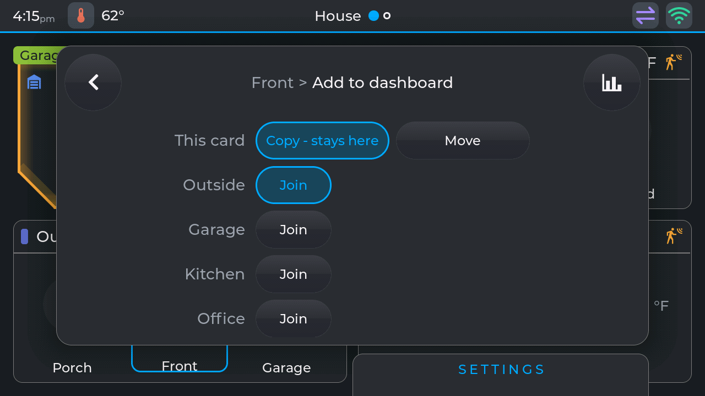
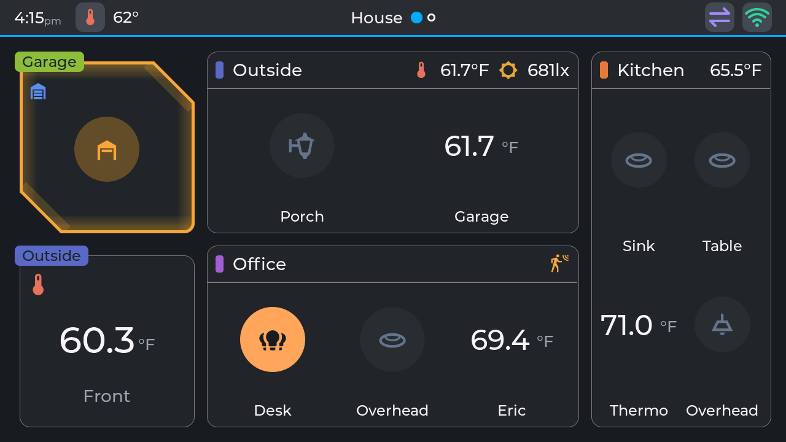
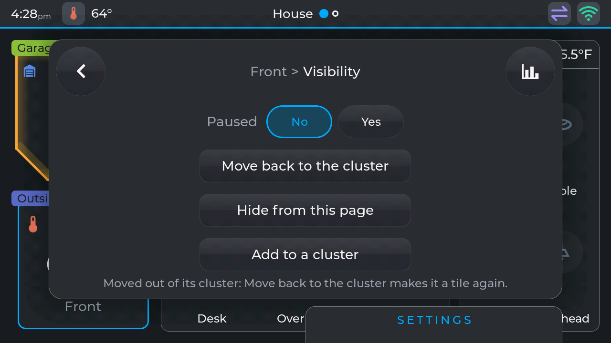
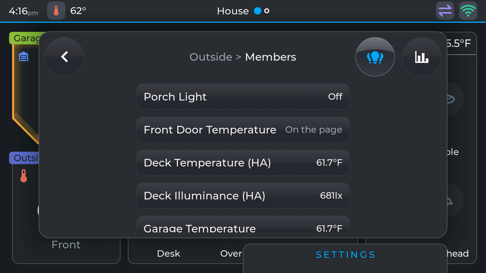

A copy's Visibility and its dialog; the 4B's Copy or Move on Linen:

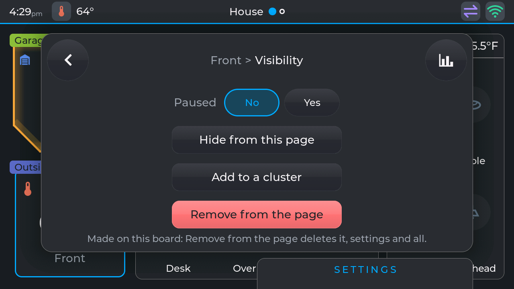
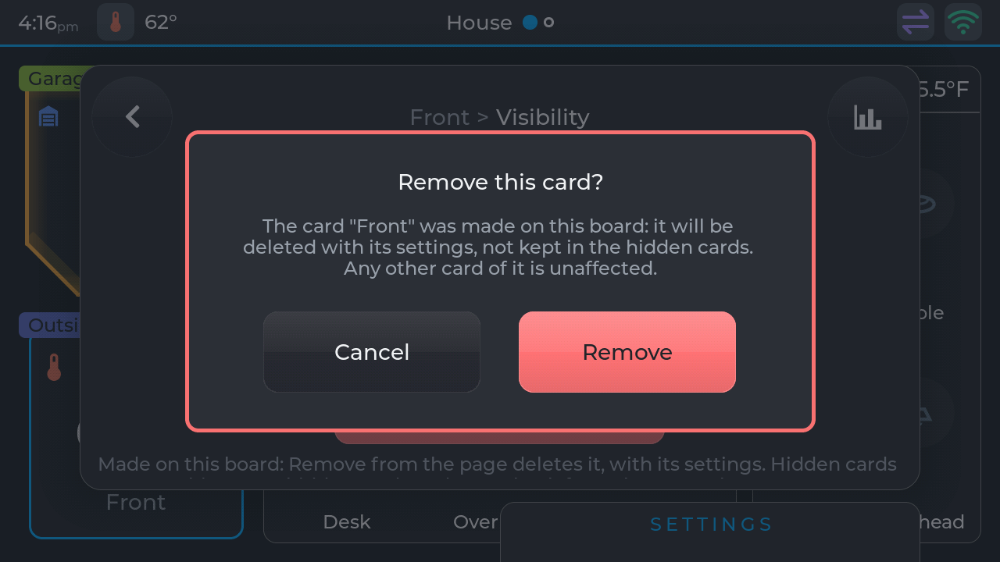
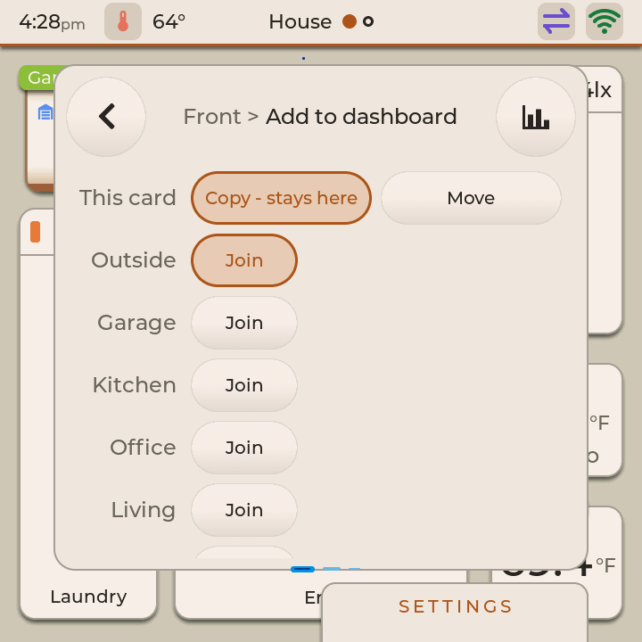

The hidden cards with the House page squeezed to one row (a test copy of your settings, yours put
back after): Kitchen and Office crowded off.

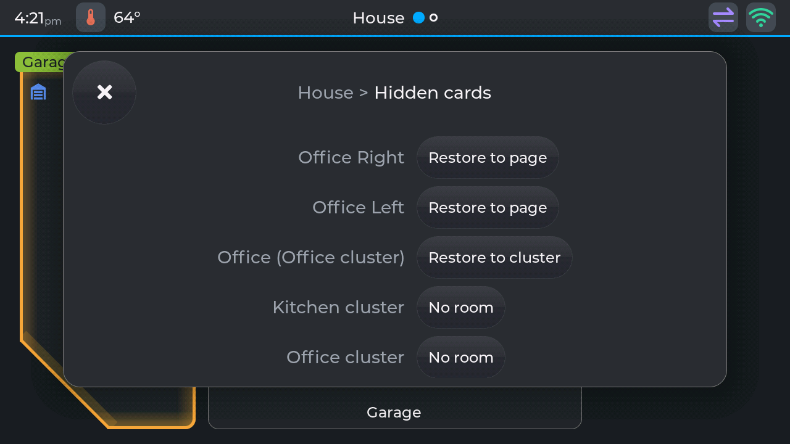

**On the 1060, your Front card from 14:55 is still on the page** (Outside's Front, added to the
dashboard before this round: the bug itself). It was made before cards remembered where they came
from, so it counts as a copy: its Visibility now has Remove from the page - L5 below.

## Tests for you

| # | Do this | PASS if |
|---|---|---|
| L1 | Long-press a tile (Outside's Porch) - SETTINGS - Visibility - Add card to dashboard | "This card: Copy - stays here / Move" above the groups, Copy lit |
| L2 | Move, Add card to dashboard | the window closes; Porch is a card on the page and gone from Outside; Outside's Members says "On the page" for it; it is not in the hidden cards |
| L3 | That card - Visibility | Move back to the cluster, Hide from this page, Add to a cluster - no Remove. Move back: Porch is a tile again and the card is gone |
| L4 | L1 again with Copy | Porch stays a tile, a Porch card joins the page; the tile no longer offers Add card to dashboard |
| L5 | That card (or the 1060's Front Door Temperature) - Visibility - Remove from the page - Remove | the dialog asks; the card goes, and is not in the hidden cards |
| L6 | Desk - Members - a lamp - Visibility - Add card to dashboard | no Copy / Move row - a copy |
| L7 | UI Tweaks or the system panel: Row - until something leaves the page; tap the page name - View hidden cards | each card that left is listed with "No room"; a tap on it says there is no room; Row + brings it back and it leaves the list |

## Choices that were mine

- **A moved member keeps its entry**, `hidden`: `moved` - for a copy made on the glass too. HANDOFF's
  draft had a moved copy deleted; kept, Move back brings back the copy's own name and settings and
  its place among the members, and the rule is one rule for every member, as K111's is for every
  card (a card moved into a cluster keeps its entry, `removed`: `moved`).
- **The card on the page takes the tile's name** when the tile has one of its own (the dashboard's
  "Front", or one typed), for Copy and Move both - a moved card is the same card, and a copy looks
  like it, as Add to a cluster's copies do. A tile with HA's name keeps following HA (K65).
- **Remove from the page is offered on every card made on this board** that is not a moved one -
  the copies out of a cluster, the older ones without a record (the 1060's Front), and K17's cards
  from a group card's member. Each is a copy of something still elsewhere.
- **A moved header member leaves the header too**, and comes back to it with Move back.
- **"No room" rows have no Restore**: nothing was hidden, so nothing is put back - more room is.
  They are listed after the hidden ones, a cluster as "Kitchen cluster".

## Results (mine, before you)

- On the P4_5, from the PC (`/popup`): Front moved out of Outside (the page arranged again, 5 blocks
  on 4 x 2, 1 ms), its Visibility, Outside's Members, Move back (4 blocks again); Front copied out,
  its Visibility, the dialog, Remove; then the settings file compared with the saved copy: no
  difference. The crowded list from a one-row test copy of the settings, then the saved copy put
  back (no difference). The 4B's Copy / Move view looked at and closed.
- Not tapped on the glass: any of it - each was driven from the PC.

# Round 9 (2026-10-20, night, unattended) - v8 on the boards; a development Reset; the mocks

The last sprint's items 3 to 7 (HANDOFF), while you were away. Flashed to the P4_5, the 4B and the
1060, each board's settings saved first (`bench/settings/<board>/20261020-19*.json`). Every test
that changed your settings ran on a test copy, and your file was put back and compared afterwards:
no difference on any board. Nothing for the gate, the CHANGELOG or the PR (item 8 waits for you).

## 1. The arranger by your rules (Playground v8), on the boards

| Where | Before | Now |
|---|---|---|
| **The arranger** | Playground v5, in cells: a page's grid, then its clusters' shapes | **v8, in units** (a cell's halves): every entity the same size, solo cards square, clusters wider than tall, clusters with as many tiles the same size, a little empty space rather than unequal sizes - your knobs as its defaults (size 75, square 30, wide 20, twin 70, empty unit 11, order 4). Line for line from the playground; its answers are the host tests (19, every one matching) |
| **A solo card** | its cells | its **finished box**: units off its top while that brings it nearer square, then any free unit rows above or below shared out as even margins (v7's finish) |
| **A cluster's tiles** | across and down by the tile rule | **as the arranger counted them** (Kitchen's four in one row) |
| **Col / Row** (the system panel) | a count for the page, which the arranger obeyed whole - with the board's own default always set, so it never chose a grid at all | **a pin**: each press pins that count for the page; the arranger keeps it and chooses the other. A new line, **Grid:**, says "4 x 2, pinned", "4 columns, pinned" or "auto, 10 x 8 units", and **Auto** beside it takes both pins away |
| **Tuning from the PC** | `/settings?arranger=hole\|comfy\|...` | `/settings?arranger=size\|square\|wide\|twin\|gap8\|order` (HTTP_REFERENCE) |

**Your pages' earlier choices are pins now, left as they were.** Each was a Col / Row choice saved
before this round, and each is now a pin the arranger keeps:

| Board | House | Fleet |
|---|---|---|
| P4_5 | **4 x 2, pinned** (your choice; not changed) | 7 columns, pinned |
| 4B | 4 rows, pinned | 4 rows, pinned |
| 1060 | 5 x 2, pinned | - (auto) |

Auto on a page gives it back to the arranger. The pictures below show each House page pinned, and
what Auto would give (from a test copy, put back after).

The P4_5's House page as pinned (4 x 2: Doors one cell, Kitchen across three, Outside and Office
splitting the bottom row) and as Auto would arrange it (10 x 8 units: your "what should happen",
Doors with a unit of margin above):

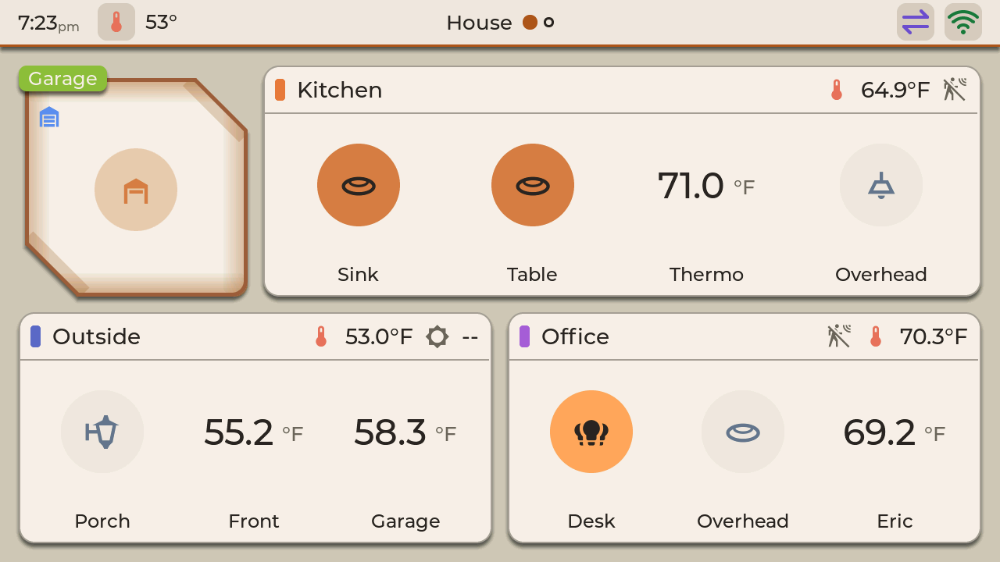
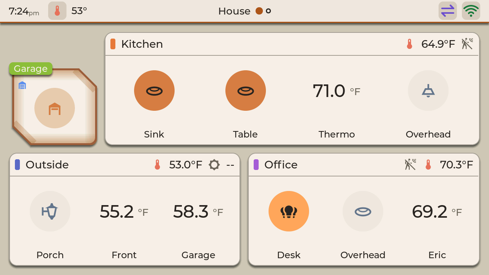

The 4B (pinned at 4 rows; auto) and the 1060 (pinned at 5 x 2; auto):

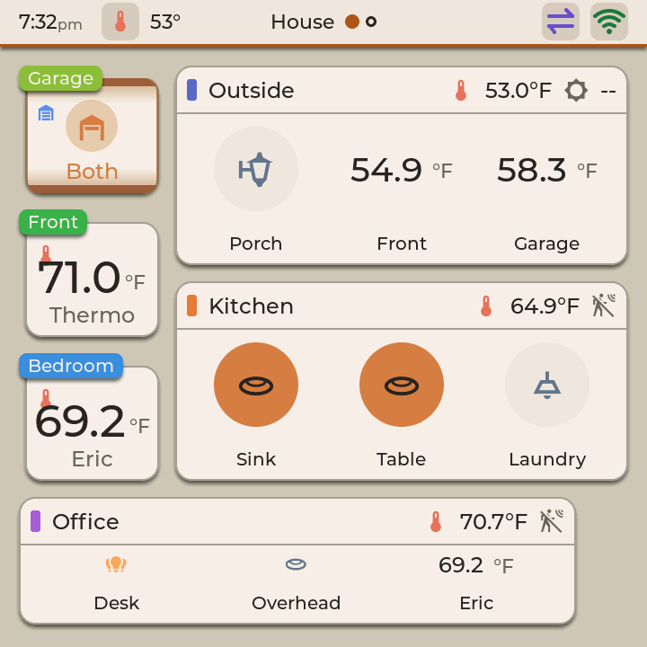
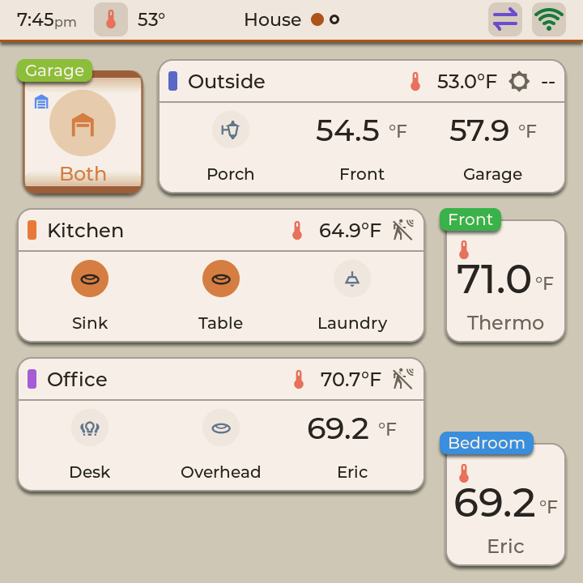
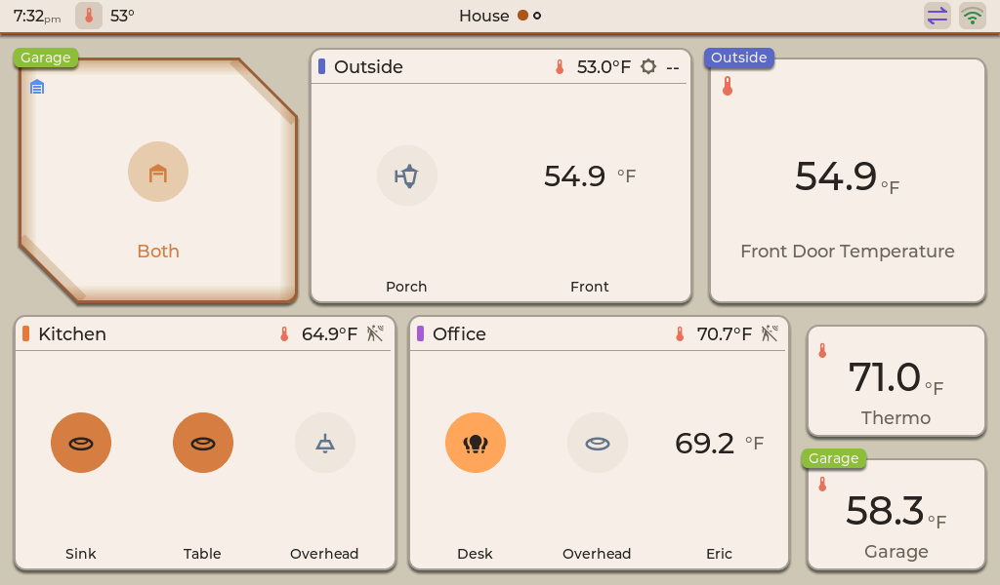
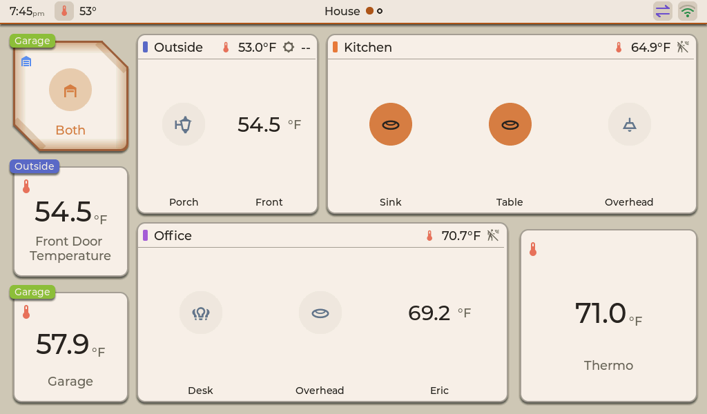

The P4_5's Fleet page unpinned (16 cards on 12 x 6 units; Lamp 3 and Switch take the free unit row
under them as margin), and the Grid line:

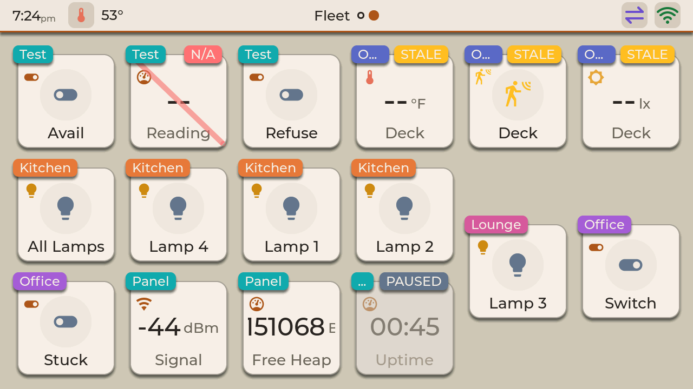
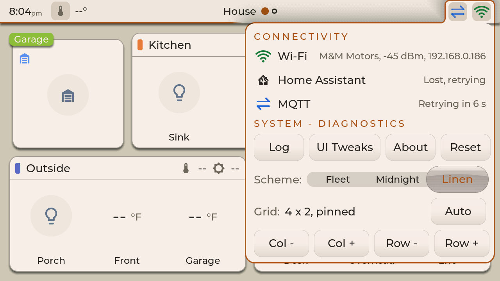

**Timed** (`/popup`'s second line; the search runs on its own task while the page flows, then the
page is built again):

| Board, page | Grid | Steps | Time | Stack used |
|---|---|---|---|---|
| P4_5 House, pinned 4 x 2 | 8 x 4 units | 627 | **19 ms** | 5 KB |
| P4_5 House, auto | 10 x 8 | 313,539 | **1.95 s** | 11 KB |
| P4_5 Fleet, auto | 12 x 6 | 205,360 | 1.2 s | 13 KB |
| 4B House, pinned 4 rows | 12 x 8 | 169,818 (budget hit) | 0.8 s | 9 KB |
| 4B House, auto | 8 x 7 | 341,180 (budget hit) | 1.9 s | 9 KB |
| 1060 House, pinned 5 x 2 | 10 x 4 | 20,032 (budget hit) | 76 ms | 6 KB |
| 1060 House, auto | 11 x 6 | 735,416 (budget hit) | 3.2 s | 11 KB |

`WS_S3_4B` compiles (RAM 38.6%, flash 36.1%); not timed - no S3 runs. An S3 would be slower again.

| # | Do this | PASS if |
|---|---|---|
| M1 | The P4_5's House page | as the first picture: 4 x 2, Outside and Office the same width; Kitchen's four tiles in one row |
| M2 | The system panel | a **Grid:** line saying "4 x 2, pinned", **Auto** beside it, Col / Row under it |
| M3 | Auto | within ~2 s the page arranges itself as the second picture; Grid says "auto, 10 x 8 units" |
| M4 | Col +, then Row - | each press pins (the Grid line says which), the page arranges again; Auto takes the pins away |
| M5 | Swipe to Fleet and back | each page keeps its own pins |
| M6 | Restart the board | each page comes up arranged at once (its answer kept), no second build |

**Choices that were mine (item 3):**

- **A count is a pin; the board's own grid is where the search starts.** Before this round the board's
  default (5 x 3 on the P4_5) was always handed to the arranger as the page's grid, so it never chose
  one - your round-5 note ("never re-picks rows or columns"). Now a count is pinned only by a press.
- **One count pinned searches the other** (the playground pins both or neither): Col + alone keeps
  the columns and lets the arranger choose the rows.
- **Older files' "auto" reads as not pinned**; unpinning removes the entry. A page the arranger does
  not place (the arranger off, more than 24 blocks) flows at the board's own grid.
- **A grid of more than 192 units is skipped** (16 x 12 at most when pinned): the search goes a level
  deeper for each unit, and its stack is 24 KB.
- **The playground's step budget, 20,000 a pass**, so the boards' answers are the playground's.

**Questions for you (item 3):**

1. **Time**: unpinned, the search takes 1-3 s on the P4s, in the background (the page flows, then
   arranges itself once and keeps it). Keep it, or give it a time limit? *My recommendation: keep it
   for now* - it runs only when a page's blocks change, and a limit would make the boards' answers
   differ from the playground's, where you tune. An S3 would take longer; measure one before
   deciding.
2. **The finish's margins**: a solo card takes free unit rows above or below as even margins, so a
   card can sit half a card lower than its neighbours (Lamp 3 and Switch on the Fleet page, Bedroom on
   the 4B). Keep v7's rule, or keep a card level with its neighbours' tops? *My recommendation:
   level with the top* - the margin rule was made for a lone card beside a cluster.
3. **Your old Col / Row choices are pins now** (the table above). Leave them, or Auto on every page
   but the P4_5's House? *My recommendation: try Auto on the 1060 and the 4B* - their pinned pages
   were chosen before the arranger could choose. Neither 1060 picture is even yet: pinned, Front
   Door Temperature has three times Thermo's area; on Auto Thermo is the large one. The size knob
   (75) is the one that would even them, and the playground is the place to try it.

**A bug of mine, found and fixed this round**: the first build's tile rule (`Layout::tileGrid()`)
stopped at one column whenever the arranger gave no count - every cluster on a page that flowed
(the second or two while a page arranges, or the arranger off) stacked its tiles. The host tests
caught it after the first flash; the boards were flashed again with the fix (`r9b`).

## 2. A development Reset

**Where**: the system panel, SYSTEM - DIAGNOSTICS: **Log, UI Tweaks, About, Reset** (D-17 made that
row the place for development tools). A line of its own did not fit the P4_5's height with the new
Grid line, so Reset joined the buttons; its dialog says what would go.

**What it does** - the dashboard and its clusters back to the compiled ones:

| Goes | Stays |
|---|---|
| every card made on this board: added to a page, copied into a cluster, moved out of one (their entries and settings) | every look: names, card labels, entity labels, tap actions, units, density, Card UI |
| every hide and move: hidden cards and cluster members shown again, moved cards back where they were built | groups and their colours, cluster header styles and icons, a cluster's Rename |
| clusters' header slots and presentation as compiled (`slots`, `present`) | schemes, UI Tweaks, the windows' timeout |
| every page's kept arrangement: each arranges itself again | **the pages' pins** (Col / Row) - Auto is their reset |

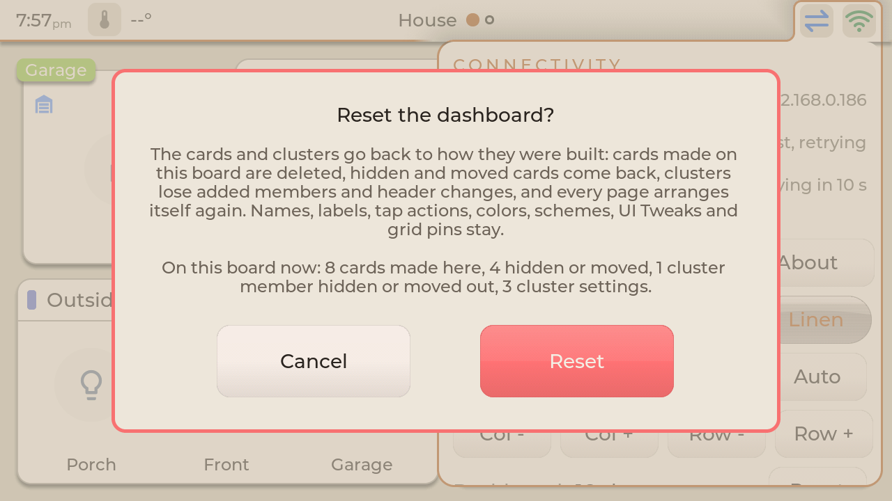
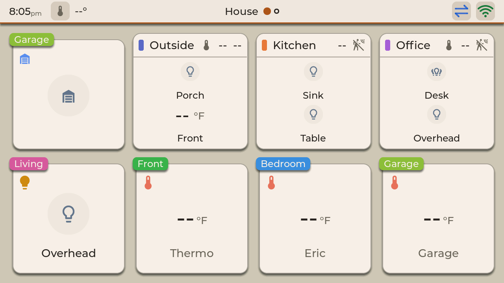

Run once, on a test copy of the P4_5's settings: 8 cards made here deleted, 7 hides and moves undone,
3 clusters' header slots and 1 member as built; the House page arranged itself again in 29 ms (8
blocks on your pinned 4 x 2). Then your file was put back: no difference.

| # | Do this | PASS if |
|---|---|---|
| N1 | The system panel - Reset | the dialog, counting what would go; **Cancel** leaves everything as it was |
| N2 | (On a board whose dashboard you can lose - or after `save_settings.ps1`) Reset - Reset | the panel closes; every page is the compiled dashboard, arranged again; your scheme, names and pins are as they were |

**Choices that were mine (item 6):** the pins stay (they are a choice about the page, and Auto
already resets them); a cluster's Rename and header style stay (looks); groups made on the board
stay even if no card wears them now; no restart (the page is taken down, the records read again,
the page built - the 1060 boot-loops on a software restart, below).

**Question:** is the system panel the right home, or would you rather have it in UI Tweaks beside
Reset all (one place for both resets)? *My recommendation: the system panel* - UI Tweaks' Reset all is
about looks, and two Reset buttons side by side invite the wrong one.

**Found while testing**: the 1060 boot-looped after a software restart (a settings copy put back with
`?reboot=1`): its Wi-Fi co-processor stopped answering at boot, and the board restarted itself every
~20 s, off the network. A watchdog reset (`esptool --after watchdog-reset`) brought it back; LESSONS
says how to restore it from now on. Why the co-processor does not come back after a software
restart is unexplained; this round did not change the restart path (the settings restore's), and
the P4_5 and the 4B restart cleanly.

## 3. Tiles' icons on the 1060, and borders round tiles

**Why they looked tiny.** A tile's disc was capped at twice its icon face's height, and the icon
face is sized by the board's pixel density to the same **4.5 mm on every board** (the P4_5's 52 px,
the 1060's 30 px). The cap is ~9 mm everywhere. On the P4_5 a tile is ~18 mm, so the disc is half of
it; v8 gives the 1060 ~27 mm tiles, and the same disc is a third. Nothing was wrong on any one
board: the icon simply does not grow with the room.

**Fixed** on the two 7" boards: a **roomy hero face**, 1.5 x the icon (6.9 mm - the 46 px face the
4B already uses, so no new font; ~119 KB of flash on the 1060 and the 7B only). A tile, and a solo
state card, uses it wherever its room holds most of the larger disc, and keeps the old faces
elsewhere. Other boards are unchanged (their roomy face is the icon itself). **And on an arranged
page the tiles no longer copy a solo card's disc** (round 4's rule): the arranger has made every
entity one size, so each fills its own room - a card a pin squeezed (the 1060's Thermo) no longer
shrinks every tile.

The 1060 before and after (its House page as pinned, 5 x 2; Home Assistant was down, hence the
dashes and the plain bulbs):

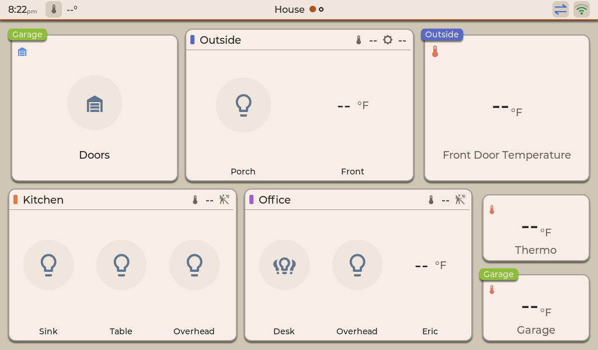

The 4B after (its tiles size themselves now; the short Office cluster's stay small - the pin to 4
rows gives it two units of height):

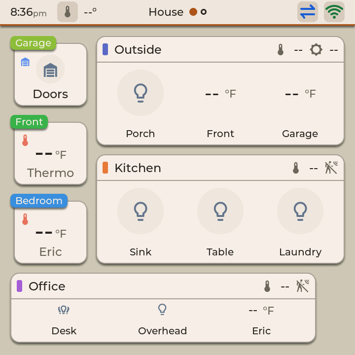

**Borders round tiles: a mock** - [2.11 Round 9 Mocks](https://claude.ai/artifact/SpSG1hhpbJsUmxBLv3cdfY), page *Tile borders*:
the 1060's Kitchen cluster at its size in pixels, four ways - **A** as built (no tile borders,
K89); **B** a hairline round each tile; **C** a hairline, and an on tile wearing the Corner cut as a
solo card does; **D** a faint fill per tile, no line. Linen or Midnight from its Tweaks.

| # | Do this | PASS if |
|---|---|---|
| O1 | The 1060's House page | the tiles' icons fill their tiles as the Doors card's does (the second picture) |
| O2 | The P4_5 and the 4B | nothing smaller than before; the 4B's Outside and Kitchen tiles larger |

**Questions (item 4):**

1. **Keep the roomy face on the 7" boards?** It costs ~119 KB of flash on each. *Recommendation:
   keep* - it is what "scale them" asked, and those boards have ~4 MB free.
2. **Borders round tiles** - A, B, C or D? *Recommendation: A, or D if you want the tiles grouped* -
   B and C put a line round every tile inside a bordered cluster, the "busy" look the mini tiles
   were made to avoid (K89), and C gives a tile two ways to say on.

## 4. The group view - a mock, not built

[2.11 Round 9 Mocks](https://claude.ai/artifact/SpSG1hhpbJsUmxBLv3cdfY), page *Group view*, on the
P4_5 in Linen:

- **The group view**: a window of a group's members **as tiles** - Desk's three lamps, large, each
  saying its state; a tap switches one, a long press opens its own window; the window's X and its
  timeout as every window's. No corner tabs (no Members or History): it is the members and nothing
  else. Opened by a group card's or a cluster's tap when its **Tap action is Group view** (a new
  choice beside Members), so the same window serves Desk, the garage Doors and any cluster.
- **A cluster shown as one card**: its Visibility gains **Show as - Cluster / One card**; as one
  card it takes one entity's room (1x1), names what is on ("Sink, Table on"), shows **its icon**
  (chosen from a row of icons), and its tap opens the group view. Cluster brings the tiles back;
  the members keep their settings.

**Questions (item 5):**

1. **The group view and group pages (K90, K99).** K90 said a group card's tap may open "a group
   page holding only its members"; K99 made group pages whole pages too - full screen, swiped to,
   targeted from the navbar. Three ways to fit the group view in:
   - **(a) The group view is K90's group page, as a window** - a tap opens the window; K99's whole
     pages stay a separate, later thing (the navbar, Phase 4). *My recommendation*: it is the
     smaller build, it answers interview §4 Q8 ("back" from a group page) by being a window - the X
     is the way back - and it is what you described.
   - (b) The group view now, and a whole group page later replacing it as the tap's target.
   - (c) Whole group pages only, no window.
2. **Where it is chosen**: Group view as a **Tap action** (SETTINGS), as you said, and as the
   default tap of a cluster shown as one card. Members stays the cluster's default tap otherwise?
   *Recommendation: yes* - Members lists hidden members too (K110), which the group view does not.
3. **Hidden members in the group view**: left out (Members lists them), or shown dimmed?
   *Recommendation: left out* - the view is for using the group.
4. **The icon choice** for one card: from the members' own icons plus a short list by kind (a room,
   a pot, a sofa, a bed, a garage, a tree), or any MDI icon the board carries? *Recommendation: the
   short list plus the members' icons* - any icon means a picker of 157, and the font has only the
   icons HA serves.
5. **A summary card** (K98, the Doors' "Both") and **one card** are near neighbours: one card names
   what is on and opens the group view; a summary card does the same for members of one kind. Fold
   them into one presentation? *Recommendation: yes, later* - one presentation "One card", the
   summary's words when the members are of one kind.

## 5. Round 4's rest - which are still wanted?

Not built, each a question (HANDOFF item 7):

| # | What | Decided before | My recommendation |
|---|---|---|---|
| 1 | **Count slots** - one entity counting the lights on or the doors open, in a cluster header's slots and the page header, a tap showing which | K103 | **Yes, after 2.11** - it needs an HA template or group per count, set up in HA first; the header's planner takes it as a new slot kind |
| 2 | **Extending a source group** - a member added to Desk keeps the card "Desk", made a group card of the Hue group and the extra | K93 | **Later (the web app, #87)** - the clusters already hold any card beside Desk's lamps |
| 3 | **Group pages** - a group's members as a page of their own | K90, K99, interview §4 Q8 | **As the group view (section 4, (a))**; whole pages with the navbar (4.3) |
| 4 | **Group cards as Add targets** - Add to a group card (Desk) as well as to a cluster | K96 | **No** - a source group's members are the source's (K92 rule 4); a device-made group card is a cluster here |
| 5 | **The card list** - making a cluster from a group, the HA entities labelled "Fleet" in HA | K91, K92 rule 11 | **Later (the web app)** - Add cards on a cluster covers the page's cards today |
| 6 | **Delete from the pool** - a hidden card deleted for good from the page's hidden cards | K66 | **Yes, small** - a Delete beside Restore for a card made on the board (the compiled ones can only be hidden); the development Reset covers it meanwhile |

## Results (mine, before you)

- **Built, flashed, seen by screenshot**: the P4_5, the 4B and the 1060 run `7626049` with your
  local debug lines, each board's settings saved before every flash. Host tests: 63, all passing
  (the arranger's 19 against the playground). `WS_S3_4B` compiles.
- **Driven from the PC, then undone**: Auto on each board's House page (test copies) and the
  P4_5's Fleet page; the Reset (a test copy of the P4_5's); each board's file put back and compared
  with `setdiff.py`: **no difference** on any of the three.
- **Not tapped on the glass**: the Grid line's Auto and Col / Row (driven through `/popup?grid=` only
  as far as reading the line), the Reset's buttons (driven with `/popup?dash=`), anything on the
  1060 or the 4B beyond screenshots.
- **Home Assistant was down** for most of the evening (the header's "Lost, retrying", MQTT too, on
  every board), so the later pictures show dashes and generic icons; the arranger, the Reset and the
  icons need nothing from it. The values come back when it does.
- **Lines of code**: HANDOFF's table, recounted.

## Your results

**2026-10-26** - answers to rounds 9's questions and new notes; **the tests wait for one final pass
once the features are done** (your word). Your answers are DECISIONS K114-K120. In short: keep the
arranger as it is and keep arranging automatic, with solo cards no bigger than clusters, centred
rows, symmetric solo cards and a card's preferred span to prototype next (K120); the larger icon
stays; active tiles wear the card state, with C (hairline) or E (faint fill, new in the mock) for
the rest (K116); the Reset stays where it is; the group view first, group pages later (K118);
counts and alerts from HA template sensors (K119); Delete only from the web app (K117).

Bugs you found: in Fleet and Midnight a slot panel's top corners block a small piece of the bar's
accent line; in Linen a slot panel at the screen's edge shows the bar's drop shadow at its own edge;
in Linen a cluster's Band stops short of its border on some clusters; non-sensors offered for a
cluster's header; the header's values in a different order on each cluster. The 4B's arranging: rows
added become empty space.

# Round 10 (2026-10-26) - names, cluster headers

| Where | Before | Now |
|---|---|---|
| **UI Tweaks** | "Card label" (Float, Band, Tag, None) - the same name as Card UI's row for the label's words | **Label type** (K114) |
| **A cluster's Header style** | Swatch / Bar | **Swatch / Band** (still saved as `bar`) |
| **Header slots** (the cluster's window) | every member offered | **sensors only** (temperature, occupancy, light level...); a non-sensor already there is listed so it can come out |
| **The header's values** | in each cluster's own order | **one order everywhere** (K115): from the right, temperature, occupancy, light level, then the rest; they give way from the left |
| **Swatch headers** | on the cluster's own surface | **on a faint band**, the page header's colour (SURFACE_ALT) |
| **A Band header** | sized from the width the page computed, a pixel or three short of the border on some clusters | **the room's whole width** - to check in Linen, where you saw it |

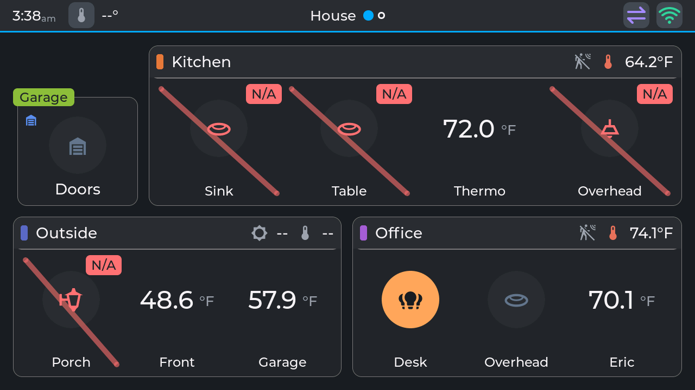

**The tile-borders mock** has **E** now: every tile a faint panel, an on tile framed with the Corner
cut ([2.11 Round 9 Mocks](https://claude.ai/artifact/SpSG1hhpbJsUmxBLv3cdfY), page *Tile borders*).

## Your questions, answered

**The Doors card.** It is a **summary** (K98, round 4): a group card made on the device - its members
are the two door cards, defined in the dashboard (`Dashboard_HA.h`, `present: summary`) - drawn as
one card. On and off follow the group card's **Active state**, which SETTINGS already offers on any
group card made on the device: **Any members are on** (its default, so either door open lights it)
or **All members are on**. Its words are the one piece of logic of its own (`SummaryCard::nameText()`
in `CardCatalog.cpp`): none open - its own name ("Doors"); one - that door's name from the
dashboard ("North"); all - "Both" (two) or "All"; some of more - "2 open". So yes: "North", "South",
"Both" is what it does. Nothing lets you change those words on the board; customising them belongs
with the web app (#87), as you said. It is the only summary on the dashboard so far.

**HA template sensors as the backbone.** Yes, and I think you have it the right way round: the
counting and the conditions live in HA, where they can be written once, tested in HA's own template
editor, and shared by every board; the board shows an entity. A "garage doors" template sensor whose
state is the number open and whose attributes carry the open doors' names can be the Doors card
(its words from the attribute) and a header slot at once. An **alert** template sensor ("after
10 pm and the garage open", "front door open over 5 minutes") is a binary sensor: on in a header
slot it shows, off it shows nothing - which is exactly #76's claim model (a notice queue, a slot that
appears only while something claims it). What it asks of the board: a header slot kind "alert",
shown only while on, and a slot that reads its words from an attribute. Recorded as K119; it
belongs with #76, after 2.11.

**Round 4's question 5, the card list.** When you make a cluster, or Add cards to one, the board
offers only the cards already on the page. K92 rule 11 proposed a longer list: also the HA entities
you have **labelled "Fleet" in HA** (HA's labels, since 2024.4) - so you could bring a new entity onto
the board without editing the dashboard. The question was whether to build that list in 2.11. My
recommendation stands: later, with the web app, which can search all of HA.

**Group view or group page - tiles or cards?** (K118's open part.) *My recommendation*: **tiles in the
group view** - it is a window, so it is a cluster's members at a glance, and tiles are what fit -
and **cards on a group page** - a whole page is a page, built like any page, by the arranger, so a
member there is a card with its own border. A choice for each later, from the web app.

**Delete** (K117): the board only hides. One thing to settle: K112 gave **copies made on the board**
a *Remove from the page* (and a copy in a cluster *Remove from the cluster*) - deleted, not hidden,
because the card it was copied from is still there. Keep that for copies, or make them Hide too?
*My recommendation: keep Remove for copies made on the board* - nothing original is lost, and a
hidden copy would sit in the hidden cards beside the card it copies.

## Left for the next session (not built)

- **The bugs that need the glass**: the slot panel's corners on the accent line (Fleet, Midnight);
  the drop shadow at a panel's edge (Linen); the Band check.
- **The 4B's arranging** (rows added become empty space): most likely its search finds no page
  for some row counts and the page falls back to the flow - to confirm from `/popup`'s second line
  on a test copy, row by row.
- **The arranger, next** (K120): solo cards no bigger than a cluster; centred rows and symmetric solo
  cards, or even space round them; a card's preferred span (Free Heap, Uptime) - in the playground
  first (v9), then the port.
- **Active tiles in the card state** (K116), and the header's sensor icons in the glyph styles (K115).

## Your answers (2026-10-26, morning)

E for the tiles; both follow-up recommendations (copies keep Remove - K117; tiles in a group view,
cards on a group page - K118); Add cards to offer the cards on the board or the entities labelled
"Fleet" in HA (K119, after 2.11). Then: work unattended, and improve the arranger from your notes.

# Round 11 (2026-10-26, unattended) - tiles as E, header glyphs, the arranger v9

All built, flashed and seen by screenshot on the P4_5; the 4B and the 1060 flashed (below). Every
test that changed your settings ran on a test copy, your file put back and compared afterwards.

## 1. Tiles: E (K116)

Every tile a faint panel inside its cluster, and a tile that is on framed as a solo card is - the
Corner cut by default (Bracket if you choose it), its lit disc kept. The Office's Desk switched on for
the picture, and off again as it was:

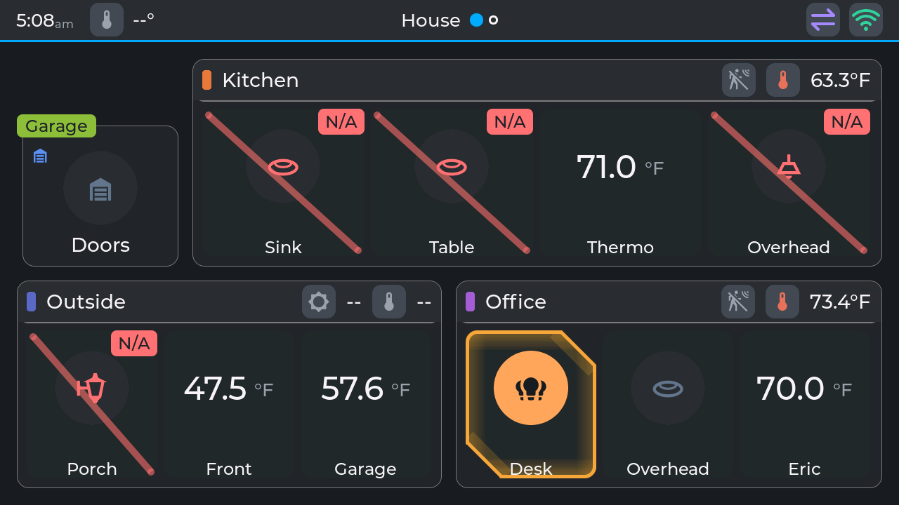

## 2. Header icons in the glyph styles (K115)

A cluster's header values take UI Tweaks' **Header glyphs**: framed (Square, or Circle) on a Swatch
header, bare on a Band (the band is the group's colour, and a frame on it looked like a hole). Bare in
UI Tweaks makes them bare everywhere.

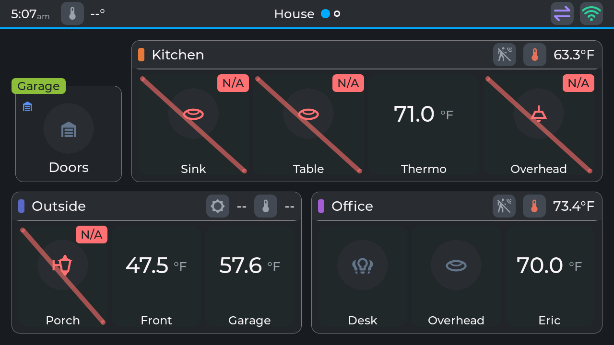

## 3. The two bugs on the glass

- **Linen, a slot panel at the screen's edge showing the bar's shadow** - found and fixed: the face
  painted back over the bar's shadow under an open panel was a rounded rectangle, so where the tab
  runs straight down into the wall (the status panel) a sliver of the shadow showed in that corner.
  It is square there now.

  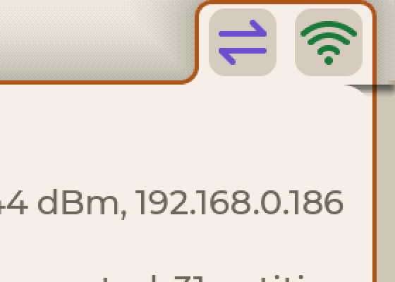
  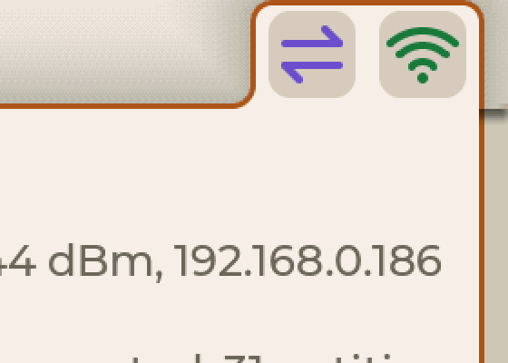

- **Fleet / Midnight, the accent line notched beside a panel's tab** - **not reproduced**: I opened
  the page slot and the status slot on the P4_5 and the 1060 and read the panels' own frame buffers
  (`/screenshot?fb=1`, what the glass shows); the coves were whole each time. If you see it again,
  which board, which slot, and was the system panel open? A photo of the glass would settle it.

## 4. The arranger, version 9 (K120)

**[Layout Playground](https://claude.ai/artifact/SBSanCnwviNbKzQmkwiJXp)**, page v11: **v9 is its
default**, with your pages to try - *The 1060's House* and *Fleet page* beside your round-5 House -
and a new knob, **Extra cost of a solo card bigger than the rest** (60). What v9 does over v8:

| Your note | v9 |
|---|---|
| "Solo cards should generally be smaller than a cluster, not bigger" | a card bigger than the page's entities pays **big** on top of the size cost: spare room stays spare |
| "Outside not horizontally centred", "Doors and Thermo symmetrical", "floating with an equal amount of space all around them" | **the spare room is shared out**: blocks in rows (bands) spread down the page, the blocks of a row spread across it, each centred in its row's height - the gaps between whole, the edges half |
| "Free Heap and Uptime should prefer 1.5x the horizontal space" | **a card's preferred shape** is its spec's span (they were already 3 units wide in the dashboard; v8 ignored it) |
| The 4B: "adding rows simply adds loads of empty space at the bottom" | not a crash: at 5 pinned rows the arranger found a page but left the spare units as one strip at the foot. **The rows now part evenly** instead |

The 1060's House page in the playground (auto, 14 x 8 units): Outside centred on the top row, Doors and
Thermo mirrored either side of it with even space, each centred in the row's height; every entity
within 5% of the others. The P4_5's House page on the glass, and its Fleet page (a test copy with
the Fleet page's old 7-column pin taken off - at 14 units across no card can be both your smallest
size and not too tall, so a 7-column pin makes it flow):

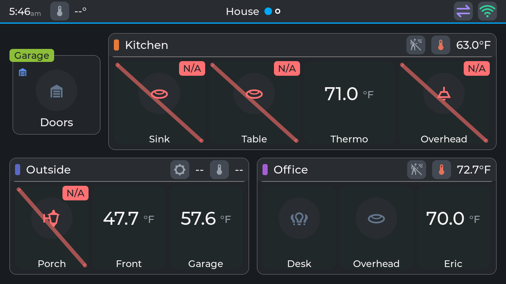
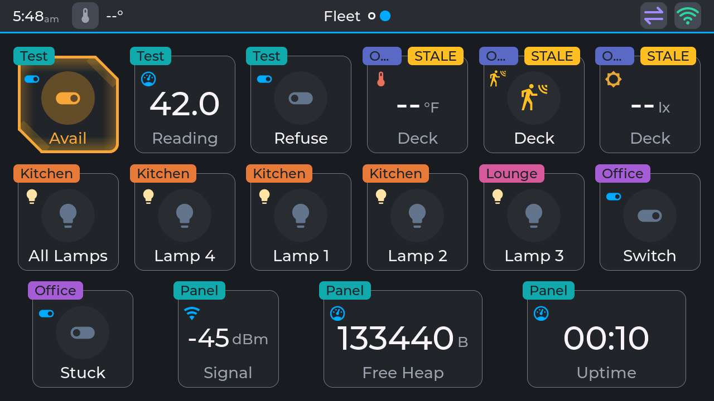

Before, the 4B at five pinned rows (v8, your earlier dashboard on a test copy) - the strip at the foot:

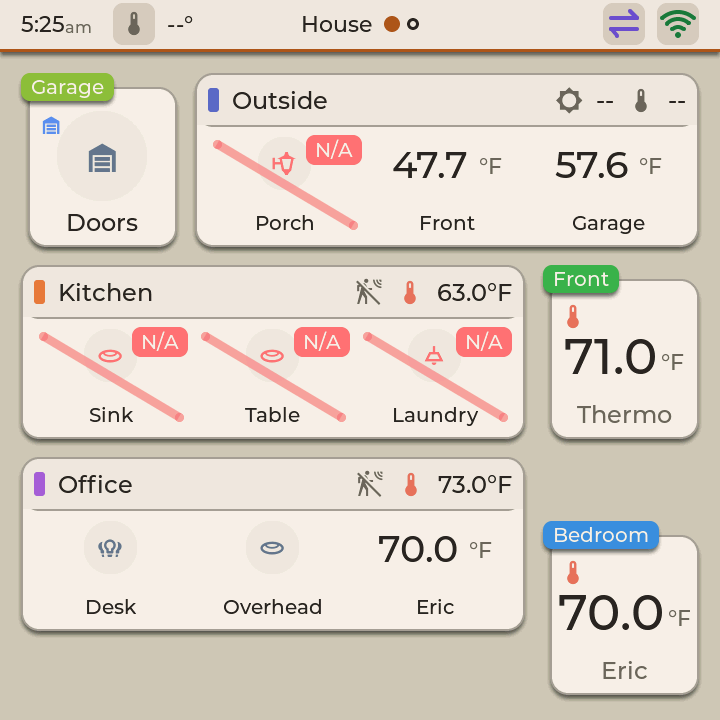

The 1060 on v9, at your 7 x 5 pin (14 x 10 units, 110 ms): Outside centred on the top row, Doors and
Thermo mirrored either side of it, each centred in the row's height - the layout you found by hand,
now from the arranger:

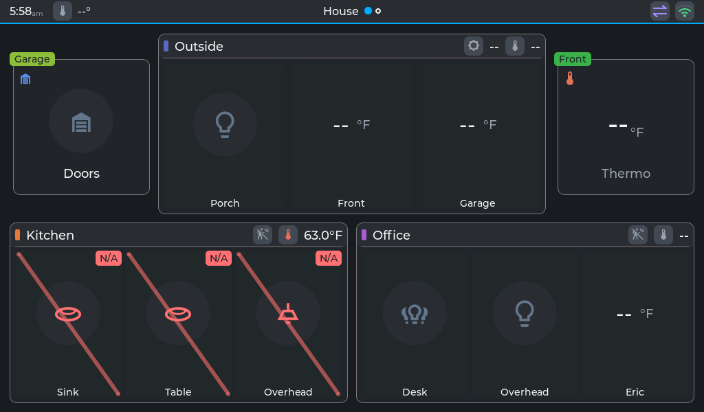

The 4B on v9 (its compiled dashboard, since your Reset; unpinned, 12 x 7 units): Doors centred beside
Outside. The stagger at the foot is the search's own placement - Office's two tiles stacked make it
taller than Kitchen, and Bedroom and Garage sit under it - not the finish:

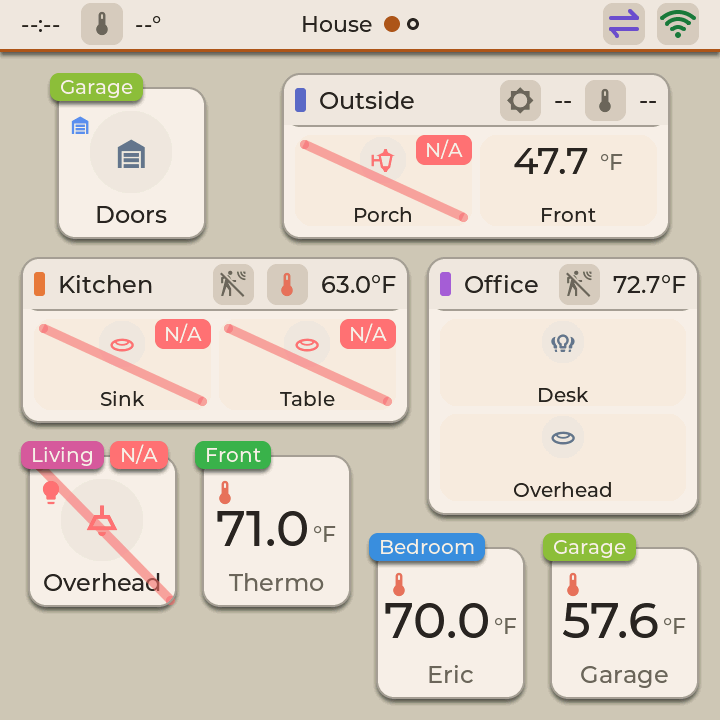

**Time**: the P4_5's House page unpinned, **49 ms** (3,601 steps; v8 took 1.95 s - the `big` term
prunes most oversized card shapes before the search sees them); its Fleet page 140 ms. **The 4B's
eight blocks: 3.7 s** (808,154 steps, the budget hit on a grid) - in the background, but the slowest
board; a time limit is the question below.

**Host tests**: 27, generated from the playground's own code - four sets of blocks on eight boards
and the pinned cases, every place, trimmed box, finished rectangle and score matching.

## For the final pass (your one test, when the features are done)

| # | Do this | PASS if |
|---|---|---|
| P1 | A cluster with a light on | the tile is a faint panel, framed with the Corner cut; off tiles faint panels, no frame |
| P2 | UI Tweaks - Header glyphs: Bare, Square, Circle | the cluster headers' icons follow on Swatch headers; bare on a Band |
| P3 | Linen: the status slot's panel | no shadow in its top corner by the screen's edge |
| P4 | Auto on each board's House page | rows of blocks spread down the page, a row's blocks across it; solo cards no bigger than tiles, centred in their row |
| P5 | Row + twice on the 4B | the rows part evenly - no strip of empty space at the foot |
| P6 | The Fleet page with Auto (its old 7-column pin taken off) | Free Heap and Uptime 1.5 cells wide on the last row |
| P7 | The playground: v9, The 1060's House on the 1060 board | Outside centred, Doors and Thermo mirrored with even space |

## Choices that were mine (round 11)

- **Frames only on Swatch headers**: a Band is the group's colour, and a square on it read as a hole.
- **"Around" spacing** for the spare room: the gaps between blocks whole, the edges half, so a row
  floats a little off the page's edges rather than touching them.
- **A lone block centred in its row's height**; a column of stacked blocks moves as one.
- **`big` at 60**: on your pages it changes little about where blocks go (the solo cards were already
  near tile size); what it does is keep a card from swelling into spare room, and it cut the search
  forty-fold on the P4_5.
- **Kept answers are `v3`** (the search's places only); every page arranges once on the new firmware.

## Questions for you (round 11)

1. **The 4B takes 3.7 s** to arrange its eight blocks (in the background; the page shows meanwhile,
   then arranges itself and keeps it). Leave it, or a time limit? *My recommendation: leave it* -
   it runs only when a page's blocks change.
2. **Spacing "around" or "between"?** v9 leaves half a gap at the page's edges; "between" would put
   the outer blocks flush to the edges and all the spare between them. *Recommendation: around* -
   try both in the playground if you have time and say.
3. **The accent-line notch**: which board and slot, and was the system panel open?
4. **The group view** (the mock): into 2.11, or after? *Recommendation: after* - 2.11 has enough to
   sign off, and K119's Add cards from HA's "Fleet" label pairs naturally with it.

## Results (mine, before you)

- **Seen by screenshot**: tiles as E with the Desk on (put back off); glyph frames; the Linen corner
  before and after; v9 on the P4_5 (House; Fleet on a test copy), the 4B and the 1060.
- **Settings**: every board's file saved before each flash; tests ran on test copies; each file put
  back and compared - no difference, except the P4_5's kept House layout, which the new firmware
  rewrote itself on its first boot (`v2` to `v3`, the same blocks).
- **Not reproduced**: the accent-line notch.
- **The structure check**: two files over 1,000 lines (`GUIManager.cpp` 1,520, `Card.cpp` 1,456),
  405 style calls outside the kit in 29 files (438 at `v0.2.18`), 10 colour literals in 2 files.

## Your notes after round 11 (2026-10-26, midday)

The 1060: Doors and Thermo centred in their free space at 5 x 5, "exactly as I suggested"; the tiles
should be drawn smaller inside a cluster when needed (Desk much taller than wide), their labels are
too close to the foot - inside the active frame's glow - and could be bigger on the P4_5 and the
1060. The 4B: Auto (8 x 7) leaves dead space between the rows - the clusters should grow to fill it,
the solo cards keep their size; horizontal clusters always over vertical; 4 x 6 is about right; 4 x 3,
4 x 4 and 4 x 5 squash everything into two short rows. Your answers: spare space goes round the
blocks, **but only when that would not make the blocks too small**; the accent-line notch is gone;
the group view after 2.11, once you have labelled the cards in HA.

# Round 12 (2026-10-26) - clusters grow, tiles near square

Built, flashed to the P4_5, the 4B and the 1060, and seen by screenshot on all three. The
[Layout Playground](https://claude.ai/artifact/SBSanCnwviNbKzQmkwiJXp) is at page v12 - the engine
button reads **v9: grow, spread** - and the C++ is its line-for-line port again.

## 1. The arranger

| Your note | Round 12 |
|---|---|
| "The clusters should expand vertically to fill the space and leave the solo cards the size they currently are" | **Clusters grow into the spare height first**: each row of blocks holding a cluster takes an equal share, each cluster growing to its row's height plus that share - never past square tiles. Solo cards keep their size and centre in their row |
| "Spare space should go around the blocks, but only when that would not make the blocks too small" | that is the order: the clusters grow first, and only what is left is spread round the blocks |
| "I would always prefer horizontal to vertical groups" | a cluster whose tiles stack more rows than columns pays the **wide** cost again, by how many more |
| 4 x 3, 4 x 4, 4 x 5: everything on two short rows | **found**: each block kept only its ten cheapest shapes, and at 4 x 5 the clusters' ten were all four units tall - no page fitted, so the page fell back to the flow. **A block now keeps its tightest shape too.** And a solo card may take a box up to half again taller than it may be, drawn at its tallest allowed shape and centred, the rest paid as a hole - at 4 x 3 that is what lets Doors and Thermo fit |

**A bug on the way, fixed**: a kept answer stores each cluster's tiles across but not down, so a page
built from one gave the finish no room to grow its clusters (the 4B at 4 x 5 showed them at 173 px
where the playground grows them to 195). Kept answers are now **v4**, so every page arranges once
on this firmware; on all three boards the House pages came out where they were.

The 4B, your House page, pinned (on your own settings, put back afterwards):

| 4 x 3 | 4 x 5 |
|---|---|
| 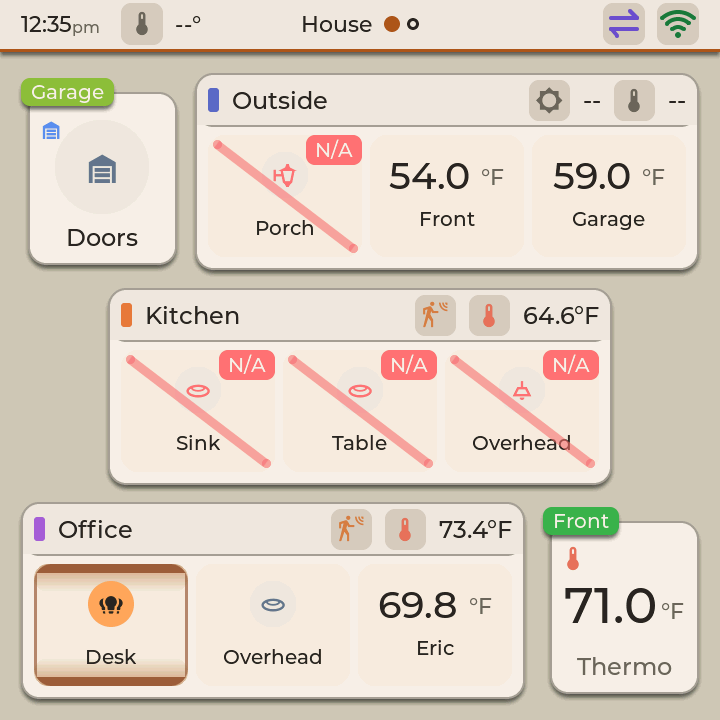 | 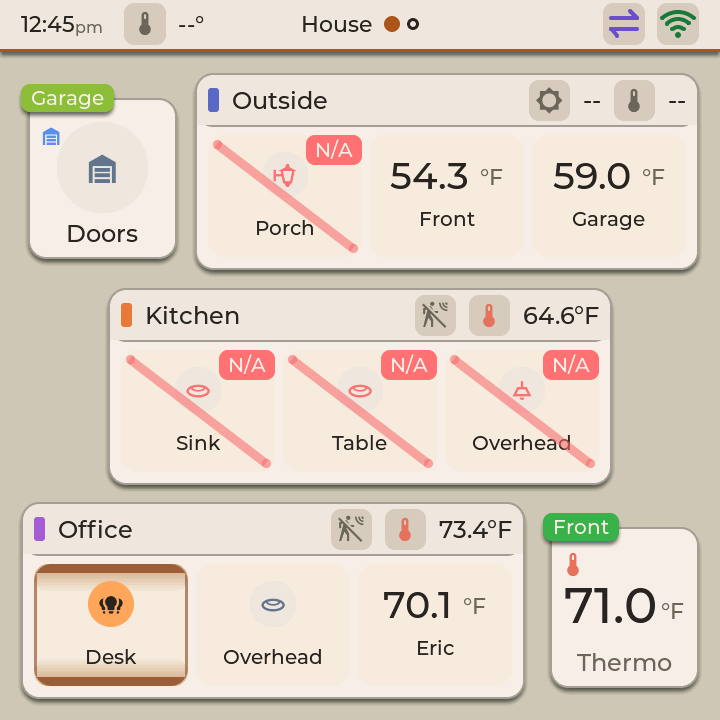 |

| 4 x 6 (your pin) | 4 x 4 |
|---|---|
| 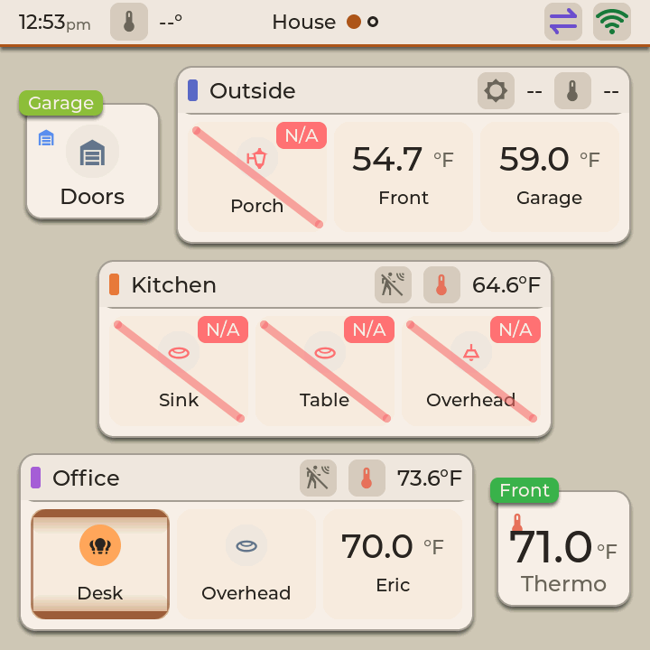 | 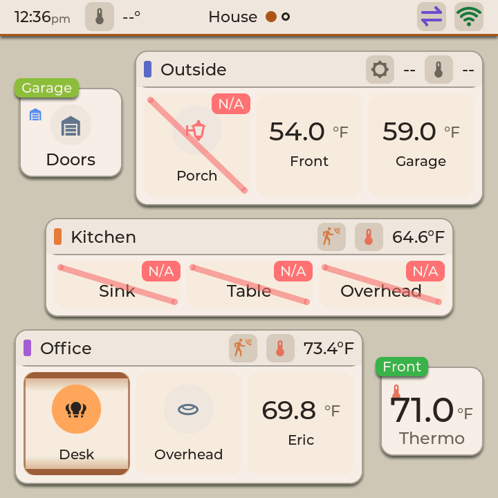 |

4 x 3, 4 x 5 and 4 x 6 now give the same page: three rows of clusters filling the screen, Doors and
Thermo at either end. **4 x 4 fills the screen but unevenly** - Kitchen two units tall and seven
wide between two clusters three units tall: at 8 x 8 units three equal rows do not divide, and the
search counts empty units before the clusters grow, so it prefers filling the units unevenly
(question 1).

## 2. The tiles

- **Near square** (`C_TILE_TALL`, 1.1): a tile is drawn no taller than 1.1 times its width, centred
  in its slot - a little room left inside the cluster, as you allowed. The 1060's Desk is near
  square now.
- **The hero and its label centred as one** (`C_TILE_FOOT`, 1.5 mm off the tile's top and foot),
  as on a solo card - the label is out of the active frame's glow.
- **A bigger label where it costs the hero nothing**: the name's face (the solo cards' card-name
  size) when a state tile's disc would be no smaller with it - the P4_5 and the 1060 - and the tag's
  face otherwise (the 4B, whose discs would shrink). Decided by the tile's size alone, so every tile
  of a cluster has the same.

| P4_5 | 1060 |
|---|---|
| 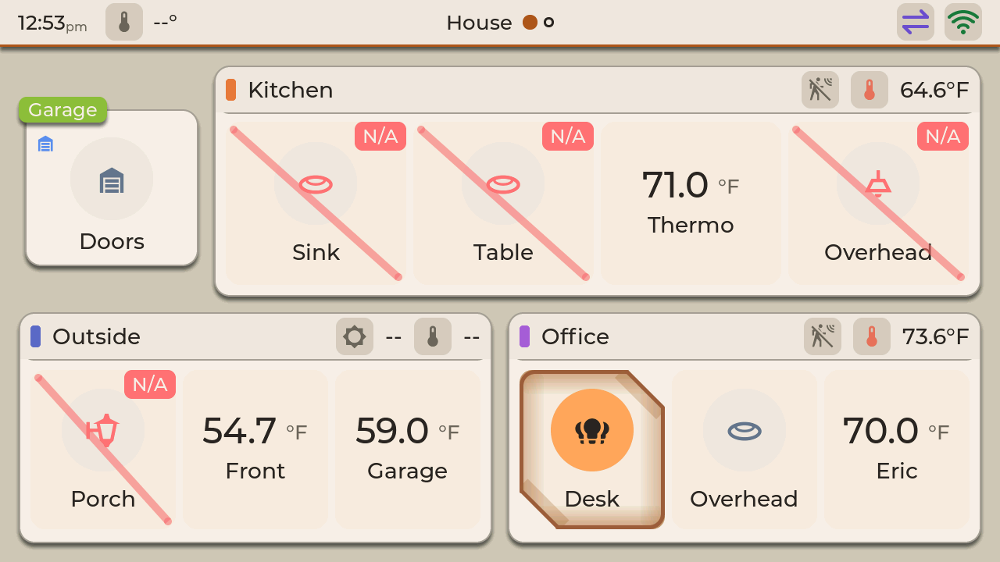 | 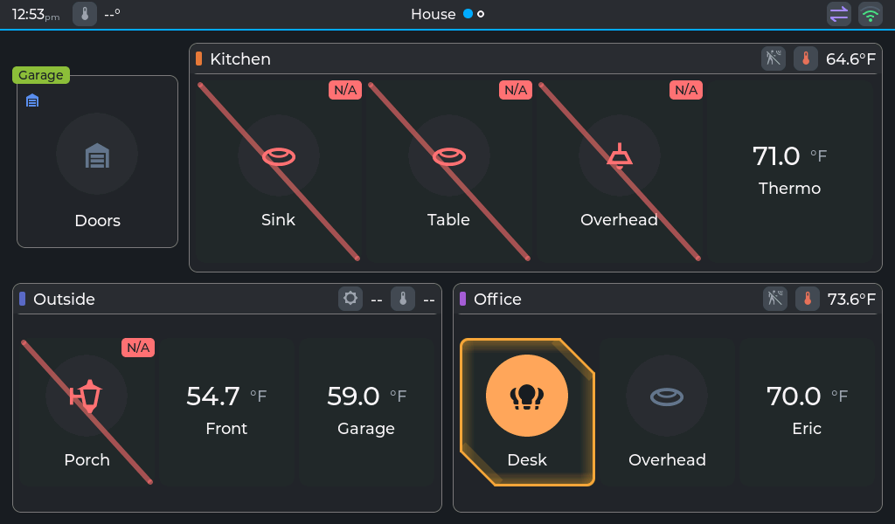 |

## For the final pass (added to round 11's)

| # | Do this | PASS if |
|---|---|---|
| P8 | The 1060's House: a cluster with tall slots (Office) | its tiles near square, centred in their slots |
| P9 | Switch on a light in a cluster | its label sits clear of the frame's glow; the hero and label centred in the tile |
| P10 | The 4B: Auto, then 4 x 3, 4 x 5, 4 x 6 | each fills the screen; the clusters grow, the solo cards keep their size; no strips of empty space between rows |
| P11 | The P4_5 and the 1060 | the tiles' labels in the bigger face, the same in every tile of a cluster |

## Choices that were mine (round 12)

- **Growth stops at square tiles**, so a cluster on a tall page does not grow tiles taller than
  wide; the rest of the height goes round the blocks.
- **A tile 1.1 times as tall as wide at most**, and 1.5 mm off its top and foot - both tokens, easy
  to tune on the glass.
- **The bigger label by the tile's size alone**: my first try decided tile by tile and mixed two
  sizes in one 4B cluster (the value tiles took the bigger face, the state tiles did not). A long
  name that does not fit gets dots, as before.

## Questions for you (round 12)

1. **The 4B at 4 x 4** fills the screen unevenly (above). The fix is for the search to score a page
   after its clusters grow - a deeper change to the search. *My recommendation: leave it for now* -
   Auto and your 4 x 6 give the even page; say if 4 x 4 matters.
2. **The 4B's tile discs** are a little smaller than before (the foot takes 1.5 mm at each end of a
   small tile). Fine, or a smaller foot on small tiles?

## Results (mine, before you)

- **Seen by screenshot**: the P4_5, the 1060 and the 4B on their House pages; the 4B pinned at 4 x 3,
  4 x 4, 4 x 5 and 4 x 6.
- **Host tests**: 74, all passing - the arranger's 30 generated from the playground's own code
  (among them the 4B's House at 4 x 3 and 4 x 5, and a page finished without its tiles down, which
  fails on the old code).
- **Settings**: every board's file saved before each flash. The 4B's pin test ran on your settings
  and the file was put back and compared: no difference. The P4_5 and the 1060: only the kept House
  layout's version moved (`v3` to `v4`, every place the same).
- **The structure check**: two files over 1,000 lines (`GUIManager.cpp` 1,520, `Card.cpp` 1,456),
  409 style calls outside the kit in 29 files, 10 colour literals in 2 files.

# Round 12b (2026-10-26, evening) - the 4B's boot loop, one tile height a page

Your notes on round 12: the 1060's and P4_5's Kitchen tiles kept their height while the bottom
row's were shortened, their faint panel "a bit too faint, barely visible"; **the 4B hung after
Auto** - cyan, then black, the same ~20 s after every power-up.

## 1. The 4B's boot loop - fixed

The serial log: `task_wdt: - IDLE0 (CPU 0)`, `CPU 0: arrange`, then a reboot, every ~20 s. The
arranger's task ran at priority 1 and never blocks, so core 0's idle task never ran, and the task
watchdog aborts after 5 s of that. Round 11's search on your 4B took 3.7 s; round 12's extra shape
for each cluster took it past 5 s, and since the search never finished, no answer was kept and every
boot searched again. **The task now runs at the idle task's priority** (time-sliced with it, so the
watchdog is fed). On your 4B the search finished - **1,238,747 steps in 10.3 s**, in the background
while HA started - and its answer is kept, so later boots build at once (LESSONS).

**My miss**: round 12 said "Auto and your 4 x 6 give the even page". Your 4B was pinned at 4 x 6, so
Auto had not run on round 12's firmware on the glass - I had seen it in the playground only.

Auto on your 4B now (12 x 6 units):

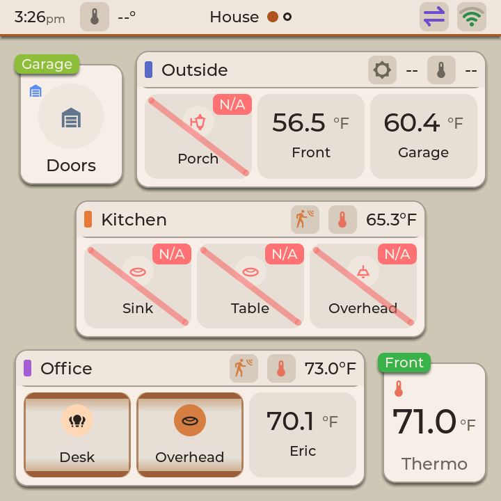

## 2. One tile height a page

Not by design: Kitchen's tiles were just under the near-square limit (195 x 210 px on the 1060,
1.08 times as tall as wide, the limit 1.1), so they kept their slot's height while the narrower
bottom-row tiles were cut. **Every cluster on a page now draws its tiles as tall as the shortest any
of them draws** (K124), centred in their slots: 170 px in all three rooms on the 1060, 204 px on
the P4_5. The width stays each room's own, so Kitchen's four tiles still fill its row. And **the
tile panel** is a step further from the cluster's surface (6% toward the text), so it shows on
Midnight; the off disc still stands apart from it.

| P4_5 | 1060 |
|---|---|
| 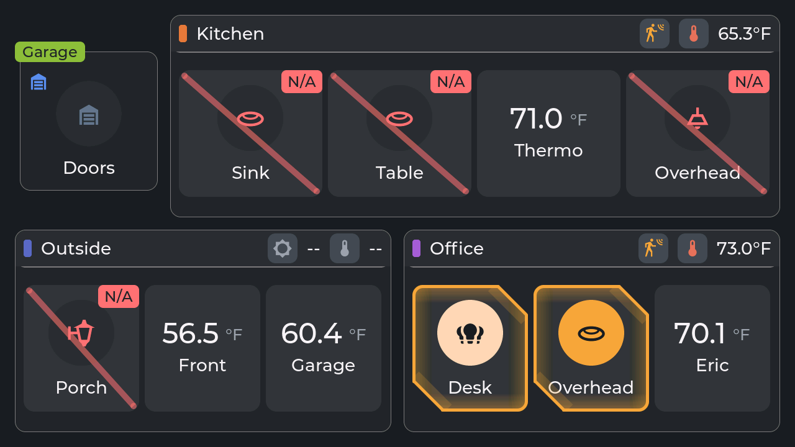 | 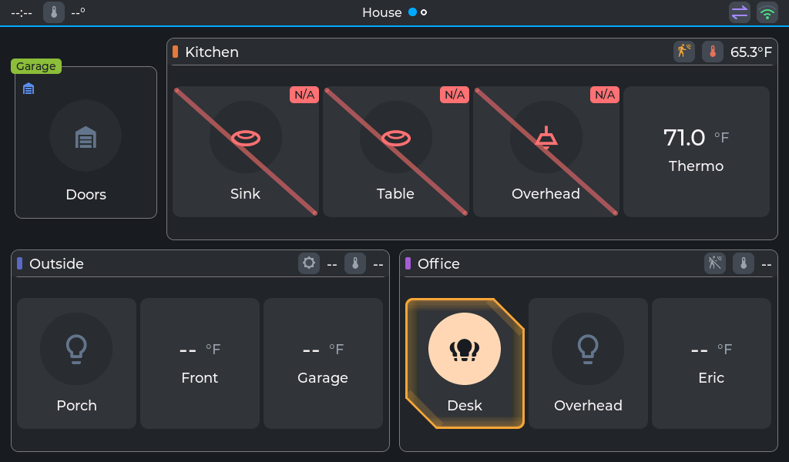 |

## For the final pass (added)

| # | Do this | PASS if |
|---|---|---|
| P12 | The 4B: Auto, then power it off and on | the page arranges itself within ~10 s of HA starting, and the board keeps running; after the power cycle the page is built at once |
| P13 | The P4_5's and 1060's House on Midnight, Linen and Fleet | every room's tiles the same height, each with a visible panel, the off discs still distinct |

## Questions for you (round 12b)

1. **The 4B's search now takes ~10 s** (round 11's question 1 said 3.7 s). The page shows its flowed
   layout meanwhile, then the arranged one; it runs once per change (a pin, a card added or moved),
   then the answer is kept. A time budget would cut it, with a chance of a
   slightly worse page on the 4B. *My recommendation: a budget of ~3 s, tried in the playground
   first* - say if the wait bothers you.

## Results (mine, before you)

- **Seen by screenshot**: the 4B on Auto (above), the P4_5's and 1060's House pages.
- **Settings**: every board's file saved before the flash (the 4B's caught between reboots);
  compared afterwards: the P4_5 and 1060 0 differences, the 4B only its kept House layout (Auto's
  new answer).
- **Host tests**: not rerun - the search is unchanged; the change is the task's priority and the
  tiles' drawing.
