# TEST - the UI follow-ups: #96, #97, #23 (part), #92 (part), #98

Branch `feat/ui-followups` (off `main` at `v0.2.13`), built unattended on 2026-10-14 from the
owner's brief; one commit per item, so any one can be reverted alone. **The P4_5, the 4B and the
1060 run the whole branch** (flashed 2026-10-14, with your local debug lines). Pictures are in
`docs/followups/`; the harness's captures behind them are `test/golden/<board>/<label>` (`f0` =
`v0.2.13`, `i1`...`i8` = after item N, `c16` / `c12` = the two token candidates).

**Read first - two things went wrong on the way, both in "Questions" below:** the **P4_5 lost its
saved-settings file** during the run (Q1 - not restored, your call), and the colour-temperature
mark in Desk's window **sits at different heights from one build to the next** with the light
unchanged (Q2 - not caused by this branch, not explained).

## What changed, item by item

| # | Issue | What | Proved by the harness |
|---|---|---|---|
| 1 | #96 | The Remove dialog's buttons share a narrow row: each `min(W_DIALOG_BTN, (row - 3 x S7) / 2)` - the row spaces them evenly, so `S7` (2.4 mm) sits between and beside them where they are narrowed | `v0.2.13` -> item 1, all states: **no differences on the P4_5 and the 1060**; on the 4B only `desk_dialog` (241 -> 145 px buttons, side by side) |
| 2 | #97 | **About this board in every build**: a fourth button on the system panel's first row, Log / Tokens / Cards / About. The drawer stays open under it. Page swipes stand down under any sheet now, not only the card window | the drawer (new harness state `system_panel`): the row has four buttons; every window state unchanged |
| 3 | #97 | **Fact lists in two left-aligned columns** (Entity properties, About): the words' column as wide as the longest words in that list (at most half of it). The first build put the pair against the left wall with the gap halved; **after your note on it (2026-10-14) the two are centred** - the room the longest words and value leave is shared equally between the walls and the gap (`S5` at least; a long value wraps in its column) | only `desk_props`, `lamps_props` and `about` changed |
| 4 | #97 | **The countdown bar**: 2 px at 294 and 255 PPI, 1 px at 170 (was 6 / 6 / 3), on the window's bottom edge inside its border, between the rounded corners | every window's bar; nothing else (the harness treats the bar as volatile - its width is the clock's - so the pictures show it) |
| 5 | #23 | **The Remove dialog shows the same bar** while it is up - the window's countdown, since it closes with the window | `desk_dialog` gains a 2 px bar on its bottom edge; nothing else |
| 6 | #97 | **The near-equal shape tokens merged** (`tokens.md` §7): the five with a clear target, plus `S_MEMBERS` -> `S5` 1.6 and one radius `R_CONTROL` 1.6 - **both candidates pictured below for you to choose** (Q3, Q4) | the header row's gaps, Members' rows, the panel's controls and the dialog's buttons, the span chips; nothing unexpected |
| 7 | #92 | **History's span buttons are the control deck's selector, compact** - a span chip's height, the same choices, the same "Show span buttons" setting, in the chart and in activity | only History's states changed |
| 8 | #98 | **`/panel?flash=N` keeps only the NVS mode**; without `&nvs=1` it answers with a refusal and changes nothing | tried on the P4_5: refused; `flash=2&nvs=1` ran (35 and 5 ms, no underrun); its settings file untouched |

How each was checked: each board walked through every harness state (48 now, 45 on the 4B - two
added: the open system panel and About) on the build before and after, minutes apart, the
differences read state by state. **The house changed under several pairs** (the Desk lights went
off at night and back on in the morning): those states were captured again both ways before being
compared. The P4_5's pairs after 11:44 were taken with its empty settings file on both sides (Q1).
The 1060 was walked at `v0.2.13`, item 1, items 1-3 and the whole branch, alone each time: item 1
**no differences**; items 2-3 only the drawer's fourth button and the fact lists; items 4-8 the
merged tokens and History's selector, its Desk states changed by the house (not walked again on
the slow 1060 - the P4_5 and 4B covered those both ways). Its settings file kept throughout.

**The all-nine gate** (`scripts/release/gate.ps1`, the committed `platformio.ini`, at item 8):
**all nine SUCCESS** in 32 min (a cold build cache - the token struct changed), flash 34-41 %;
your local lines restored after. The centred columns came after it: compiled on the three P4s and
the S3_4B. Structure check: 524 style calls outside
the kit in 25 files (531 in 26 at `v0.2.13`: About's list and the system panel's first row moved
onto the kit), 44 colour literals in 4 files (unchanged), no shape numbers, no LVGL in the core
layers; `GUIManager.cpp` 1,548 lines (+10, the drawer hook), `Card.cpp` 1,462.

## The pictures

**#96 - the 4B's Remove dialog**, before / after:

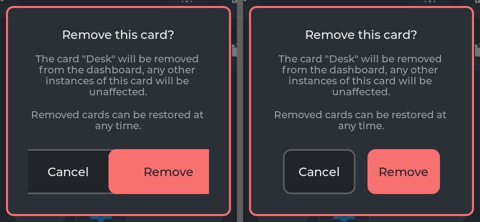

**#97 - the system panel** (P4_5), the new About button:

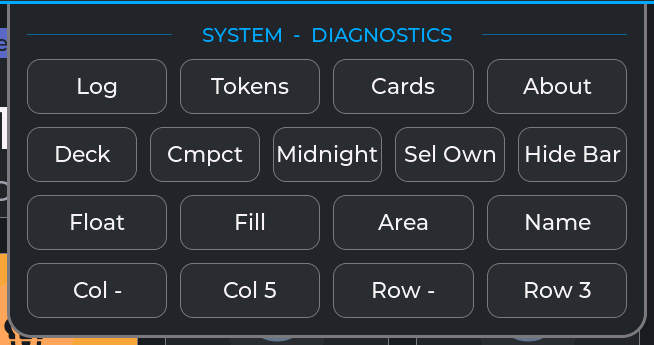

**#97 - Entity properties and About this board** (P4_5), before above, after below:

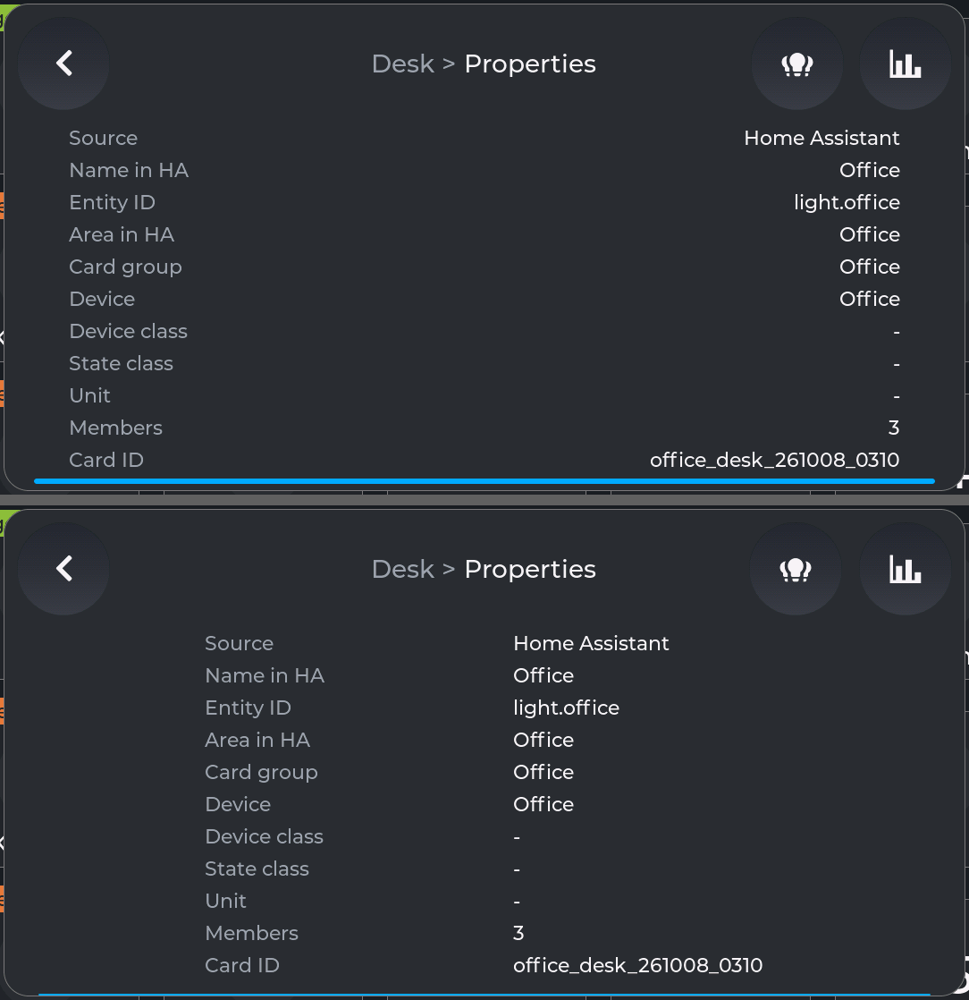
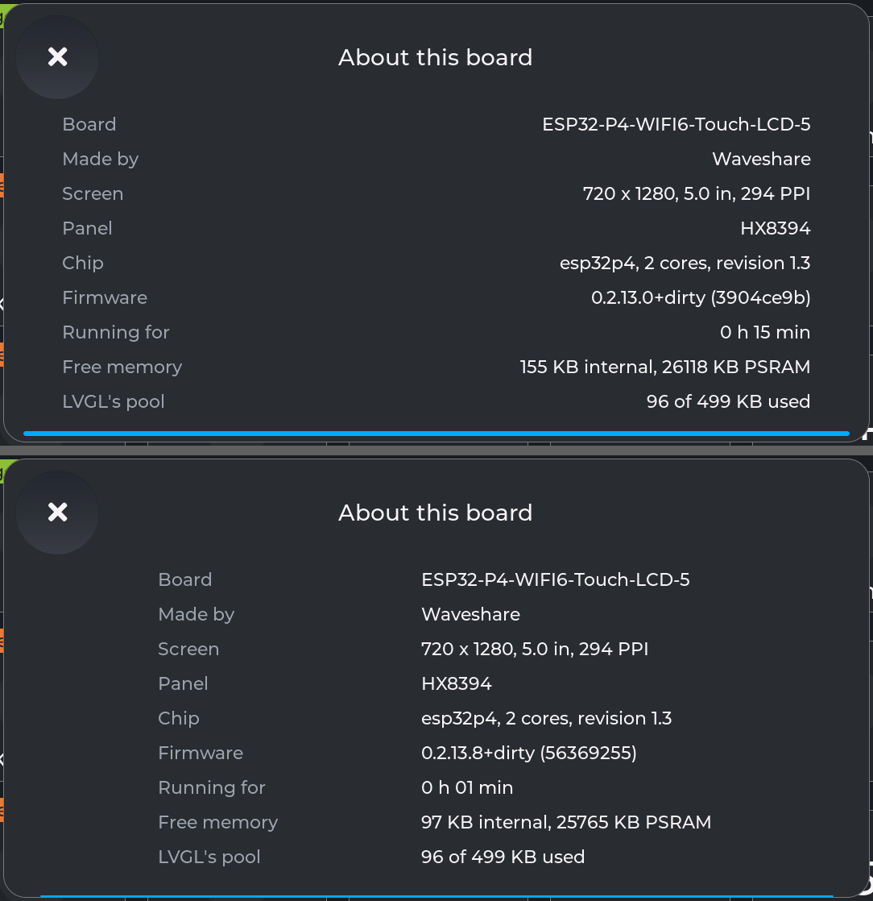

**#97 - the countdown bar** (P4_5, the window's bottom edge), before above, after below:

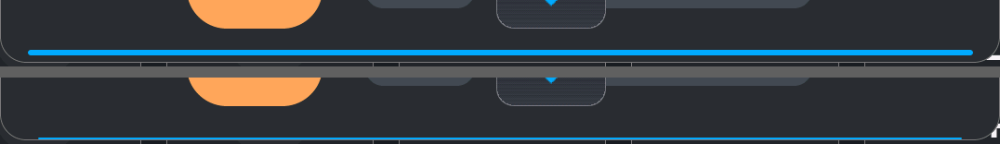

**#23 - the Remove dialog's bar** (P4_5), before / after:

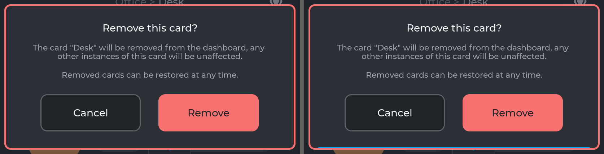

**#97 - the merged tokens.** The header row's gaps (`S_GUTTER` 1.5 -> `S5` 1.6), before above,
after below:

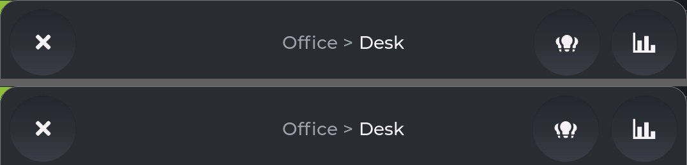

**Members' spacing** - `v0.2.13`'s 1.4 mm / **1.6 (`S5`, built)** / 1.2 (`S4`). P4_5 top to
bottom, 4B left to right (the 1.2 capture happened with the lights off - the words differ, the
spacing is what to look at):

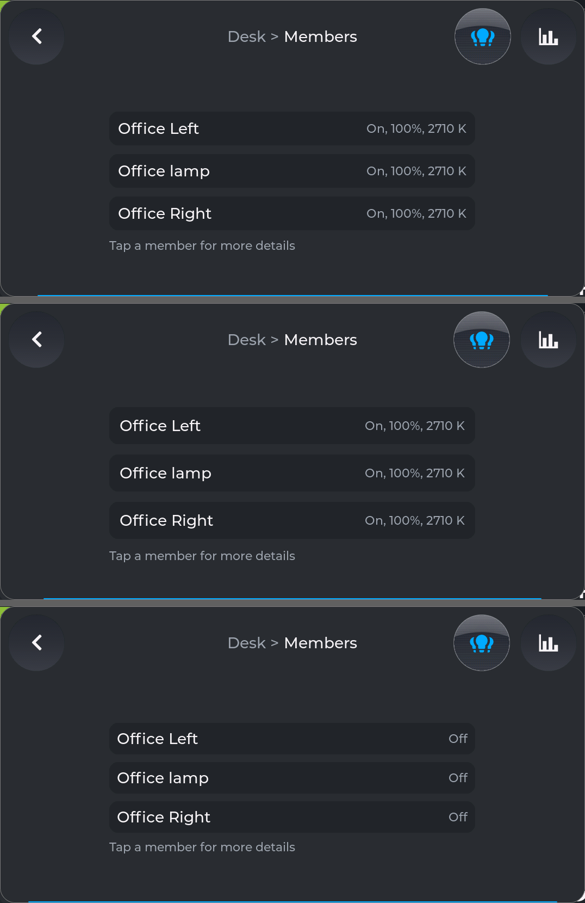
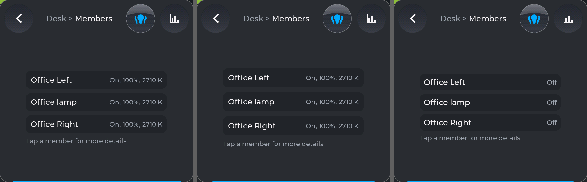

**One radius for the controls** - `v0.2.13` (dropdowns 1.2, buttons 1.6) / **both 1.6 (built)** /
both 1.2. SETTINGS' dropdowns, checkbox and row button, P4_5 then 4B:

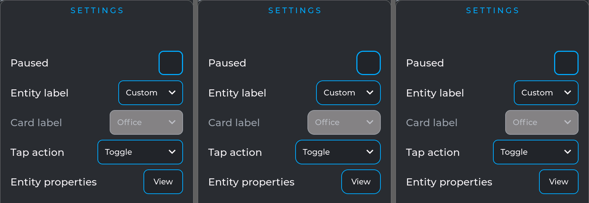
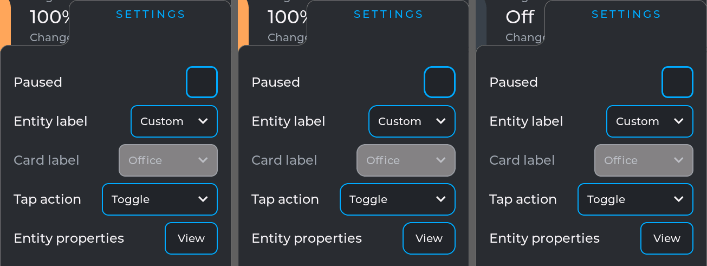

The dialog's buttons, top to bottom in the same order, P4_5 then 4B:

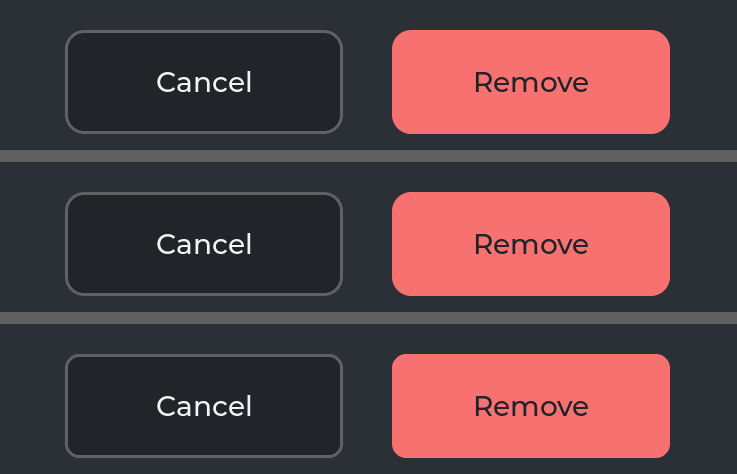
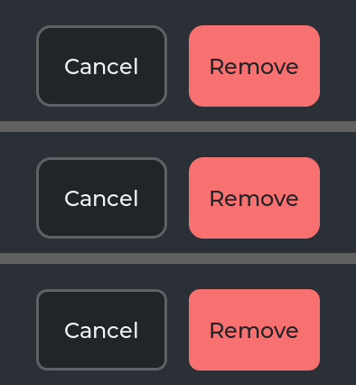

**#92 - History's span buttons**, before above / left, after below / right: the chart (P4_5, then
the 4B, whose Deck card has its span buttons turned off - "Showing:" - so nothing changes there),
and activity (P4_5, then 4B):

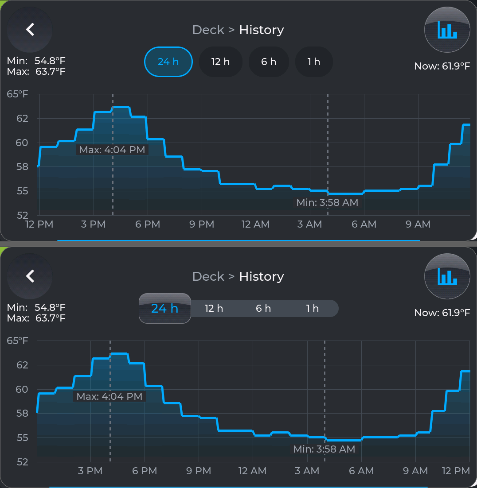
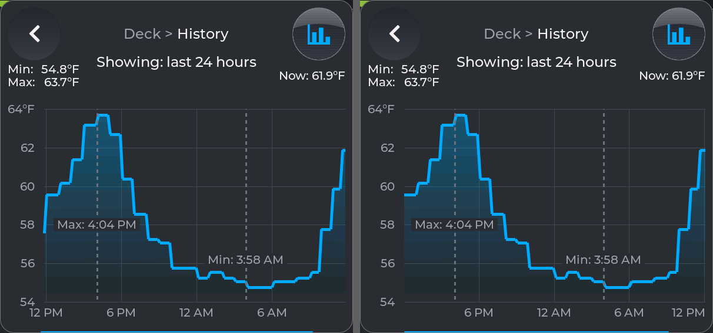
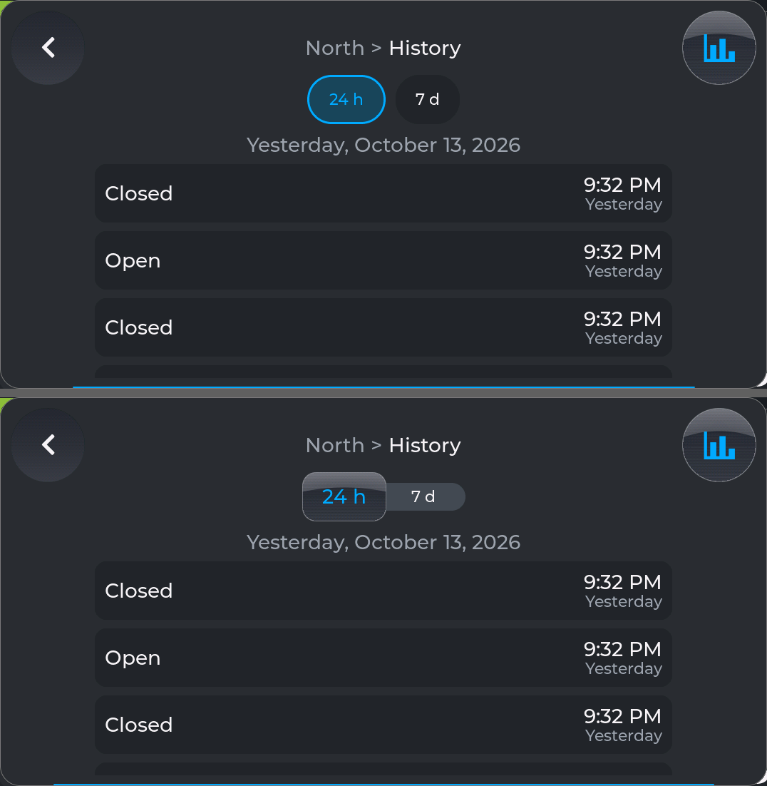
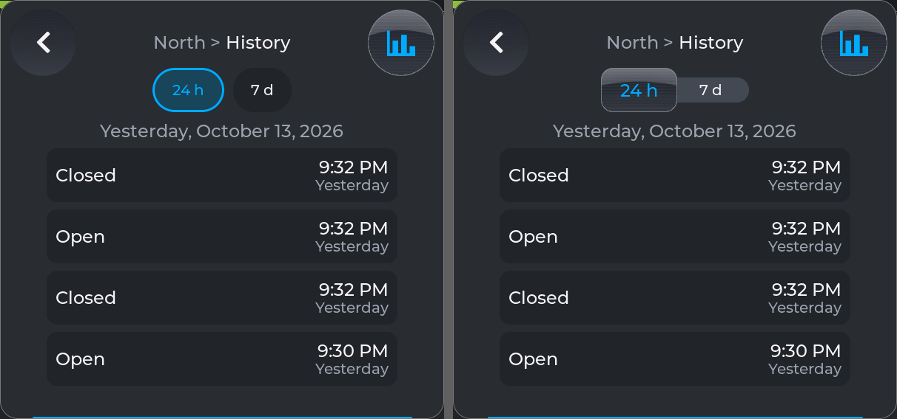

## Tests for you

| # | Do this | PASS if |
|---|---|---|
| T1 | On the 4B: Remove card on an added card (or `/popup?removecard=3` over any window) | Cancel and Remove side by side, the same gap between and beside them; on the P4_5 and 1060 as before |
| T2 | Open the system panel (the header's icon) on each board | Log / Tokens / Cards / About, four buttons the same size; on the narrowest panel still readable |
| T3 | Tap About | "About this board" opens over the drawer; X closes it and the drawer is there again; a minute untouched closes it; a sideways swipe on it does not turn the page |
| T4 | A light's SETTINGS -> Entity properties; then About | Both columns left aligned and centred, the same space from each wall and between them; a long value wraps in its column |
| T5 | Any window, watch its bottom edge | The countdown bar is a hairline on the edge (2 px; 1 px on the 1060), clear of the content, shrinking toward the middle; it never crosses the rounded corners |
| T6 | Remove card's dialog, then wait without touching | The dialog shows the same bar, shrinking in step with the window's; a touch restarts both; at zero the dialog and the window close together |
| T7 | Members (Desk), SETTINGS (dropdowns, checkbox, row button), the dialog's buttons, History's chart gutters | The look you choose in Q3 and Q4; nothing else looks different |
| T8 | History on a sensor (Deck) and on a door (North): drag the span selector, tap a span, let go between two | It slides like the control deck's, snaps to the nearest, loads that span; "Show span buttons" off still shows "Showing: ..." |
| T9 | History on the 4B (the narrow window) with span buttons on | The four spans fit between Min/Max and Now without touching them |
| T10 | From the PC: `curl "http://fleet-ws-p4-5/panel?flash=1"` | "flash test refused: only the NVS mode is kept"; your settings untouched (`/settings?stats=1`) |
| T11 | Reboot a board | It boots as before; the 4B and 1060 keep their saved choices |

## Questions for you

- **Q1. The P4_5 lost its saved settings - restore them?** At 11:44 I flashed the P4_5 back to an
  earlier build of this branch (to re-capture states the house had changed); it booted with "no
  settings file yet" and saved a fresh 66-byte file. The 6,453-byte file (33 cards' names, groups,
  added and removed cards, History choices, the selector look) was there at 11:35. Nothing in the
  firmware deletes it - a crash mid-save would leave `settings.tmp` behind, and `/cfg` holds only the
  new file - so LittleFS most likely failed to mount and was formatted (`format_if_mount_failed`).
  **Cause unknown**: the same app-only flash (0x10000 up, never the data partition) went to the 4B
  and 1060 a dozen times tonight and both still have their files (checked after each flash). I have
  the file as it was at 00:26 today (`/settings`, nothing changed since), kept in this session's
  scratchpad (`settings_backup/fleet-ws-p4-5.json`); copying it into the repo's `test/golden/` was
  refused by the session's permissions. Options: (a) restore it - a LittleFS image of the backup
  written to the `spiffs` partition with esptool (needs your OK: it writes the data partition);
  (b) leave it and set things again on glass; (c) read the P4_5's boot log first (`ui_golden.py
  bootlog COM15`) to see the next mount. **Recommended: (c) then (a)**, and an issue for the cause.
  Related: `Settings.cpp` already records one strange P4_5 boot (2026-10-08, the file there but
  read as empty).
- **Q2. Desk's temperature mark moves between builds.** In `desk_temp` the ring marking the light's
  colour temperature sat at y 249 on the P4_5 at `v0.2.13`, 264 on item 1, 249 on items 1-3, with
  the light at the same 2710 K; on the 4B 191 / 202 / 191. Each build is consistent across reboots.
  Nothing on this branch touches it (`PopupLight.cpp` places it from the light's kelvin range, the
  members' `minTempK` / `maxTempK`). A fresh build of untouched `main` could not settle it: the
  house had turned the light off. **Recommended: an issue** - read the range the window used
  (`/popup?view=3` could print it) on two builds with the light on.
- **Q3. Members' spacing: 1.6 (`S5`, built) or 1.2 (`S4`)?** `v0.2.13` had 1.4. Recommended **1.6**:
  a little more air between rows you tap, the same step as Properties' rows and the panel's.
- **Q4. One radius for the panel's controls and the dialog's buttons: 1.6 (built) or 1.2?**
  Recommended **1.6**: the dialog's buttons and the squared selector keep the corners you set on
  glass (K27), and the dropdowns match the panel's own corners (`R_PANEL` 1.6).
- **Q5. #96's formula** differs from the issue's `(row - gap) / n`: the row spaces its buttons evenly,
  so the leftover is split three ways; `(row - 3 x S7) / 2` keeps 2.4 mm between and beside them
  (with the issue's formula the gap would be a third of that). Keep? Recommended: yes.
- **Q6. The selector's chosen word** is in the name face, a size up from the ribbon's (as the
  deck's icon is a size up). Recommended: keep; the alternative is the same face as the ribbon.
- **Q7. The chip row** (`Kit::chipRow`) has no user now. Recommended: keep it in the kit for #92's
  chart options; remove it if those never come.

## Your results

**Round 1 (owner, 2026-10-14):** T1-T8, T10, T11 **PASS**; T5: the gap between the bar and the
chart's legend was the point of it, "looks great now"; T6 PASS, with a request (round 2's T12);
**T9 PARTIAL** - on the 4B the selector widened while the next span loaded, into the room Min / Max
and Now take, and narrowed again when the chart came (fixed in round 2).

Answers: **Q1** the old settings do not matter - not restored; a way to restore settings after a
loss is open for discussion. **Q2** an issue: #104. **Q3** 1.6, as built. **Q4-Q7** the
recommendations, as built (Q7: a "low / no eye candy" setting may come, for a plainer look).

## Round 2 (2026-10-14, after your results)

Two commits on the branch; the P4_5 and the 4B run them (the 1060 still runs round 1).

| # | What | Checked |
|---|---|---|
| T9 | **The span selector keeps its size** (K80): the chart's corners set its room, and they are not drawn while a span loads - so the room now only narrows while the window shows one subject (a wider Min / Max narrows it once); Show min/max or another entity starts it afresh. Before the first answer it starts from Now's width | the 4B, Deck's History, every span: 298 px wide while loading ("Loading..." showing) and when drawn (round 1, worked out from the tokens rather than captured: about 394 while loading, 298-306 drawn) |
| T12 | **The windows' timeout and countdown bar, from a PC** (K79): `/settings?window_close=60\|30\|10\|off` and `window_bar=on\|off` - system settings in the settings file, from the next window | the 4B: 45 refused; 10 s closed the window after ~11 s; `off` kept it open past 70 s with no bar; 30 with the bar; the bar off hides the window's and the Remove dialog's; 60 and on again leave nothing in the file |

| # | Do this | PASS if |
|---|---|---|
| T9 | On the 4B, History on Deck with span buttons on: tap each span, and Show min/max off and on | The selector keeps its width while the chart reloads; it never touches Min / Max or Now |
| T12 | `curl "http://fleet-ws-p4-5/settings?window_close=10&window_bar=off"`, open a card, wait | No bar; the window closes after 10 s untouched; `window_close=off`: it stays; `window_close=60&window_bar=on`: as before |
