# TEST - 2.8: the header's slots

Rounds in order, each with your results under it. **Signed off 2026-10-17** after round 6 ("Apart
from that we are good!"); round 7 is the two picks and the shadow's joins. Merged as `v0.2.18`.

# Round 1 (2026-10-15, morning)

Branch `feat/2.8-header-slots` (off `main` at `v0.2.16`), built unattended on 2026-10-15 from your
interview answers (`docs/design/header-slots.md`, DECISIONS D-11 to D-15 - both on PR #107, still
open) and the mock's round 2 (the "2.8 Header Slots" canvas: the four slots in the three glyph
styles, at every board's width, and each slot's panel). **No pull request** - for your look first.

**To see it**: the boards are back on `main`'s build. Flash the branch to the P4_5 (and the 4B):
`git switch feat/2.8-header-slots`, then the usual upload. Your settings file is not touched by it
except by what you change on the device (the glyph style, a page's header).

## What changed

| Where | Before | Now |
|---|---|---|
| **The header** | the device's name left, the page's name and dots in the middle, the link and Wi-Fi glyphs right | **four slots, each a quarter of the bar, no true middle** (D-12): the clock, the page (name and dots), status (the link and Wi-Fi, as before), the outdoor temperature (`outside_deck_temp`: its icon in its tint and a whole degree, "51°"). The device's name has left the bar (About this board shows it) |
| **The clock** | - | "6:56am" as you wrote it: 12-hour, am / pm small beside it, no seconds; `--:--` until the time is known; redrawn when the minute changes and only then |
| **No live value** | - | **dashes, never an old value** (D-15): the sensor slot shows `--°` until its sensor reports this boot, and `--°` with a small **"!"** on an amber disc when its source says unavailable or it has gone stale; its panel says which |
| **A tap on a slot** | the status icons opened the system panel from the right edge | **slides down that slot's own panel from its place** (D-13); the slot is drawn open, in the panel's colour, like a folder's tab. Another tap, a tap outside, a swipe up or sideways puts it away. One panel at a time |
| **The status slot's panel** | the system panel, against the right edge | **the same system panel, centred under its slot**; a new **Glyphs** button on its first row |
| **The clock slot's panel** | - | the time large, the date, "Next alarm: none set" (the alarm's place, K84) |
| **The page slot's panel** | - | **PAGES**: House and Fleet, this one marked - a tap goes there; **Header: Shown / Hidden** for this page |
| **The sensor slot's panel** | - | its name, its reading ("51.0°F"), "reported 48s ago" - or dashes and what went wrong |
| **The glyph style** (#19's open question) | bare | **a setting with all three**: bare (the default), a rounded square, a circle in the glyph's own colour with the glyph in the bar's. The **Glyphs** button cycles them, saved (`system.header.glyphs`). Every glyph in the bar takes it - the status glyphs and the sensor's icon; words and numbers never do |
| **Header shown / hidden** | Hide Bar, for every page, not saved | **a page setting** (D-14), saved by the page's slug (`pages.<slug>.header`): the page panel's Shown / Hidden, and **Hide Bar now hides this page's header**. Hidden, a swipe down from the top edge brings it back for three seconds, as before |
| **Narrow boards** | - | the same four slots everywhere; where a slot is too narrow for the page's name and its dots, the name gives way and the dots stay (measured, not by board) |

How it is built (the "bones" you asked about): a slot is **data** - its kind and, where it has one,
its entity (`include/UI/HeaderSlots.h`); a page's header is `PageSpec::headerSlots` (none: the
default four) and `headerShown`; each kind is a build and an update in one table in
`Panel_Header.cpp`, and a panel in `SlotPanels.cpp`. **A new kind of slot is a new row**, never
layout code. The bar, a slot, a glyph's frame and the slot drawer are kit components with their
own roles, their sizes a new token group (`UIHeader`, `UI::hdr()`): `components.md`, `tokens.md` §8.

## The pictures

The header on the P4_5: `v0.2.16`, then bare, square, circle:

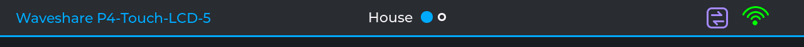

The 4B (720 px): before, bare, square, circle:

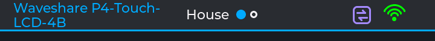
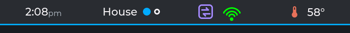
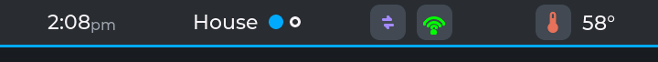
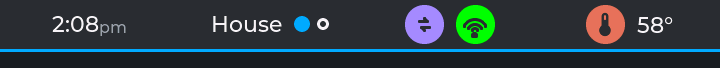

The status slot's panel - the system panel - before (right edge) and now (under its slot):

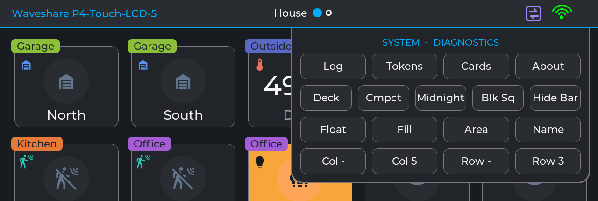
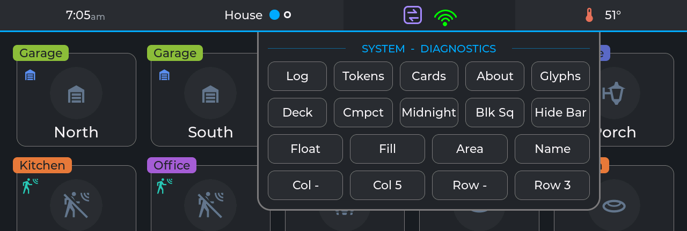

The clock's, the page's (P4_5, then the 4B) and the sensor's panels:

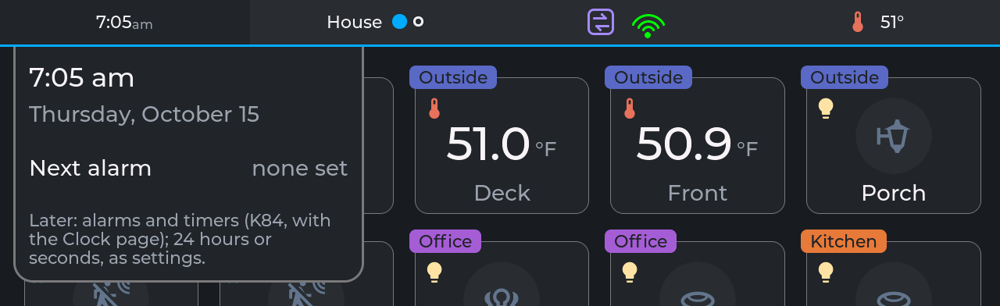
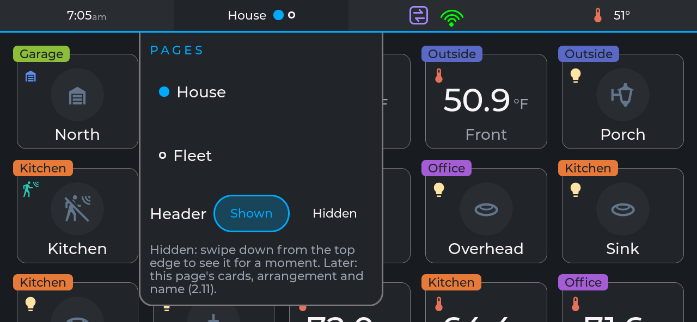
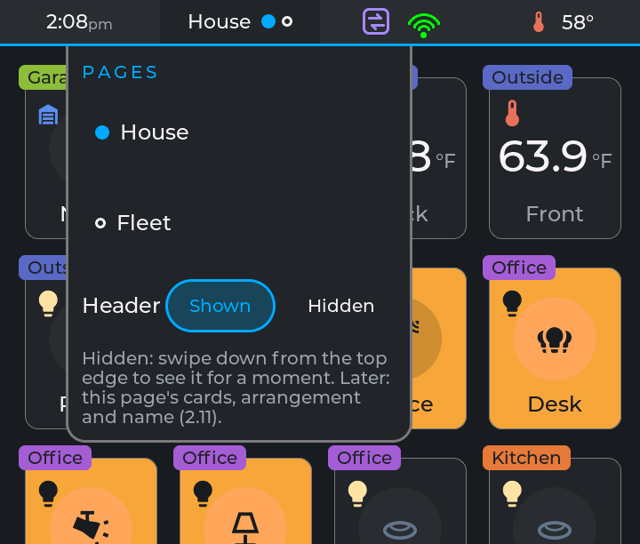
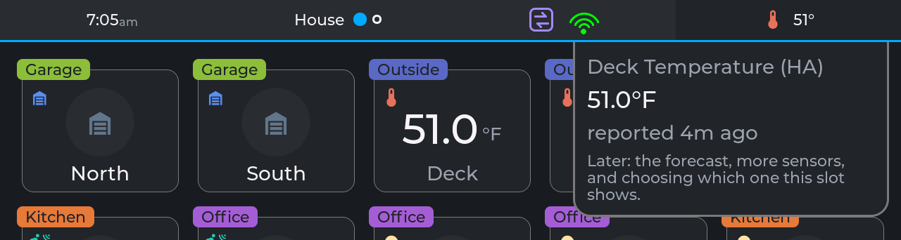

## How it was checked

- **The harness**, P4_5, `v0.2.16` against the branch (53 states; five new: `header_square`,
  `header_circle`, `slot_clock`, `slot_page`, `slot_sensor`): the header changed in every state, as
  it should - the clock where the device's name was; the system panel moved under its slot and has
  the Glyphs button; **every window's contents unchanged** (the only unexplained pixels in a window
  state are the header's left slot above it). LVGL's pool: about **+2.7 KB** in every state (the
  header's extra objects). The 4B: its header states captured and looked at (pictures above).
- **A page's header hidden** (P4_5, from the PC): the cards grew into the room, the setting was
  saved as `pages.house.header = hidden`; shown again, the key was removed - the file is as it was.
- **The glyph styles** on both boards, all three, and back to bare (shown from the PC, never saved).
- **Drawing cost**, P4_5, a full redraw of the House page (`/bench what=full`, 20 frames): **102.9
  ms** on the branch (render 88.3); `main` - see Results. The clock redraws once a minute and the
  sensor only when its whole degree changes: [UI STATE] counts each slot's redraws (`Header: clock
  N | page N | status 0 | sensor N`).
- **Compiles**: all nine (see Results). **Not on glass**: the S3 boards (none can be flashed), the
  narrow forms (the 3248's USB is broken, the 4880 was not flashed), the Linen and Fleet schemes
  beyond the first look, and the alarm (nothing sets one yet).

## Tests for you

| # | Do this | PASS if |
|---|---|---|
| T1 | Look at the House page | four slots, evenly spaced: "h:mmam", "House" and its dots, the link and Wi-Fi, a thermometer and the deck's temperature in whole degrees; the device's name gone |
| T2 | Watch the clock across a minute | it turns over on the minute; nothing else in the bar flickers |
| T3 | Tap each slot in turn | each slides down its own panel from under it, the slot drawn open; the status slot's is the system panel, centred under it |
| T4 | With a panel open: tap the same slot; tap a card; swipe up; swipe sideways | each puts it away (the tap on a card does nothing else) |
| T5 | Page panel: tap Fleet | the Fleet page, the panel gone |
| T6 | Page panel: Header > Hidden, on one page | that page's cards grow into the bar's room; the other page keeps its header; a reboot keeps both; Shown brings it back |
| T7 | Hide Bar (system panel) | hides this page's header, as T6 |
| T8 | Glyphs (system panel), three times | square, circle, bare - all four glyphs framed each time; the choice survives a reboot |
| T9 | The schemes (Midnight, Fleet, Linen) with each glyph style | the frames and circles read on each; a circle's glyph is the bar's colour |
| T10 | Unplug the deck's sensor, or wait for a stale reading, if convenient | `--°` and the "!" mark; its panel says what went wrong |
| T11 | The 4B | as T1-T8 at 720 px |

## Choices that were mine (the documents left them open)

1. **Bare is the default glyph style** - the header as it was - and the other two are a button press
   away. The style is one setting for every glyph in the bar.
2. **The sensor slot shows `outside_deck_temp`** (the House page's "Deck") as a whole degree with
   its card's icon and tint. A board without that entity shows `--°`.
3. **Stale counts as no live value**: a reading past its entity's stale time shows dashes and the
   mark, as unavailable does (your "an old value is worse than no value").
4. **The error mark**: "!" on a small amber disc beside the dashes - a shape and a colour.
5. **The open slot is drawn in the panel's colour**, so slot and panel read as one piece (the
   folder-tab idea from the card window). The status slot's panel kept its width; the others are
   narrower (at most 260 logical px).
6. **Hide Bar is now this page's setting**, saved, matching D-14 (until now it was every page's and
   forgotten at a reboot).
7. **The Glyphs button** sits on the system panel's first row (Log / Tokens / Cards / About /
   Glyphs) until the settings pages (4.1).
8. **The page panel's rows are a finger tall** (9 mm), so two pages already make it tall.
9. **The clock** is 12-hour with a small am / pm and no seconds; 24 hours and seconds are not built.
10. **Narrow boards** keep all four slots; only the page's name gives way, measured. The weather
    icon from the mock is not built: the slot shows its sensor's own icon.

## Questions for you

- **Q1. The glyph style** (#19): bare, square or circle, now that all three are on glass?
  **Recommended: square** - it groups the status glyphs and the sensor's icon without the circle's
  loudness, and a state change still shows in the glyph's own colour. The circle makes a fault
  hardest to miss; bare is quietest.
- **Q2. The clock's form**: "6:56am" as built - or 24 hours, or seconds, as settings? **Recommended:
  keep 12-hour; 24 h and seconds as settings with 4.1.**
- **Q3. How a hidden header comes back**: a swipe down from the top edge, as Hide Bar's always did -
  or also a drag down that starts on a card (header-slots.md §4)? **Recommended: keep the edge
  swipe; try the card drag on glass in round 2** - it starts as a press on a card, so the two need
  feeling together.
- **Q4. The error mark** (D-15's "a way to communicate an error"): "!" on amber beside the dashes.
  Enough, or too loud for a slot you may glance at all day? **Recommended: keep it.**
- **Q5. The open slot's look** - the slot in the panel's colour. Does it read as "this panel came
  from here", or would you rather the slot stay as it is? **Recommended: keep.**
- **Q6. What the slots' panels should hold next** (each panel's last line says what it could):
  the clock - alarms and timers with the Clock page (K84); the page - its cards' size and layout
  (2.11); the sensor - the forecast and choosing the sensor. **Recommended: the sensor's "choose
  which one" first** - it is the slot's only setting today, and it is in the code as data already.
- **Q7. The system panel's own look**: it is still the old panel (not the kit), so it differs a
  little from the three new panels (its title row, its buttons). **Recommended: move it onto
  `Kit::Drawer` in round 2**, so all four panels are one component.

## Results

- **The gate**: all nine SUCCESS on `3260eb0` (15:49) and again on the final commit `a04711b`
  (10:28; P4_5 41.0% flash, the S3 boards 34.5-36.6%).
- **Drawing cost**, P4_5, a full redraw of the House page, 20 frames: `main` **101.8 ms** (render
  87.0) -> the branch **102.9 ms** (render 88.3), about 1%. LVGL's pool on the House page: 4.4 KB
  more in use (the four slots, the frames and the slot drawer, built once).
- **The structure check** (W13): files over 1,000 lines - `GUIManager.cpp` 1,551 -> 1,605 (2.8's
  slot code is its own file, `GUIManagerHeader.cpp`, 141), `Card.cpp` 1,462; style calls outside
  the kit 523 -> 501 (the header moved onto the kit; `Panel_Header.cpp` keeps 3, the sensor's tint);
  colour literals 44 -> 46 (the two status glyphs' "off" colour, now also used for their strike in
  the bare and square styles); no shape numbers; no LVGL in the core layers.
- **The boards are back on `main`** (`v0.2.16` with your local lines): the P4_5 and the 4B, each with
  its settings file byte-identical to its copy from this morning (05:42); the 1060 was never
  flashed.

## Your results

**First look (owner, 2026-10-15)** - seen on glass before the table was run:

> "I caught some of the screens when there were 4 header slots, it was an idea I kinda wanted to see
> but I'm not really crazy about it. For the main system header I'd probably leave the status icons
> on the right, page info in the middle, and put the clock/alarm/temp on the left side."

> "The 'knobs'/buttons in the 'SYSTEM - DIAGNOSTICS' panel are there basically so we can test
> various UI looks/functions while developing and is not intended to be there in the final product.
> Or at least not in its current incarnation. That panel will ultimately provide settings and/or
> shortcuts to settings or popups to manage the various statuses. Same for all of the header slots."

Recorded as DECISIONS D-16 (three places; D-12 superseded) and D-17 (the panels are for settings;
the knobs are development tools); `header-slots.md` §9.

**The table (owner, 2026-10-16, on round 2's build)**:

| # | Result |
|---|---|
| T1 | N/A (four slots are gone) |
| T2 | PASS |
| T3 | PASS |
| T4 | PASS - "Nice job on the swipe upwards to close! Exactly what I would have wanted." |
| T5 | PASS |
| T6 | PASS |
| T7 | PASS |
| T8 | PASS - glyph switching works |
| T9 | **FAIL** - "We need a major glyph overhaul" (below) |
| T10 | the dashes seen; the "!" not seen (the deck's sensor has not been unavailable or stale since) |
| T11 | PASS - the 4B works |

- **The page panel**: a selector bar in place of the Shown / Hidden buttons.
- **Q1**: "I want to say square but the icons become far too small to be useful, and in linen the
  visibility becomes even worse" - waits for the glyph overhaul.
- **Q2**: as built. **Q3**: the edge swipe, as built. **Q4**: keep.
- **Q5**: the open slot in a darker colour (lighter on Linen) "doesn't look great as-is" - the
  owner's idea in its place: **the panel breaks through the bar's accent line**, so the slot's
  contents and the panel's sit inside one border and one colour, no line between them, as the
  canvas's status-panel artboard drew it; all corners rounded, no 90-degree cut-offs; the border
  one colour (the accent?) - "the panel contents pouring out of the header bar itself, not from
  underneath it".
- **Q6**: the status icons' panel will hold connectivity, with deep links to the Wi-Fi settings and
  connectivity stats; the other "later" suggestions agreed.
- **Q7**: the system panel onto `Kit::Drawer` with the knobs moved out to a **"UI Tweaks" window**;
  the panel itself as the canvas demo drew it (CONNECTIVITY, then SYSTEM - DIAGNOSTICS); every
  header panel follows the window timeout; the swipe down on the left half opens UI Tweaks in place
  of the log page. The owner's layout is in DECISIONS D-22.
- **The header's type**: the clock and the page's name are too small - one step up, between today's
  face and the cards' entity label, if there is one; the panels' type stays.

**The glyph overhaul (T9)**, in the owner's words where they matter:

- The Wi-Fi glyph sits lower than the link glyph, and its dot is off centre, to the left.
- Framed (square or circle) the link's arrows are "far too small" and the Wi-Fi fan shrinks: "the
  graphical portion of the icon should not have to change size to be placed within a border".
- Whether the bare link glyph keeps its own coloured border is to be decided; if it does, square.
  Without it the arrows could be larger.
- **Wi-Fi is "practically invisible" on Linen**: bright green on a light ground, hard to read even
  framed.
- **The glyphs should be the mocks' exactly** - the "Fleet Status Glyphs" and "Linen Fill and Header
  Glyphs" artifacts: a narrower fan, so the waves fit a square without shrinking. "How can we
  better transfer those illustrations to the device?"
- **An AP mode gets its own "AP" glyph** in the status place, not a mark on the Wi-Fi fan.

# Round 2 - three places, on claims (2026-10-15, evening)

Branch `feat/2.8-header-slots`, `main` (`v0.2.17`) merged in, built with you at the desk from your
verdicts on round 1 and the round-2 mock (DECISIONS D-16 to D-20, `docs/design/header-slots.md`
§9-10). **No pull request** - for your test first.

**On the desk now**: the P4_5 and the 4B run round 2 (with your local lines), their settings files
as found; the 1060 runs the `v0.2.17` release.

## What changed since round 1

| Where | Round 1 | Round 2 |
|---|---|---|
| **The header** | four evenly spaced slots | **three places** (D-16, D-18): **left** the clock and the deck's temperature; **middle** the page's name and dots, on the bar's centre; **right** the alarm (while one is set) and the link and Wi-Fi |
| **Where things stand** | each slot a quarter of the bar | **claims** (D-19, your idea): each slot claims the room it needs, measured on the board; when a side would run into the middle, the claim of the lowest priority gives way first - the alarm's time, then the temperature's icon, then the page's name; the clock, the dots and the status glyphs never leave. The middle never moves |
| **The alarm** | "Next alarm: none set" in the clock's panel | **its own slot among the status glyphs** (D-18): a bell and "6:30am"; **on the bar only while an alarm is set** (D-20). Its panel: NEXT ALARM, the time, "in 12 hrs 53 min". Nothing sets an alarm until K84, so for now **a PC sets a pretend one** (RAM only, nothing rings) |
| **The glyph style** | bare by default, a setting | **square by default** (Q1, D-20); the Glyphs button still cycles square, circle, bare (a development tool, D-17) |
| **The system panel** | the old panel, centred under its slot | **the kit's drawer**, the same component as every other slot's panel (Q7, D-20): the same frame, slide and joined look; its buttons and width as before |
| **Under the hood** | slots laid out by flex | a pure planner, `Layout/HeaderPlan` (ten tests on the PC), and the slots as data with a place each (`HeaderSlots.h`) - a notice (#76) will be one more claim, no new layout code |

## The pictures

The P4_5: `v0.2.17`, then round 2 (square), bare, circle, and with an alarm set:

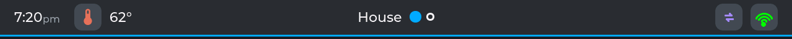
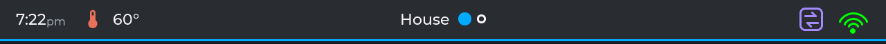
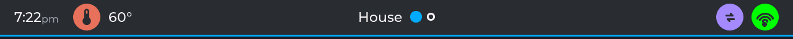
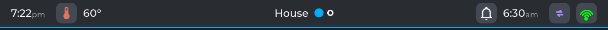

The 4B (720 px), and with an alarm set - everything still in full:

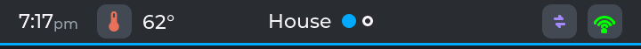
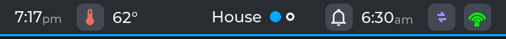

The panels, each joined to its slot - the alarm's (P4_5, then the 4B), the system panel, the
clock's, the temperature's, the page's:

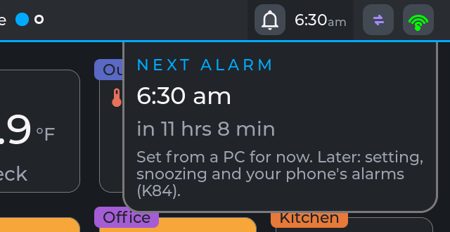
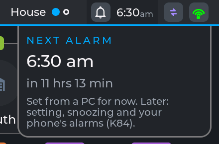
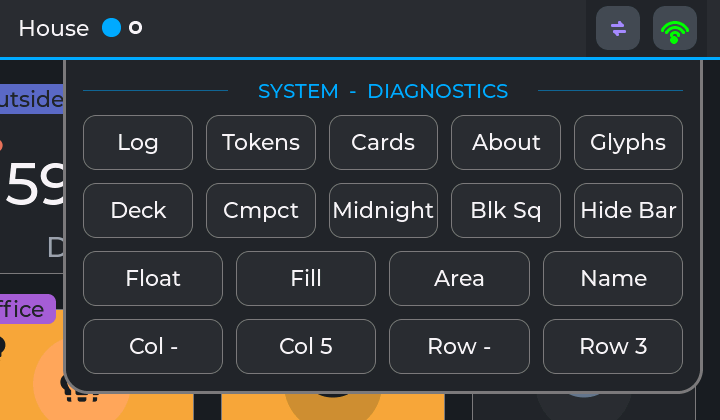
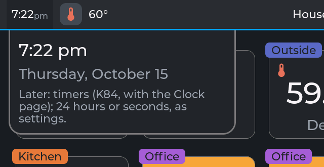
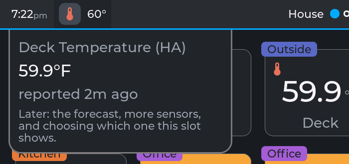
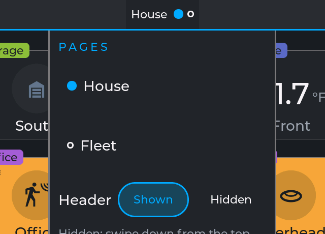

## Tests for you

To set a pretend alarm from the PC (and clear it):

    curl "http://fleet-ws-p4-5/popup?alarm=0630"
    curl "http://fleet-ws-p4-5/popup?alarm=-1"

| # | Do this | PASS if |
|---|---|---|
| R1 | Look at the House page | the clock and the deck's temperature on the left; "House" and its dots in the middle of the bar; the link and Wi-Fi on the right, each glyph in a rounded square; no bell |
| R2 | Watch the clock across a minute | it turns over on the minute; nothing else in the bar flickers (when the time gains a digit, 9:59 to 10:00, the temperature moves over by that digit - expected) |
| R3 | Tap each slot: clock, temperature, House, the status glyphs | each panel slides down from under its slot, the slot drawn in the panel's colour so the panel pours out of it; the status glyphs' is the system panel |
| R4 | With a panel open: tap its slot again; tap a card; swipe up; swipe sideways | each puts it away (the tap on a card does nothing else) |
| R5 | Set the pretend alarm (above) | a bell and "6:30am" appear left of the status glyphs; the middle does not move |
| R6 | Tap the bell; then clear the alarm from the PC | NEXT ALARM, its time and how long until it; cleared, the slot and its panel leave together |
| R7 | The page panel: Fleet; Header Hidden then Shown | as round 1: the Fleet page; this page's cards grow into the bar's room and come back |
| R8 | The system panel (status glyphs) | the same buttons in the same place; its slide and look match the other panels |
| R9 | Glyphs (system panel), three times | circle, bare, square; the choice survives a reboot (square is stored as nothing) |
| R10 | The schemes (Midnight, Fleet, Linen) | the squares read on each; an open slot still reads as part of its panel |
| R11 | The 4B | as R1-R8 at 720 px |

## Choices that were mine

1. **The keeps** (who gives way first): the alarm's time 10, the temperature's icon 20, the page's
   name 30, the temperature itself 60, a set alarm's bell 200; the clock, the dots and the status
   glyphs never. The order is your mock's; the numbers leave room for #76's notices between them.
   On the P4_5 and the 4B everything fits in full; the planner's tests cover the 320 px board.
2. **Slots are as wide as what they show**, plus a pad each side - no 9 mm minimum (Q9 below). The
   status glyphs stay one slot, one tap target, as in round 1.
3. **The alarm's look**: the outline bell (`bell-outline`, added to the icon font) and its time in
   the clock's form; its panel says how long until it, in TimeFormat's words.
4. **"Next alarm" left the clock's panel** - it is the alarm slot's now.
5. **A pretend alarm** is the only way to see the slot until K84: RAM only, not saved, nothing
   rings; at its time it leaves the bar and its panel goes with it.
6. **The system panel kept its width** (half the P4_5) **and its buttons**; only its frame is new.

## Questions for you

Carried from round 1, with their recommendations: **Q2** the clock's form (keep 12-hour; 24 h and
seconds as settings with 4.1), **Q3** how a hidden header comes back (keep the edge swipe; try a
drag from a card later), **Q4** the error mark (keep it), **Q6** what each panel holds next (the
temperature's "This slot shows" first). New:

- **Q8. When the alarm shows.** Today: whenever one is set. Your message also said "an alarm about
  to go off within a few hours". **Recommended: whenever set for now; "only within N hours" as a
  setting with K84**, when there are real alarms to judge it by.
- **Q9. Tap targets.** Slots are as wide as what they show: on the P4_5 the clock is 94 px (~8 mm),
  the temperature ~10 mm, the status pair ~10.5 mm, and the bar is ~5 mm tall. A 9 mm minimum
  width (`UI::minTouch()`) would space the sides out unevenly. **Recommended: keep, and see how
  they feel to tap.**

## Results

- **The harness**, P4_5, `v0.2.17` against round 2, 55 states each, minutes apart (`r2b`, `r2c`):
  **every window's contents unchanged** - its tree identical but for `desk_temp`'s temperature
  mark, 15 px lower, which is #104 (open, seen before); the only unexplained pixels in a window
  state are the new header above it. The header differs in every page state, as it should. **The
  system panel**: the same place and width (623,35, 640 px); its first row has five buttons where
  `v0.2.17` had four (round 1's Glyphs). LVGL's pool: **+3.4 to +4.8 KB** in every state (the
  header's slots, the alarm's built and hidden, the frames, the slot drawer). The first window
  after the flash took 111 ms, the face painting every boot pays (HANDOFF); the rest within 1 ms.
- **The 4B**: its header states captured (`r2h`) and looked at (pictures above). Its full walk
  stops at the Desk window: the 4B's own setting closes a window after 10 s (`system.window.close`),
  shorter than the walk - left as you set it.
- **Drawing cost**, P4_5, a full redraw of the House page, 20 frames, three runs each:
  `v0.2.17` **103.9 ms** (render 89.4) -> round 2 **104.8 ms** (render 90.5), under 1%.
- **Host tests**: 27, all PASS (the planner's ten new).
- **The structure check** (W13): files over 1,000 lines - `GUIManager.cpp` 1,615 (round 1 1,605:
  the [UI STATE] line and the panel guard), `Card.cpp` 1,462; style calls outside the kit **492**
  (round 1 501: the system panel's frame is the kit's now; `Panel_Header.cpp` 5, the sensor's tint
  and the alarm's circle); colour literals 46 (unchanged); no shape numbers; no LVGL in the core.
- **The gate**: all nine SUCCESS on `418ed0f` (17 min; P4_5 41.3% flash, the S3 boards 34.7-36.8%).

## Your results

**Owner, 2026-10-16**:

| # | Result |
|---|---|
| R1 | PASS |
| R2 | PASS |
| R3 | PASS - "The color of the panel matches that background of the slot" (but see Q5 under round 1: the joined look is to change) |
| R4 | PASS |
| R5 | PASS |
| R6 | PASS |
| R7 | PASS |
| R8 | PASS |
| R9 | PASS |
| R10 | see round 1's Q5 and the glyph overhaul |
| R11 | PASS |

- **Q8 - the alarm, the owner's model** (DECISIONS D-21): **the bell sits next to the clock** while
  an alarm is set (or goes off within about 7 days); **tapping the clock** is where alarms are set
  and their details seen. **Within 12 hours of an alarm, a separate notice glyph joins the status
  icons** - dismissable each time, or turned off altogether; the 12 hours is the owner's to set,
  from the clock's panel.
- **Q9**: keep.

# Round 3 - the look, UI Tweaks and Card UI (2026-10-16, built overnight)

Branch `feat/2.8-header-slots`, built unattended from your verdicts on rounds 1 and 2 and the
canvas "2.8 Header Slots" (its four Round 3 artboards; DECISIONS D-21 to D-28). **No pull
request** - for your test first.

**On the desk now**: the P4_5 and the 4B run round 3 (with your local lines), their settings files
as found (each saved before every flash, `bench/settings/`); the 1060 runs the `v0.2.17` release.

## What changed since round 2

| Where | Round 2 | Round 3 |
|---|---|---|
| **The status glyphs** | icon-font glyphs, shrunk to sit in a frame | **the mocks' glyphs, drawn from numbers** (D-24, D-27): the narrower Wi-Fi fan and the link's two arrows as LVGL arcs and lines, centred, **one size bare or framed** (the frame grows round it); **the dark schemes' softer greens** (34D399 / 4ADE80), Linen its own darker set; **AP a mast of its own** in the status place |
| **An open slot and its panel** | the slot in the panel's colour | **one shape in the accent** (D-23): the panel breaks through the bar's accent line, the tab and the panel inside one outline, every corner rounded - a cove beside the tab, a flare beside the panel; a panel at a screen edge shares that side with its tab |
| **The alarm** | its own slot among the status glyphs | **a bell inside the clock's slot** while an alarm is within about 7 days; **within 12 hours a notice joins the status icons** (the bell ringing, amber): tap it for its panel, Dismiss or Settings. The clock's panel: NEXT ALARM, and **"Warn me before"** 1 h / 3 h / 6 h / 12 h / Off (D-21) |
| **Type, the P4_5** | header words and card tags 22 | **24** (D-26) - everything in the tag face follows: SETTINGS' title, the member rows |
| **The system panel** | the knobs | **CONNECTIVITY** (Wi-Fi: SSID, dBm, IP; Home Assistant; MQTT - each its glyph and its state in words) and **SYSTEM - DIAGNOSTICS**: Log / UI Tweaks / About; Fleet / Midnight / Linen on the selector, set apart from a **Status bar** toggle; Col / Row (D-22, D-25) |
| **The knobs** | system panel buttons, cycling | **UI Tweaks**, a window: Glyphs, Card label, Entity label, Card state, Selector and its shape, Card density, Window timeout, Timer bar - each a selector, the rows lined up - then Tokens and Reset all. **While it is open, AUDIO and DISPLAY rise at the foot, splitting the window's width** (D-25) |
| **A card's window** | SETTINGS: Entity label, Card label | **Card UI**, a view from the last row of SETTINGS (D-28): Entity label, Card label (Inherit / Custom / None), Selector and its shape, Card density, Window timeout, Timer bar - "Inherit" follows UI Tweaks. SETTINGS keeps Paused, Active state, Tap action, Entity properties |
| **Swipe down, left half** | the log | **UI Tweaks** (the log is a tap away on the system panel) |
| **The header's panels** | open until put away | **close on the window timeout**, as a window does (D-22) |
| **Saved** | the glyph style | also **the scheme** (now one for every page), **each page's Col / Row**, and **every UI Tweaks and Card UI choice** |

## The pictures

The header on the P4_5: Midnight, Linen, bare, circle; an alarm in two hours (the bell, the
notice); the sensor failed (from a PC, below):

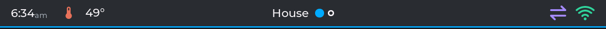
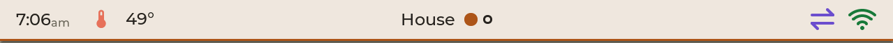
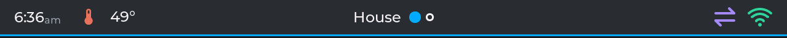

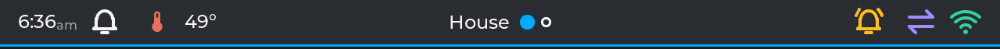
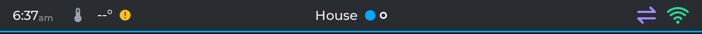

The panels, one shape with their slots - the clock's, the notice's, the temperature's, the system
panel (and on Linen):

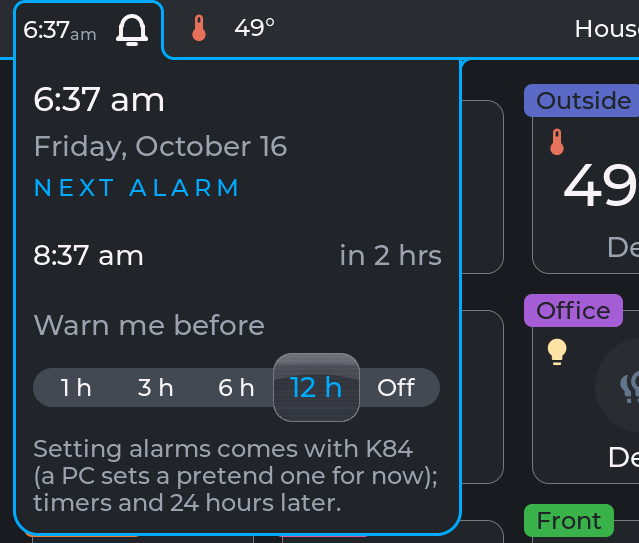
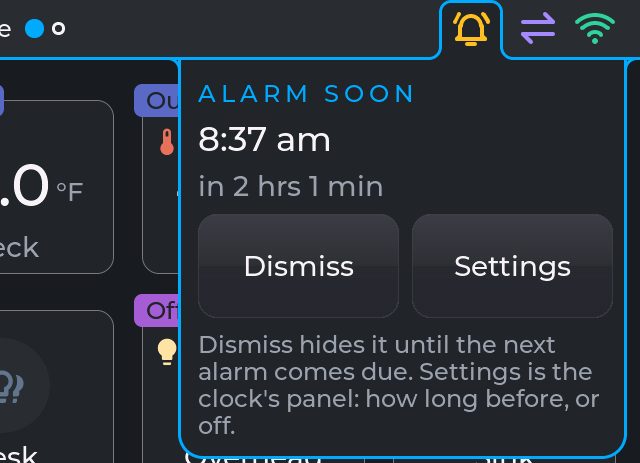
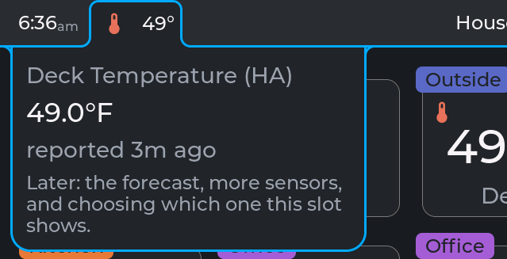
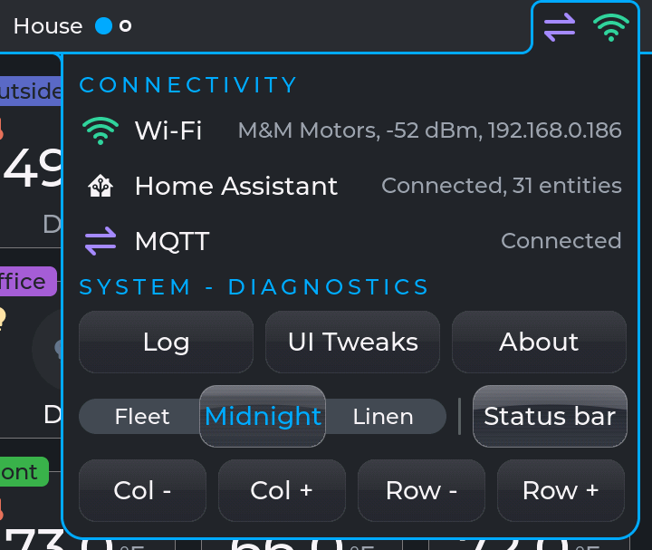
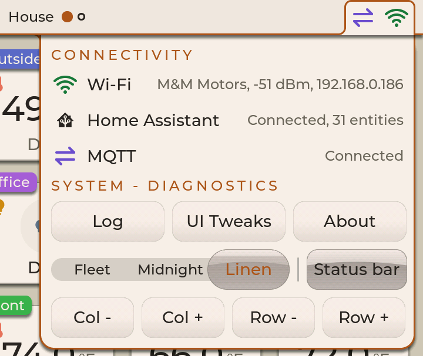

UI Tweaks, then DISPLAY open under it; a card's SETTINGS, then its Card UI:

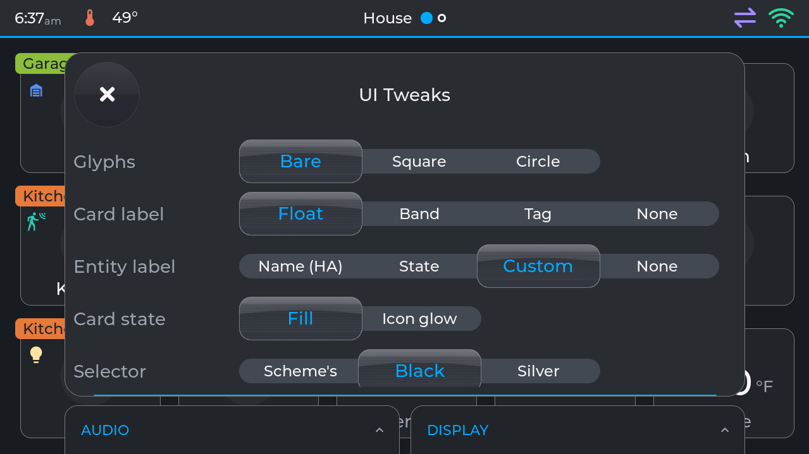
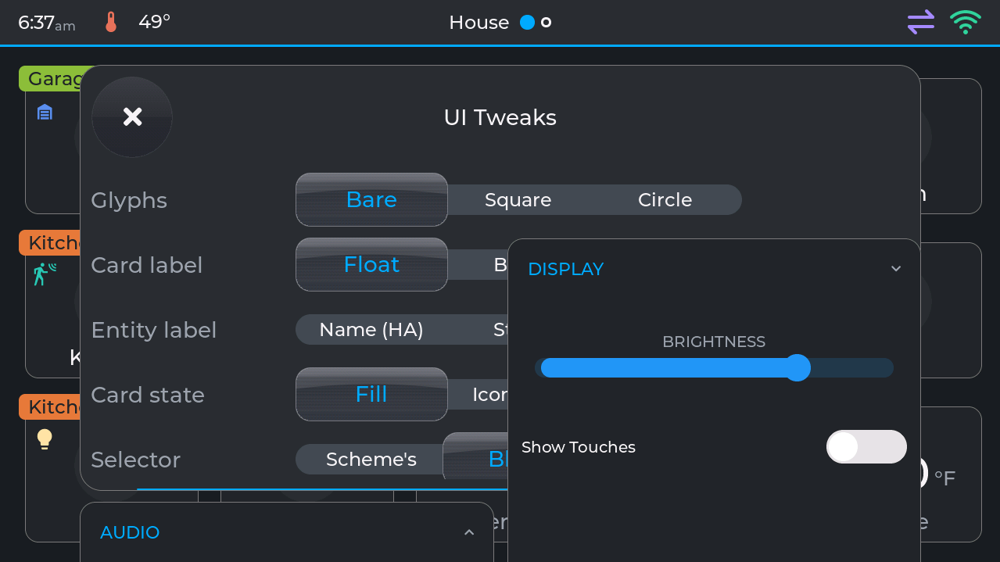
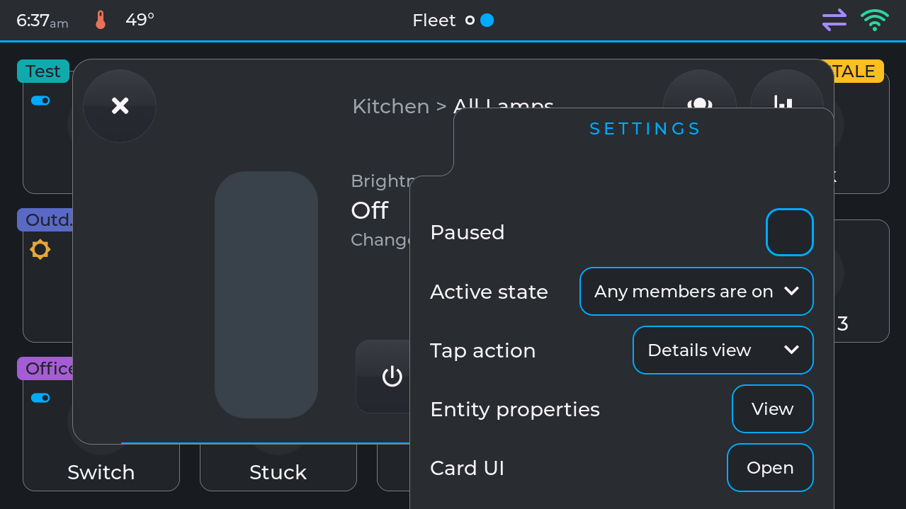
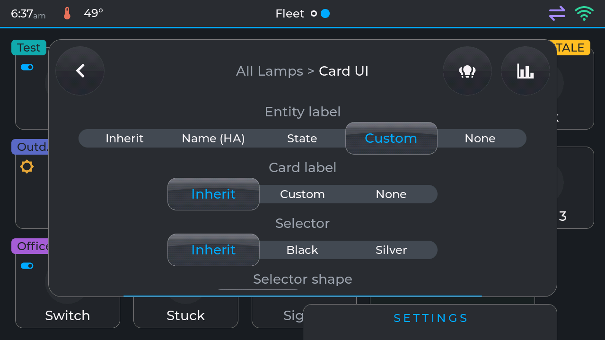

The 4B (720 px): the header with an alarm, the system panel, UI Tweaks (each row's words above its
selector), Card UI:

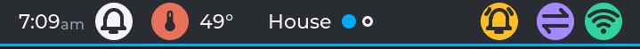
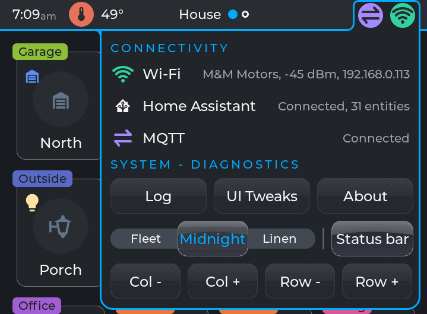
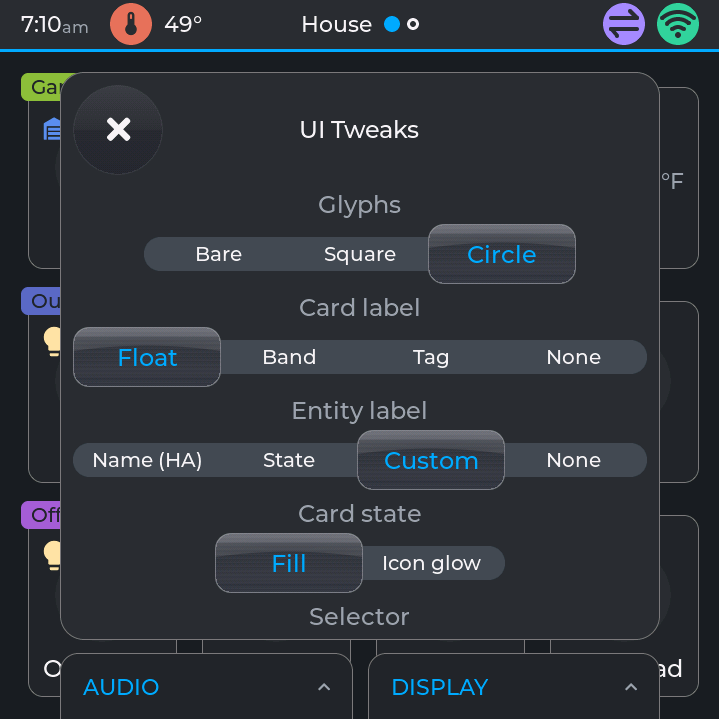
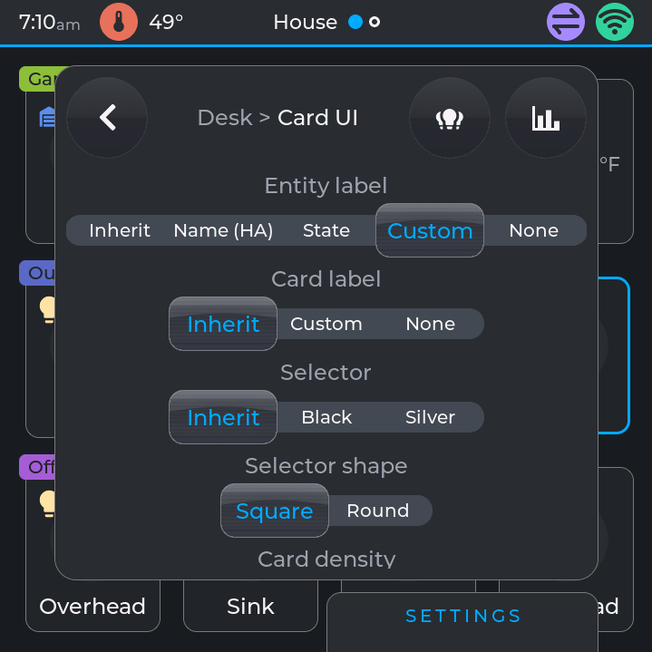

## Tests for you

From the PC (debug builds; RAM only, nothing saved):

    curl "http://fleet-ws-p4-5/popup?alarmin=120"     an alarm in two hours: the bell and the notice
    curl "http://fleet-ws-p4-5/popup?alarm=-1"        cleared
    curl "http://fleet-ws-p4-5/popup?sensorerr=1"     the header's sensor shown failed; 0 puts it back

| # | Do this | PASS if |
|---|---|---|
| U1 | Look at the House page | the Wi-Fi fan and the link are the mock's: centred, the same size whatever the frame; the greens softer |
| U2 | UI Tweaks > Glyphs: Bare, Square, Circle; then each scheme | a glyph never shrinks; every glyph reads on Linen |
| U3 | Tap each slot | the tab and its panel inside one accent outline, the bar's line broken where the panel comes out, every corner rounded |
| U4 | Set an alarm in two hours (above) | a bell inside the clock's slot; the ringing bell, amber, among the status icons; the middle does not move |
| U5 | Tap the notice; Dismiss | its panel (the time, how long); dismissed, the notice leaves and the clock's bell stays |
| U6 | Tap the clock; Warn me before: Off, then 12 h | NEXT ALARM and the selector; Off keeps the notice away; it survives a reboot |
| U7 | The system panel | CONNECTIVITY: Wi-Fi's network, dBm and address, Home Assistant "Connected, N entities", MQTT; then Log / UI Tweaks / About, the schemes beside Status bar, Col / Row |
| U8 | Scheme: Linen, Fleet, Midnight; Status bar off and on | every page takes the scheme, and it survives a reboot; the toggle hides this page's bar |
| U9 | Col + and Row + on one page; swipe to the other | only that page changes; both survive a reboot |
| U10 | UI Tweaks (its button, or a swipe down on the left half) | the rows; AUDIO and DISPLAY rise at the foot, splitting the window's width |
| U11 | Under UI Tweaks: open DISPLAY, move the brightness; tap in the window; tap outside it all | the slider works; the tap in the window only folds the panel; the tap outside closes the window, and the deck goes with it |
| U12 | Each UI Tweaks row in turn | Card label, Entity label, Card state and Card density change every page; Selector and its shape redraw the rows in the new look; Window timeout and Timer bar from the next window; all survive a reboot |
| U13 | Reset all | it asks first; then every row back as shipped (Square, Float, Custom, Fill, the scheme's selector, Compact, 60 s, On) |
| U14 | Leave a header panel open, untouched | it closes after the window timeout (U12's choice) |
| U15 | A card's window: SETTINGS > Card UI > Open; try each row | Entity label and Card label at once on the card; Selector in this window; Card density once the window closes; Window timeout at once; Timer bar from the next opening; each kept for this card only |
| U16 | `sensorerr=1`, then `0` (above) | `--°` and the "!" beside it; then the reading again (T10) |
| U17 | The 4B | as U1-U15 at 720 px |

## Choices that were mine

1. **The scheme is one for every page** now, saved (`system.ui.scheme`): UI Tweaks' choices are
   device-wide, and a scheme per page beside them read as a fault. **Col / Row stay per page**
   (your 2026-09-23 rule) and are saved with the page (`pages.<slug>.cols` / `rows`).
2. **The word "Scheme" is left off the P4_5's system panel**: on its half-screen panel the three
   names, the rule and the toggle fill the row. It shows on a panel with room; the names say what
   they are.
3. **CONNECTIVITY's words a face smaller** than the names, so SSID, dBm and address fit one line;
   MQTT says how long since a message once one has come.
4. **Reset all asks first** (a dialog) and leaves the scheme and the grid alone - those are the
   system panel's.
5. **The Selector rows set the look for the scheme showing** (K45: each scheme keeps its own).
6. **Card UI's Card label "Custom"**: there is no way to type words on the device yet, so choosing
   it keeps the words showing then (the group's name) as the card's own - they stop following a
   rename. A PC still sets them (`/settings?card=..&label_text=..`).
7. **When a Card UI choice shows**: Window timeout at once; Timer bar from the next opening (the
   bar is made with the window); Card density once the window closes (the page is built again).
8. **The deck under UI Tweaks** is only as tall as an open panel while it is up, so bringing it
   forward redraws that strip and not the screen; it slides up and away in 220 ms.
9. **The harness's new keys**: `tweaks=1|0`, `slot=deck0|deck1`, `sensorerr=1|0`, `view=6` (Card
   UI); `scheme=N` now goes through the dashboard (header and page follow) and is never saved.

## Questions for you

- **Q10. The joins' size.** The corner where the outline meets the bar's line is `JOIN_R`, 6
  logical px (~10 px on the P4_5). **Recommended: look at U3; say bigger or smaller.**
- **Q11. The bottom-left swipe up** still shows the deck on the dashboard. D-25 made UI Tweaks the
  only way to the deck. **Recommended: remove the gesture** when the deck's options are rehomed;
  until then it does no harm.
- **Q12. UI Tweaks scrolls on the P4_5** (nine rows, five in sight). **Recommended: keep while it is
  a development window**; whittling it (D-25) fixes it.
- **Q13. Card UI's rows stack on the P4_5** (a row's words above its five choices): the window is
  not wide enough for both side by side. **Recommended: keep.**

## Results

- **The harness**, P4_5, round 2 (`r2c`) against round 3 (`r3`), 60 states (five new:
  `slot_clock_alarm`, `header_sensor_err`, `tweaks`, `tweaks_deck`, `lamps_cardui`). What differs is
  what round 3 changed: the header in every page state (the open tab's accent border, the stroke
  glyphs, the bell and notice); the tag face at 24 (SETTINGS' title, the member rows, "Tap a member
  for more details"); SETTINGS two rows shorter and one longer (Entity label and Card label out,
  Card UI in), its panel 577 -> 600 px wide. 22 card-window states also show the house changed
  between the captures (the Office desk lamps were on for `r2c`, off for `r3`). Windows opened
  ~25% faster (`desk_main` 111 -> 87 ms, the rest ~29 -> ~21 ms; fewer SETTINGS rows to build).
- **LVGL's pool**: **+12.9 KB** in every House state, +16.8 KB on Fleet (of the P4's 512 KB) - 78
  more objects: the stroke glyphs' arcs and lines (4 -> 39 lines, 3 -> 12 arcs), the joins, the
  system panel's new rows and finished buttons. **On an S3's 128 KB pool that is a tenth** -
  worth a look when an S3 is next on the desk (W6).
- **A fault found and fixed while taking the pictures**: on Linen the system panel kept Midnight's
  dark buttons, their words invisible - a finished face is painted once, in the scheme it was made
  in, and the panel is built once. It now builds its rows again on a scheme change
  (`Panel_System::restyle()`); the Linen pictures above are after the fix.
- **The 4B**: `header_alarm`, `system_panel`, `tweaks` captured (`r3`), Card UI by hand (the 4B's
  own 10 s window timeout ends the harness's walk before it); pictures above.
- **Host tests**: 34, all PASS (seven new for the glyph shapes).
- **The structure check** (W13): files over 1,000 lines - `GUIManager.cpp` **1,509** (round 2
  1,615: the knobs left for `GUIManagerTweaks.cpp`), `Card.cpp` 1,462; style calls outside the kit
  **438** (round 2 492); colour literals **10** (round 2 46: the status glyphs' colours are tokens
  now, `SIG_*`); no shape numbers; no LVGL in the core.
- **The gate**: all nine SUCCESS on `f344af3`, the build on the boards (P4_5 41.9% flash, the 7B
  37.8%, the S3s 34.9-37.0%; 12 min).

## Your results

**Owner, 2026-10-16**: "I cannot overstate how much better the header bar looks and feels! The
status icons alone are OUTSTANDING!" UI Tweaks and Card UI: "amazing QOL upgrades ... making a
clean separation of duties feels much more correct".

| # | Result |
|---|---|
| U1 | PASS |
| U2 | PASS |
| U3 | PASS - see the panels' corners below |
| U4 | PASS |
| U5 | PASS |
| U6 | PASS |
| U7 | PASS |
| U8 | PASS |
| U9 | PASS |
| U10 | **PARTIAL** - AUDIO and DISPLAY should be the window's colour, as the card window's panels are |
| U11 | PASS |
| U12 | PASS |
| U13 | PASS - "Is the glyph default Square then?" (yes: D-20; the P4_5's own file says bare) |
| U14 | PASS |
| U15 | PASS - but the held card's pressed look (its border behind the window) is lost when its card label changes |
| U16 | PASS |
| U17 | PASS |

**Bugs and requests** (round 4):

- **Choosing the Selector look in UI Tweaks corrupts the system panel's buttons** (two
  screenshots: doubled faces, Col / Row turned silver). Cause: the finished faces live in a cache
  of 16 slots that each new window may take back; the system panel is built once, so its buttons
  went on pointing at slots repainted for UI Tweaks' selectors.
- **The P4_5's header words** "look the same size as before". They did change, 22 -> 24 (House 71
  -> 78 px wide); the 4B's 22 px is still ~5% larger in millimetres; 26 would match it.
- **The panels' corners**: keep the rounded corners where the slot meets the panel (the coves);
  **remove the flares** - the panel's side walls go straight up and stop at the blue line. **Keep
  the slot open while its panel closes**, until it has fully gone.
- **Remove the system panel's Status bar** (two ways to hide the header that look different); the
  page panel's Shown / Hidden becomes **Show / Hide**. **The header is always visible while a
  header panel is open**: Hide in the page panel does not close the panel, and the header hides
  when the panel closes.
- **"Scheme:" back** in front of the system panel's selector.
- **Card UI looks unlike UI Tweaks** (its long selectors): each option gets an **Inherit**
  button; while it is on, no selector; off, the option's own selector appears under it, only as
  wide as that option's longest choice.
- **Window timeout and Timer bar take effect at once**, in UI Tweaks and Card UI alike.
- **A proposal: new active states, on the border** - for the cards and for toggles such as the
  glass Power button (not the corner tabs): (1) a dual-border "glow" frame - an outer 1 px dark
  line, an inner 3 px bright ring; (2) an asymmetric "bracket" - top and bottom 4 px, sides 1 px;
  (3) a corner cut - 3 px border, the top-left and bottom-right corners' radius doubled.
- **Settled with the owner the same afternoon**: a toggle that is not a card (Power, any on / off
  button) is **glass when off and wears the glow frame when on**; the other two are cards only;
  **all three are built, the corner cut not on Linen** (its shadow); the P4_5's header words
  **26**. The active state is UI Tweaks' "Card state", device-wide (not in Card UI).

# Round 4 - your round-3 list, and the active states (2026-10-16, afternoon)

Branch `feat/2.8-header-slots`, built with you at the desk from the list above. **No pull
request** - for your test first. **On the desk now**: the P4_5 and the 4B run round 4 (with your
local lines), their settings files as found (saved before every flash).

## What changed since round 3

| Where | Round 3 | Round 4 |
|---|---|---|
| **The system panel's buttons** | corrupted after choosing a selector look | built again whenever the panel opens (and on a scheme change), so their faces are always their own |
| **The system panel's scheme row** | the selector beside a Status bar toggle | **"Scheme:"** and the selector; **no Status bar** - the page panel's Show / Hide is the one way |
| **A panel's corners** | flares curving the line into its walls | **the walls rise straight to the blue line**; the coves beside the slot stay |
| **Closing a panel** | the slot closed at once | **the slot stays open until the panel has gone** |
| **The header while a panel is open** | Hide hid it at once, the panel left open | **always visible while a header panel is open**: Show / Hide (the page panel's words now) leaves the panel open and shows once it closes |
| **The P4_5's header words** | 24 | **26** (a HEADER role in the type scale; every other board unchanged) |
| **Window timeout, Timer bar** | from the next window (Timer bar in Card UI too) | **at once**, in UI Tweaks and Card UI |
| **Card UI** | long selectors with "Inherit" as a choice | **an Inherit toggle per row**; off, the row's own selector under it, as wide as its own longest choice |
| **The deck under UI Tweaks** | the cards' colour | **the window's colour**, as the card window's panels are |
| **A held card** | lost its pressed look when Card UI changed its label | **stays pressed in** until its window closes |
| **Card state** (UI Tweaks) | Fill, Icon glow | also **Glow frame, Bracket, Corner cut** - "on" on the card's edge, the icon lit as Icon glow |
| **Toggles** (Power, Inherit) | satin off, glass on | **glass off; glass and the glow frame on** |

## The pictures

The P4_5: the system panel; the page panel (Show / Hide, the walls meeting the line); Card UI;
the three active states on the Desk card; Power on:

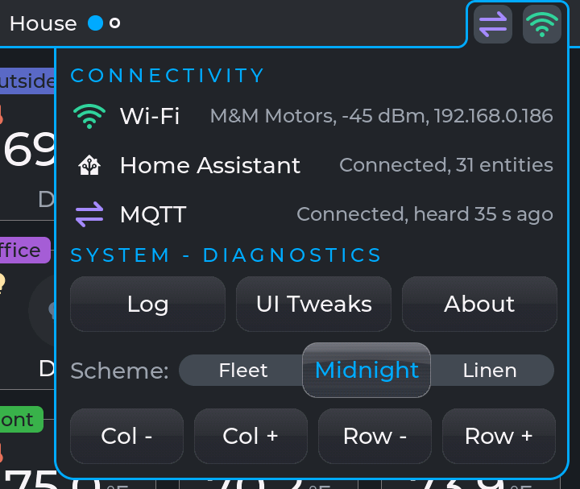
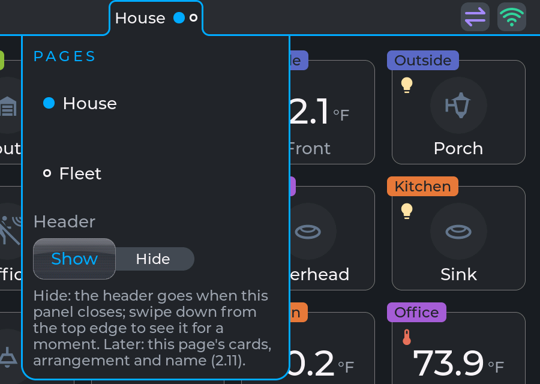
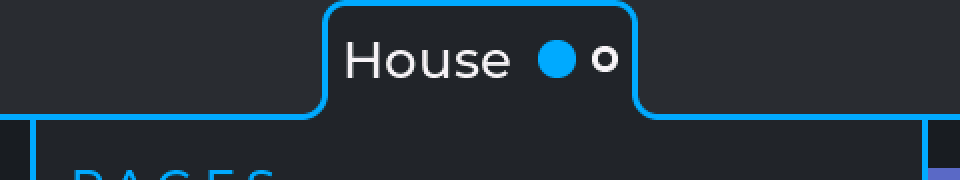
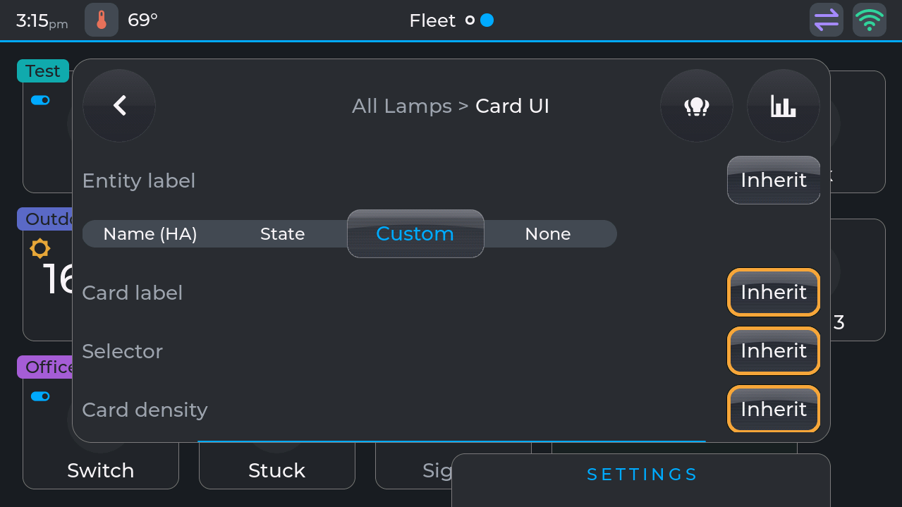
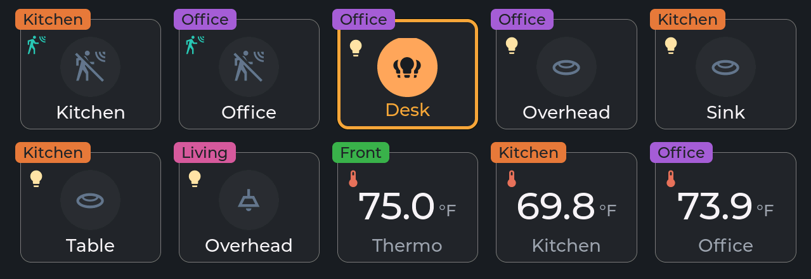
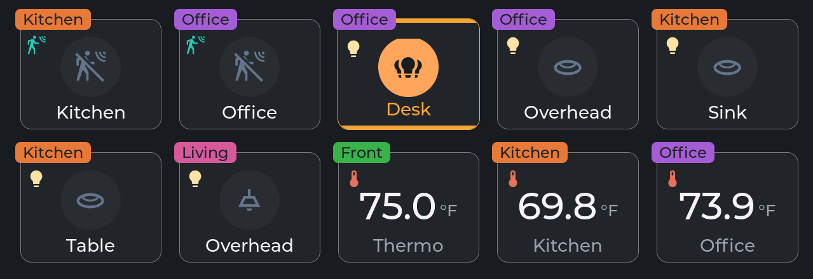

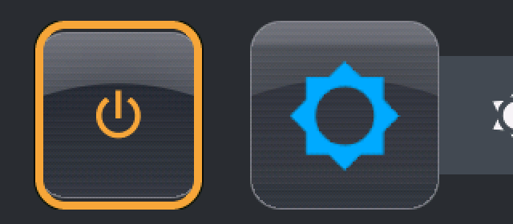

The 4B: the system panel, Card UI:

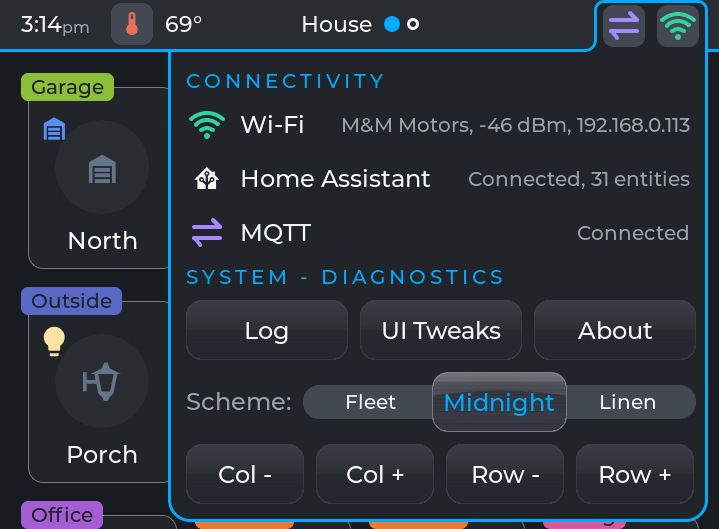
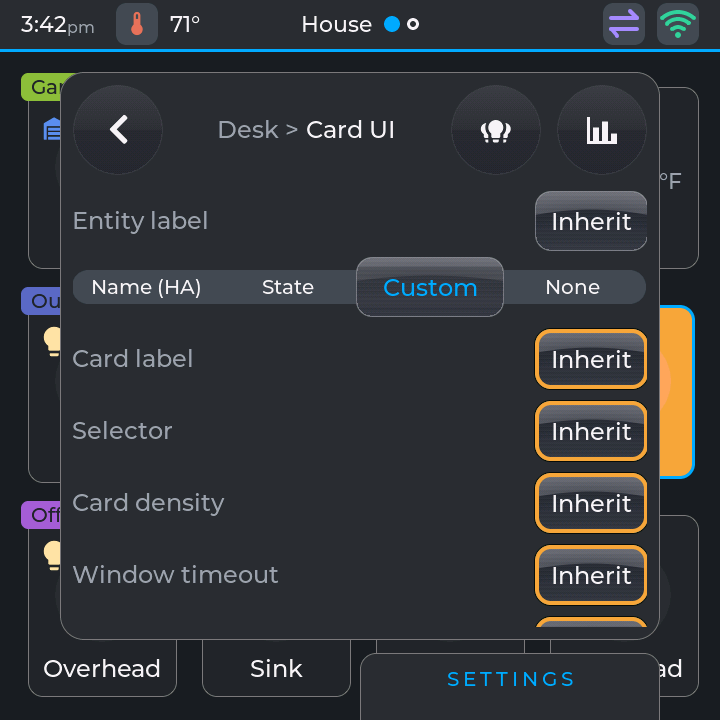

## Tests for you

    curl "http://fleet-ws-p4-5/popup?cardstate=2"     the cards' Glow frame, not saved (3 Bracket, 4 Corner cut; -1 yours again)

| # | Do this | PASS if |
|---|---|---|
| V1 | UI Tweaks: change Selector and its shape a few times; then open the system panel | its buttons are whole: one face each, Col / Row unchanged |
| V2 | The system panel | "Scheme:" before the selector; no Status bar |
| V3 | Open each slot's panel | its walls rise straight to the blue line; the rounded corners only where the slot meets the panel |
| V4 | Close a panel (its slot, a tap outside, a swipe up) | the slot stays open until the panel has gone, then closes |
| V5 | Page panel: Hide | the panel stays open and the header with it; close the panel - the header goes, the cards take its room |
| V6 | With the header hidden: swipe down, open the page panel, Show; close it | the header stays, the cards make room |
| V7 | The P4_5's clock and page name beside the 4B's | about the same size on the glass |
| V8 | UI Tweaks: Window timeout 10 s, then Off; Timer bar Off, then On | each at once: the bar restarts, speeds up, stops, goes, comes back |
| V9 | A card's Card UI: Window timeout and Timer bar | as V8, for that card's window |
| V10 | Card UI: turn Inherit off and on for each row | off: the row's own selector, its choices short ("10 s"); on: nothing under it; nothing changes until a choice is made |
| V11 | Card UI's Entity label or Card label, with the card pressed in behind the window | it stays pressed in |
| V12 | UI Tweaks with the deck up | AUDIO and DISPLAY in the window's colour |
| V13 | UI Tweaks > Card state: Glow frame, Bracket, Corner cut, with a light on; and on Linen | each on the "on" cards' edges; on Linen the corner cut is the glow frame |
| V14 | A light's window: Power off and on | glass when off; glass and the glow frame when on |
| V15 | The 4B | as V1-V14 at 720 px |

## Choices that were mine

1. **The frames light the icon and name as Icon glow does** - a frame alone, on a card with a dim
   icon, read as "selected" more than "on".
2. **The glow frame's outer line is the scheme's darkest, pulled 60% of the way to black**; its
   ring and the bracket are the scheme's active colour (`ST_ACTIVE`); the sizes are tokens
   (`ACTIVE_RING` 3, `ACTIVE_EDGE` 1, `BRACKET_W` 4 logical px).
3. **The corner cut's top-left corner sits under a floating card label** (Float), so with Float
   only the bottom-right shows the cut; Tag, Band or None show both.
4. **Every Inherit toggle that is on wears the glow frame** (your rule for toggles) - on a fresh
   card that is all six; say if the frame belongs only on Power.
5. **Show / Hide shows when the panel closes, both ways** - Show while peeking keeps the bar.

## Questions for you

- **Q14. Which active state** becomes the default (or stays a choice)?
- **Q15. The Inherit toggles' glow frame** (choice 4): keep, or a quieter "on" for them?

## Results

- **Your two screenshots' fault, found**: the finished faces (satin, glass) live in a cache of 16
  slots that each new window may take back; the system panel was built once at boot, so its
  buttons went on pointing at slots UI Tweaks' selectors had since repainted. It now builds its
  rows at every open. V1 checks it.
- **The harness**, P4_5, round 3 (`r3`) against round 4 (`r4`), 63 states (three new:
  `frame_glow`, `frame_bracket`, `frame_corner`). Differences are what round 4 changed: Power
  glass where it was satin (every light window), the clock and page name at 26 (the header above
  every window), the system panel without its Status bar, Card UI's new rows, UI Tweaks' fifth Card
  state. LVGL's pool **1.7 KB lighter** in every state (the Status bar and its finish gone); the
  corner cut costs 7 KB with its caps on every state card (built only when it is chosen). Windows
  open as before (~21-28 ms).
- **On glass**: the page panel's walls meet the line square, the coves kept (picture above);
  Power on - glass and the glow frame - seen with the Office desk lamp switched on from the PC and
  back off, as found; the 4B's Card UI fits once each selector narrows to its window (fixed during
  the round).
- **Host tests**: 34, all PASS.
- **The structure check**: `GUIManager.cpp` 1,490 lines (round 3 1,509), `Card.cpp` 1,473 - the
  frames went to `CardFrame.cpp` rather than grow it past 1,550; style calls outside the kit 457
  (round 3 438: the frames' 19); colour literals 10; no shape numbers; no LVGL in the core.
- **The gate**: all nine SUCCESS on `9bff273` (P4_5 42.0% flash, the S3s 34.9-37.0%); the move of
  the frames to their own file after it built on the two development boards (P4_5, S3 4B).

## Your results

**Owner, 2026-10-17**: every test PASS. "I love how the header slot closes only after the panel
has fully retracted"; V7 (the P4_5's header at 26) "So much better!". **Owner: the all-nine build
is only for right before the merge** - not each round (it ran three times in rounds 3-4).

| # | Result |
|---|---|
| V1-V12 | PASS (V4 "love it", V7 "so much better") |
| V13 | PASS - accurate to the descriptions "but rather boring"; Bracket cuts the hero a little at the top |
| V14 | PASS - but the yellow border is "loosely tacked onto" Power and does not follow its corners (gaps) |
| V15 | PASS |

**What changes next** (round 5):

- **UI Tweaks and Card UI go back to chip rows**: the selectors take too much room for too
  little gain, and the Inherit button's "on" look does not work. One row per option, in two
  columns - the option's name right-justified against the choices' column, the chips
  left-justified, a gap between; the longest row centred in the window; a row's chips all one
  width (rows may differ; the timeouts' a little wider than they need). Window timeout and Timer
  bar may share a row.
- **The active states need to pop**: Bracket and Corner cut are the keepers (Bracket "looks quite
  good on Linen"; the owner's pick if he had to choose today), much stronger, and **lit inside
  the border** - light from the edge fading quickly toward the centre (an overlay is fine), the
  futuristic HMI frames and Cyberpunk 2077's cursor brackets as the reference, not full cyber-UI.
  The corner cut moves to the top-right and bottom-left (clear of the corner icon), much larger,
  perhaps angular. The glow frame's dark outer line is invisible from 2-3 feet. Neither works with
  the Band card label; Float does.
- **A toggle's "on" is lit glass**, not a border: the glass itself tinted a warm white, "a light
  shining from within refracting through a semi-frosted glass surface" - the glossy-button
  references, less garish. Every glass toggle the same.
- **Settled before building**: Inherit is each Card UI row's first chip; on a window too narrow for
  two columns every row's name goes above its chips; Card state drops Glow frame; the corner cut
  is angular.

# Round 5 - chip tables, lit frames, lit glass (2026-10-17, night)

Branch `feat/2.8-header-slots`, with you at the desk. **No pull request**; **the all-nine build
waits for the merge** (owner, this round). On the desk: the P4_5 and the 4B run round 5, their
settings files as found (saved before every flash).

## What changed since round 4

| Where | Round 4 | Round 5 |
|---|---|---|
| **UI Tweaks, Card UI** | selector rows; Card UI's Inherit buttons | **chip rows** (`Kit::chipTable`): one row per option, the longest row centred, names right-justified against the chips' column, a row's chips one width; Card UI's rows start with an **Inherit chip**. Too narrow for two columns (the 4B), each name above its chips |
| **Card state** | Fill, Icon glow, Glow frame, Bracket, Corner cut | **Fill, Icon glow, Bracket, Corner cut** |
| **Bracket** | a 4 px border (it pushed the hero down) | **drawn, not a border** - the layout never moves; heavy 6 px bars top and bottom, 2 px sides, and **light falling inward from the bars** |
| **Corner cut** | rounded, top-left and bottom-right, 3 px ring | **angular**: the **top-right and bottom-left** corners cut away at 45 degrees (24% of the card's height), a 3 px frame, light inward from every edge and along each cut. On Linen it is the bracket |
| **Power, on** | glass and a yellow border | **lit glass**: smoked glass with a warm light behind it, frosted, its icon dark; glass while off |

## The pictures

## Tests for you

    curl "http://fleet-ws-p4-5/popup?cardstate=2"     Bracket, not saved (3 Corner cut; -1 yours again)

| # | Do this | PASS if |
|---|---|---|
| W1 | UI Tweaks | one row per option, the longest centred, names right-justified, chips left-justified, a row's chips one width |
| W2 | Tap chips in each row | the chip lights at once; what it sets changes, as in round 4 |
| W3 | A card's Card UI | the same layout, Inherit first in each row; Inherit and the others change the card as before |
| W4 | The 4B: UI Tweaks, Card UI | each row's name above its chips, centred, nothing cut off |
| W5 | Card state: Bracket, with a light on | heavy bars top and bottom, light falling inward, the hero where it always was |
| W6 | Card state: Corner cut | the top-right and bottom-left corners cut at 45 degrees, lit inward; the corner icon untouched |
| W7 | Both on Linen | Bracket as W5; Corner cut shows the bracket |
| W8 | A light's window: Power off and on | glass when off; lit, warm glass when on, its icon dark and clear |

## Choices that were mine

1. **The light sits behind the card's contents** (text over it is never tinted); the bars, frame
   and cuts are drawn over them.
2. **Sizes are tokens**, all logical px: `BRACKET_W` 6, `ACTIVE_EDGE` 2 (the bracket's sides),
   `ACTIVE_RING` 3 (the corner cut's frame), `GLOW_DEPTH` 18 and `GLOW_OPA` 115/255 (how far and
   how strong the light), `CUT_PCT` 24.
3. **Card UI's names drop to the chips' face on the P4_5**: its five-chip rows and "Window
   timeout" did not fit two columns at the names' usual size. UI Tweaks keeps the larger names.
4. **Lit glass's light is the active colour 40% of the way to white**; its icon the scheme's
   darkest, warmed.

## Questions for you

- **Q16. How strong**: the light's depth and strength, the bars' weight, the cut's size - each is
  one token; say "more" or "less" per frame.

## Results

- **On glass** (P4_5): every picture above; the 4B's UI Tweaks stacked. Card UI fitted two columns
  after two passes (tighter chips, then smaller names).
- **Not run this round**: the harness's full walk, the all-nine gate (pre-merge only).

## Your results

**W1-W8 all PASS** (2026-10-17). "You nailed it ... this looks a million times better ...
Completely transforms the look." Both Bracket and Corner cut "fucking amazing"; the press
animation and the active frame together - the border lighting and sinking in, then blinking into
its new shape on the long press - "I could not have designed it that way on purpose". "I love the
new power button!!"

**Notes for round 6:**

1. **Linen's active frames are not loud enough.** On Fleet and Midnight the frames glow against
   the dark; on Linen the olive is not standout obvious, and every card already has a shadow and
   contrasts with the floor. Go the other way on Linen - darker encroaching frames. Why is the
   corner cut off on Linen (the shadow? the cost?), and how long does a new border take to draw?
2. **The unlit chips in UI Tweaks and Card UI get satin** - flat black reads as voids in the
   window; on Linen a solid white pill blends into the window, so at least a faint border.
3. **Linen's active colour**: olive was a stop-gap. Try **copper** for Fill and for the frames,
   or something between burnt amber and terracotta - judged on glass, since the artifact's colours
   do not match the panel.

**Measured for note 1** (P4_5, House, Midnight, two active cards, `/bench?n=30&what=full` - a
whole-screen redraw, as on a page change): Fill 88.3 ms, Bracket 93.3 ms, Corner cut 103.2 ms -
about 2.5 ms per active card for Bracket and 7.5 ms for Corner cut. A value change redraws only
its own card.

**And one more** (the same evening): on Linen, when a slot's panel opens, the bar's accent line
opens for it but **the bar's drop shadow stays in view across the top of the panel**.

---

# Round 6 - Linen's active states, satin chips, the header's shadow (2026-10-17, early morning)

Branch `feat/2.8-header-slots`, with you at the desk. **No pull request**; the all-nine build waits
for the merge. On the desk: the P4_5 and the 4B run round 6, their settings files as found (saved
before every flash). Office Desk was switched on for the pictures and the timings, and off again.

## What changed since round 5

| Where | Round 5 | Round 6 |
|---|---|---|
| **Linen's active colour** | olive `9AA35A` | **copper `B8662E`** for you to judge on glass, with a key to try the others without a build: `/popup?active=RRGGBB` (not saved; `active=0` the scheme's own) |
| **The frames on Linen** | the active colour, as on the dark schemes | **darker**: the edge 35% of the way from the active colour to Linen's text, the light inward half that, and stronger (150 of 255, was 115). The dark schemes are unchanged |
| **Corner cut on Linen** | shown as the bracket | **the corner cut**, with a shadow drawn along each cut where the card's square shadow used to be left behind |
| **UI Tweaks, Card UI chips** | unlit flat | **unlit satin** (on Linen satin's edge is a shade - the faint border); lit as before |
| **The header on Linen** | its shadow across an open panel's top | **the panel's face over the shadow**: the panel pours out of the bar clean |

## Answers to round 5's notes

- **Why the corner cut was off on Linen**: your call in round 4, "under the presumption we may need
  to re-work it" - and it did: LVGL draws a card's drop shadow only as a rounded rectangle, so a cut
  corner left the square corner's shadow behind it. Now the cut covers that shadow and draws its
  own along the cut.
- **What a frame costs to draw**, a whole-screen redraw (a page change) on the P4_5, House page:

  | Scheme, lit cards | Fill | Bracket | Corner cut |
  |---|---|---|---|
  | Midnight, two | 88.3 ms | 93.3 ms (+2.5 a card) | 103.2 ms (+7.5 a card) |
  | Linen, one | 139.0 ms | 143.6 ms (+4.6) | 152.4 ms (+13.4) |

  Linen's corner cut is the dear one - its triangles and diagonal lines are drawn by the CPU over
  their whole bounding box, in every 50-line strip of the screen they cross, and twice (outside the
  card, then inside it, over the contents). A value change redraws only its own card. If the corner
  cut stays, it can be made cheaper; the bracket is cheap as it is.

## The pictures

*Across: copper `B8662E`, between burnt amber and terracotta `D47F45`, terracotta `CF7350`, burnt
amber `D98A3A`. Down: Corner cut, Bracket, Fill. Judge them on glass - `/popup?active=` below.*

## Tests for you

    curl "http://fleet-ws-p4-5/popup?active=D47F45"   the active colour, not saved (0: the scheme's own)
    curl "http://fleet-ws-p4-5/popup?cardstate=3"     Corner cut, not saved (2 Bracket, 0 Fill; -1 yours)

| # | Do this | PASS if |
|---|---|---|
| X1 | Linen, a light on, Card state Bracket | the bars dark copper and loud on the cream, the light falling inward |
| X2 | Linen, Corner cut | top-right and bottom-left cut, the card's shadow following the cut, no square shadow left at the corners |
| X3 | Try the colours with `active=` in each state | one of them is Linen's "on" (or none, and say what to try) |
| X4 | Fleet and Midnight, both frames | as round 5 |
| X5 | UI Tweaks and Card UI, every scheme | unlit chips satin - no voids on the dark schemes, a faint edge on Linen; a tapped chip lights at once |
| X6 | Linen, open each header panel | no shadow line across the panel under its slot; the shadow still under the rest of the bar |
| X7 | A light's window on Linen: Power on | lit glass in the new colour, its icon dark and clear |

## Choices that were mine

1. **Darker by a token, not a second colour**: Linen's frame edge is derived (`ACTIVE_INK` 35% toward
   the text), so whichever colour wins, the edge follows it.
2. **Copper shares the accent's hue** (`A8561C`, a little darker), so on Linen "on" and "chosen"
   are one colour - the frames' shapes say "on" as well now. Terracotta is the one furthest from it.
3. **Lit chips stay their role's tint and accent ring** - you asked for satin on the unlit ones.

## Questions for you

- **Q17. Linen's "on"**: which colour (X3)?
- **Q18. Bracket or Corner cut** for your own (Q15)? If the corner cut, I make it cheaper first.

## Results

- **On glass**: P4_5 every picture above; the 4B's UI Tweaks (stacked, satin) and its clock panel
  on Linen. No face came out flat (`/popup` "faces flat so far 0").
- **Two traps found on the way**, now in LESSONS: LVGL 9.5 clips an object's `DRAW_POST` to its own
  area, so anything drawn outside an object goes in `DRAW_MAIN_END`; and anti-aliased triangles that
  share an edge leave a pale seam.
- **Not run this round**: the harness's full walk, the all-nine gate (pre-merge only).

## Your results

**X1-X7 all PASS** (2026-10-17). "Corner cut looks smashing on linen!" Bracket is "a little harder to
quick discern on/off from across the room but it's pretty good".

- **Q17**: terracotta - **`D47F45`**, the one between burnt amber and terracotta (the sheet's second
  column; `CF7350` was the third).
- **Q18**: **Corner cut** as the default.
- **Note**: the corner cut's drop shadow on Linen "isn't perfect ... two points that stand out when
  looking on glass as they don't blend well with the change in angle" - the two ends of the
  bottom-left cut, where the cut's shadow met the card's. "Apart from that we are good!"

---

# Round 7 - the picks, and the cut's shadow joined (2026-10-17, afternoon)

The last round before the merge: your two answers, and the two points.

| Where | Round 6 | Round 7 |
|---|---|---|
| **Linen's "on"** | copper `B8662E` | **`D47F45`**, your pick |
| **Card state's default** | Fill | **Corner cut** (your own setting was already the corner cut) |
| **The cut's shadow** | triangles of the floor and strips of shadow, meeting the card's own shadow at the cut's ends | **one painted image per cut corner**: the floor and the shadow the cut card casts, from LVGL's own shadow measured offscreen - so it rounds both ends of the cut as a blur would, and meets the card's shadow at exactly LVGL's value (checked pixel by pixel: no step anywhere along its edges) |
| **Its cost** (P4_5, Linen, a page change) | +13.4 ms a lit card | **~+8 ms** - the light bands 4, the cuts 2, their lines about 2 |

## Tests for you

| # | Do this | PASS if |
|---|---|---|
| Y1 | Linen, a light on: the bottom-left cut's two ends, on glass | the shadow turns the corner at both ends with no step or notch |
| Y2 | Midnight and Fleet | the corner cut as round 6 |

## Results

- **On glass**: the P4_5 (Linen and Midnight) and the 4B (Linen). The image's edges against the
  card's own shadow read the same values pixel for pixel (left 173, below 115, right 189 in red),
  where the first try - in 8-bit rounding - was one 16-bit step lighter.
- **The all-nine gate** ran on the merge commit's code (below, in the pull request).
- One trap: LVGL blends into the panel in 16 bits with a 32-step mix and rounds down; an image meant
  to match its shadow has to do the same (in LESSONS).

## Your results

**Y1-Y2 PASS** (2026-10-17): "Both pass!!!" - and merged (#110), tagged `v0.2.18`.
