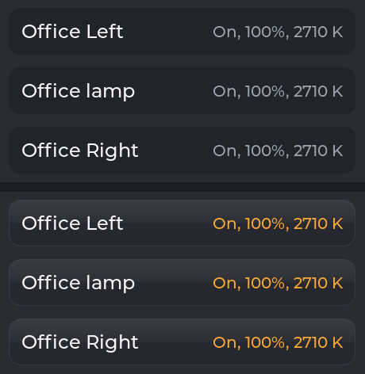
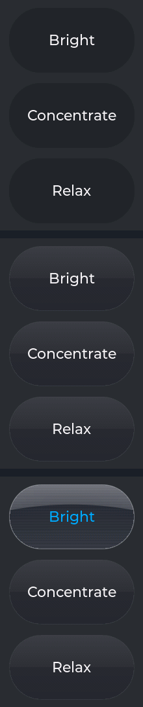
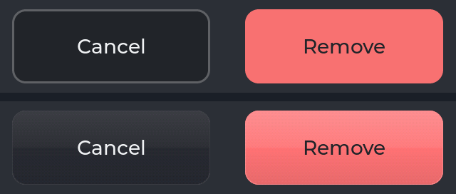
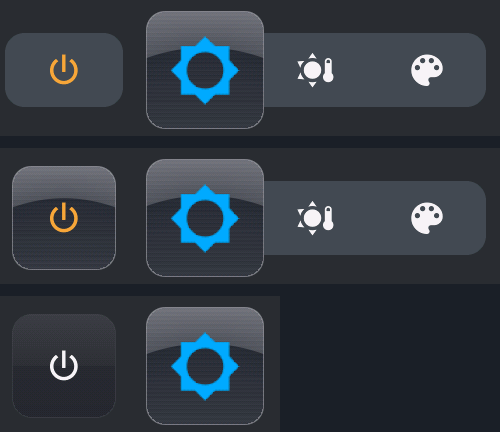
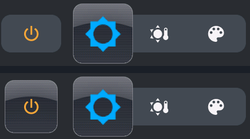
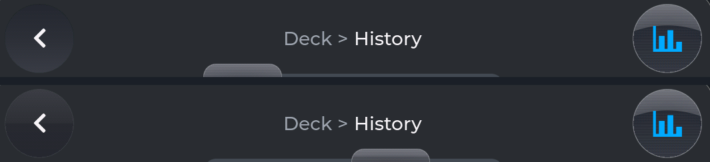
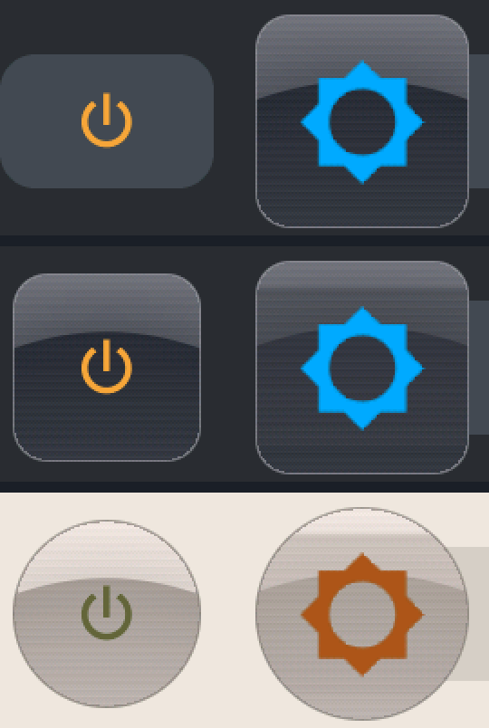
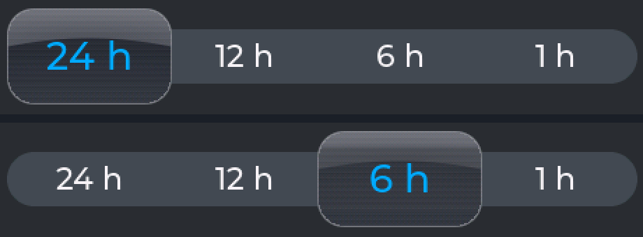

# TEST - #99: satin and glass

Branch `feat/99-satin` (off `main` at `v0.2.15`), built 2026-10-14 evening from the owner's go on
the approach. The mock it follows: "Glass, Satin, Flat"
(https://claude.ai/artifact/G5XANwGMdgWKR19HS1ZQvj); the decision K77, how it is built K85,
`docs/design/components.md` "Finishes". **The P4_5 and the 4B run it** (with your local lines); the
1060 runs `v0.2.15`.

## What changed

| Where | Before | Now |
|---|---|---|
| **Members' rows** | flat | **satin**; the state in colour - "On, 100%, 2710 K" in the active colour, "Off" white, Paused / Unavailable dimmed (it was all dim grey) |
| **Scenes** | flat pills; a blue ring round the one loaded | **satin**; the one loaded is **glass**, its name in the accent (no ring) |
| **The Remove dialog** | flat buttons | **satin**, Remove keeping its red |
| **Power** beside the control deck | a plain button on a ribbon of its own; the icon orange while on | **glass while the light is on** (icon orange), **satin while off** (icon white); no ribbon of its own |
| **Pressed** | each its own tint | satin **darkens**, glass **lightens**; the button **sinks 1 px** |

A paused (greyed) window keeps its scenes and Power plain, as before. History's activity rows stay
flat (Q1). Nothing else changed.

**How it is drawn.** LVGL's own gradients band pink and green on these 16-bit panels (LESSONS), so
satin is painted by hand and dithered, as the selector's metal is. Painted as a full-colour image
with see-through corners it made a full redraw of Members 22 ms slower on the P4_5; painted in the
panel's own 16 bits, LVGL cutting its corners, the cost halved.

## The pictures (before above, after below; P4_5 unless named)

Members (P4_5, then the 4B):

Scenes - before; after; after with Bright loaded:

The Remove dialog:

Power - before (light on); after, light on (glass); after, a light that is off (satin, Lamp 1);
then the 4B before / after:

## How it was checked

- **The harness**, every state, `v0.2.15` against the branch on the P4_5 (48 states): only the
  intended states changed - every light window (Power), Members, Scenes and the dialog. History,
  Properties, SETTINGS, the drawer and About: no differences. The 4B: the same five states, as
  expected. WS_S3_TOUCH_LCD_4B compiles.
- **What it costs to draw**, P4_5, a full redraw with the window open (`/bench what=full`, 20
  frames; `v0.2.15` -> now): Members 113.1 -> 124.1 ms, Scenes 115.8 -> 121.1, the dialog 165.9 ->
  170.3, the controls 127.3 -> 128.0. A press redraws only that button. The first window after a
  boot opens about 35 ms slower (Power's two faces painted once, then kept); later opens as before.
- **A scene loaded** (Bright, from the PC): glass at once, also when the view is opened after. Bright
  left the Office lights where they were (100%, 2710 K).
- **Not measured on an S3** (W6): none can be flashed on the desk (Q5).

## Tests for you

| # | Do this | PASS if |
|---|---|---|
| T1 | Desk > Members | Rows satin - a faint light at the top, a soft edge; each state in colour (on orange, off white). Press a row: it darkens and goes down a pixel; let go: it opens the member |
| T2 | Desk > Scenes; load one | The scenes satin; the one loaded turns glass with its name in blue; move the light's slider - it is satin again |
| T3 | Remove card's dialog (a card you added, or `/popup?removecard=3`) | Cancel satin, Remove satin in its red; each darkens and sinks while pressed |
| T4 | Desk's controls; Power off and on | On: glass, orange icon; off: satin, white icon; pressed: lighter (glass) or darker (satin), down a pixel |
| T5 | Pause a light (SETTINGS) and open its window | Scenes and Power plain and greyed, as before |
| T6 | The Linen and Fleet schemes | Satin still quiet and visible; on Linen the rows' edge a soft shade |
| T7 | Open History, Properties, SETTINGS, About | As before |
| T8 | Use it for a while | It feels as quick as before (scrolling Members, opening windows) |

## Questions for you

- **Q1. History's activity rows** can be tapped (a row opens its details), so by K77 they are satin
  too - but they are left flat for now: a list of ten or more satin rows costs the most to draw, and
  that wants the S3 measured first. **Recommended: satin, after the S3 measurement.**
- **Q2. Pressed**: the mock flips satin's light; here it darkens - one face, tinted - and sinks a
  pixel, which costs nothing to keep. Enough? Recommended: yes.
- **Q3. Power without its own ribbon** (as the mock): it now stands alone beside the selector's
  ribbon. Recommended: keep.
- **Q4. The first window after a boot** opens about 35 ms slower, painting Power's faces once.
  Recommended: accept (a paint in whole numbers could halve it later).
- **Q5. An S3 for the frame check** (W6): the 8048 or the 5B plugged in, and I measure Members, Scenes
  and the dialog there before this merges. Or merge on the P4 numbers and measure later?
- **Q6. The component pictures** in `components.md` (scenes, dialog, selector) show the old look;
  they are refreshed at sign-off.

## Your results

**Round 1 (owner, 2026-10-14):** T1-T5, T7 and T8 **PASS**. **T6**: on Linen, Power's icon was very
hard to see - its olive "on" on the silver glass. Answers: Q1 the recommendation (activity rows
satin after the S3 measurement), Q2 yes, Q3 keep, Q4 accept, **Q5 merge, measure the S3 later**, Q6
refresh the pictures as they change. Two ideas - the header's buttons in satin, and the selector
showing a magnified rail through its glass - and a bug: the activity log scrolled only from a row,
never from a day's heading.

## Round 2 (2026-10-15)

| | What | Checked |
|---|---|---|
| T6 | **An ink that reads on glass** (`Kit::glassInk()`): Power's "on" colour pushed toward the scheme's far end until it stands apart from the metal - Linen's olive becomes a dark olive; Midnight's orange is left as it was | Linen and Midnight screenshots, below |
| Idea 1 | **The header's buttons are satin** - close, back, Members, History, Scenes (they were soft dents); the tab showing stays glass | every window's header; History's below |
| Idea 2 | **The rail through the lens**: the selector's glass shows the rail behind its icon - a fifth taller than the rail outside, in the rail's own colour taken a quarter darker and half faded into the metal, edge to edge. On the control deck and History's span selector | Midnight and Linen, below |
| Bug | **A list scrolls from anywhere on it** - a day's heading, a gap, the note under Members: every scrolling list is now touchable itself (`UI::tameScroll()`), where only its rows were | needs your finger (T10) |

The harness, all 48 states against `v0.2.15`: every window's header and the light windows changed as
above; nothing moved, except Desk's own slider - the light was at 56% for this capture, 100% for
the first.

The header (before above, after below), the rail and Power (`v0.2.15`; Midnight now; Linen now,
twice the size), and History's span selector (before / after):

| # | Do this | PASS if |
|---|---|---|
| T6 | Linen: a light's window, light on | Power's icon easy to see on its glass |
| T9 | Any window: the buttons at the top | Satin discs; the tab of the view showing is glass; a press darkens and sinks |
| T10 | History > a door's activity (North): swipe from a day's heading | The list scrolls; a tap on a row still opens it |
| T11 | Slide the control deck's selector, and History's | The rail shows through the glass, quieter than the icon, and the selector still looks like glass |

- **Q7. The rail's size and strength**: a fifth taller than the rail, half faded. Too strong on
  Midnight, too faint on History's small selector? Two numbers, easy to change.

**Round 2 (owner, 2026-10-15): T6, T10, T11 PASS** (T10: "this was really annoying, it's so nice to
be able to easily scroll these now"). **T9**: pressing a header button showed a box over the top
of its circle (on Linen, a square round it), and a pressed Remove a square outline. **Q7**: good for
now - to be lived with.

## Round 3 (2026-10-15): the pressed corners

The press tint was the face's recolor, and LVGL draws an image that is both recoloured and
corner-clipped through a path that drops the clip, so the square 16-bit satin face showed whole
while pressed. The tint is now a **veil**: a rounded object in the face's own shape, over the face
and under the words, clear until pressed (LESSONS). Flashed to the P4_5 for the owner's last look.

**Signed off by the owner, 2026-10-15** - `v0.2.16`. The all-nine gate on the final code
(`2944846`, `gate.ps1`): **all nine SUCCESS** in 10 min, flash 34-41 %, the owner's local lines
restored. Structure check: 523 style calls outside the kit in 25 files (524 at `v0.2.15`), 44
colour literals in 4 files, no shape numbers, no LVGL in the core layers.
