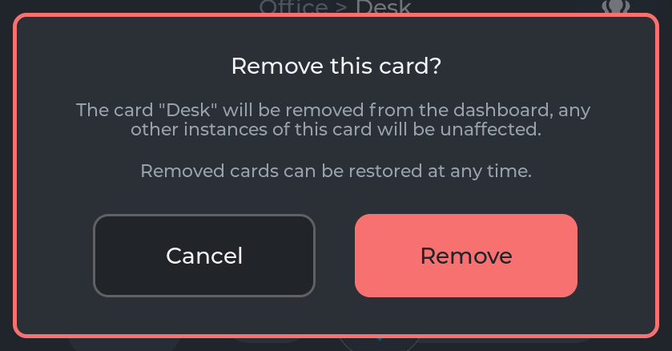
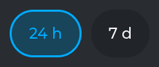
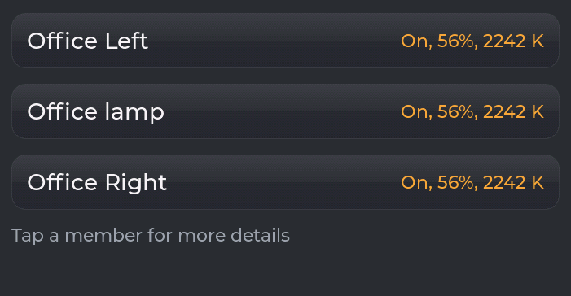
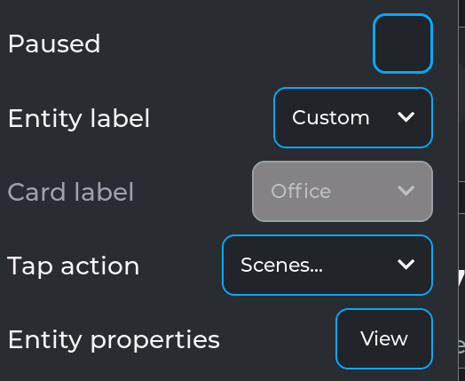
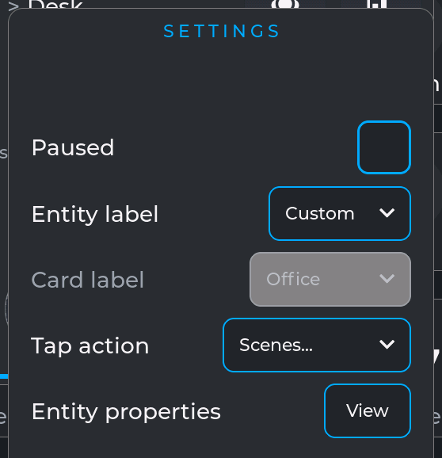
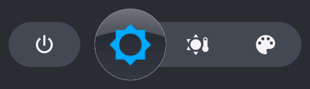
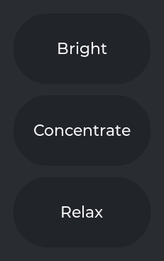
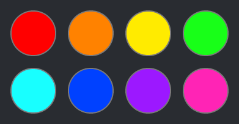
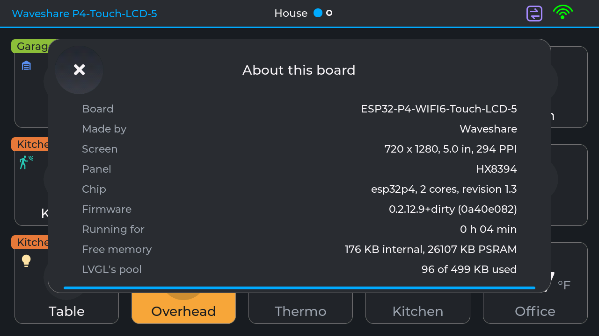

# The component kit and the Sheet (2.12 P3, P4)

**Status: built and verified 2026-10-13** - the card window is built from it, and the harness found
no tree or pixel difference against 2.12 P2 (`ui-foundation.md` §6). Companion to `tokens.md` (the
values the kit reads) and `card-sheet.md` (what the window is).

The kit is `include/UI/Kit.h`, `include/UI/Sheet.h` and `src/UI/Kit/`. It is the layer between the
tokens and a screen: a screen asks for a dialog, a row of chips, a panel of rows or a whole window
(the Sheet, §3), and the kit builds it in the house style. The card window is its first client,
"About this board" its second; #92's chart options can be the next.

---

## 1. How it works

**A component takes a role; a role is a few shared styles.** Every role's look is one `lv_style_t`
per part and state it styles (`Kit::KitStyle`), filled from the tokens by `KitStyles.cpp`. The
styles are filled once at `GUIManager::begin()` (`Kit::begin()`) and again on every repaint - a
scheme or accent change - through `UI::onRepaint()`, after which LVGL restyles every object using
them. That is `UI::paint()`'s mechanism (#64), so a component follows the scheme without a restyle
of its own.

**The caller places it and owns what changes.** A component never sizes or positions itself
beyond its own insides; the caller does (`lv_obj_set_size`, flex, align). Anything that changes
while it shows - a value, a ring round the chosen one, a greyed state that comes and goes - stays
a LOCAL property set by the caller, which beats a shared style in LVGL. A paused window's quiet
colours are set that way too, over the role's.

**The same objects, the same events.** Each component builds exactly the objects its code built
before it was a component, in the same order, with the same flags and the same event codes and
user data - which is what let the harness prove the move changed nothing. Where a component needs
its own state (the selector), it keeps it in the caller's struct and finds it through the
object's user data, so the events carry what they always carried.

**What it costs.** An object using a shared style holds one 8-byte entry in its style list
instead of a copy of every property: a window costs ~180 B less of LVGL's pool, and an open panel
or History view 1-2.5 KB less (§5). The styles themselves take ~880 B of the pool once, at boot.

**Where styles may be set.** In the kit, and in the builders of what no component draws yet -
the card window's hero (toggle, slider, disc), its chart and its activity list.
`scripts/structure_check.py` (P6) reports any other `lv_obj_set_style_*` call.

---

## 2. The components

### Basics - `plain()`, `label()`, label roles, `textW()`

`Kit::plain(parent)` is the bare object everything starts from: no theme styles, not scrollable,
not clickable. `Kit::label(parent, font, colour)` is a label with its own (local) look, for a
colour worked out at the call; `Kit::label(parent, role)` takes a shared look instead.

| Label role | Face | Colour | Used for |
|---|---|---|---|
| `KS_LABEL_NAME` | `NAME` | `TEXT` | a title, a row's words, a state |
| `KS_LABEL_NAME_DIM` | `NAME` | `TEXT_DIM` | a greyed row's words, a note, a day heading |
| `KS_LABEL_TAG` | `TAG` | `TEXT` | a value in a list, a chip, a chart reading |
| `KS_LABEL_TAG_DIM` | `TAG` | `TEXT_DIM` | "Changed 3m ago", a property's name, an axis |
| `KS_LABEL_TAG_ACCENT` | `TAG` | `ACCENT` | a lit chip, "Show more" |

### Button - `Kit::button(parent, role, text, w, h, cb)`

A plain object with words, its look by role: **CANCEL** (the surface, a faint edge) and
**DESTRUCTIVE** (`ST_BAD`, the words in the surface colour). Radius `R_BUTTON`, edge `LINE_FINE`,
pressed: 20% of `TEXT` mixed in. The words are the role's ink (`NAME`).

The brief listed PRIMARY and QUIET too. No button in the house is either today - the row button is
a row control (below), a scene is a pill - so they wait for their first user rather than ship
untested.

### Dialog - `Kit::dialog(spec)`

A question over everything, on the top layer, the rest dimmed (`GROUND` at 60%): a title, up to
two centred paragraphs, and up to two buttons side by side; a tap outside the box calls the spec's
`outside`. Returns the dim; deleting it closes the dialog. One role so far, **DESTRUCTIVE** (the
box's edge in `ST_BAD`, `LINE_HEAVY`). The box: the scheme's card radius, `SURFACE_ALT`, padding
`S9`, rows `S7`. "Remove card" (K66, K69) is its first client.

### Chip row - `Kit::chipRow(parent, words, n, lit, room, cb)`

Small round-ended buttons side by side, the chosen one lit: `SURFACE` unlit; lit, 25% of the
accent mixed in with a `LINE_FINE` accent edge and the words in the accent. Height `H_CHIP`, radius
`R_CHIP`, sides `S_CHIP_SIDE`, gaps `S4` - both shrinking to fit `room`, as far as half. Each
chip's tap carries its index. History's spans are its client; #92's chart options can be.

### List item - `Kit::item(parent)`

A tappable surface in a list - a member, an activity row, "Show more": the card's radius and
`SURFACE`, 15% of `TEXT` mixed in while pressed. The caller sizes it, lays out what it holds and
says what a tap does.

### Rows - `Kit::rows(body, specs, n)` and its parts

A panel's rows from one list of `Kit::RowSpec` - words, kind, choices, the chosen one, live or
greyed, a callback, where to keep the control - so a panel's size (`Kit::rowsNeedW()`) and its
contents cannot disagree. A row is `H_ROW` tall, its words on the left (`KS_LABEL_NAME`, dim when
greyed), its control on the right, `H_CONTROL` tall:

- **Dropdown** (`ROW_DROP`): `SURFACE`, radius `R_CONTROL`, a `LINE_HAIR` accent edge (greyed: 25%
  of `TEXT` in `SURFACE_ALT`, and disabled); its list the same, every choice in sight (the screen
  limits it), the chosen line in the accent.
- **Checkbox** (`ROW_CHECK`): a box as tall as a dropdown, a `LINE_MID` accent edge, the accent
  when ticked.
- **Row button** (`ROW_BUTTON`): a dropdown's frame with words; greyed, no accent and nothing to tap.

### Folder panel - `Kit::folder(F, spec)`

A pane of rows with a tab rising from its top edge, the join curving in like a file folder's
(owner, rounds 7-11), built below the bottom of the screen in a track it can be dragged in. The
spec says the window it belongs to, which side its tab is on, its title, its widest row, its row
count, the tab's width and the callbacks; `Folder` returns its objects, its height, the strip its
tab shows folded (`head`) and how much stays below the screen open (`hide`). Sliding it, dragging
it and what its carets mean are the caller's (`PopupPanels.cpp`). The face: `SURFACE_ALT`, the
scheme's border, radius `R_PANEL`, the scheme's lift.

### Selector - `Kit::selector(S, parent, spec)`

Choices on a ribbon and a metal selector that slides between them (owner, 2026-10-07, after HTC's
TouchFLO 3D): dragged, or glided to a tapped choice, snapping to the nearest; its icon a size up in
the accent. An ACTION (the window's Power) sits on a ribbon of its own before the choices, and the
selector never lands on it. The spec gives the choices' icons, the chosen one, the action, whether
it is quiet (a paused window), what to ask before anything moves (`blocked`) and what to call when
the selector arrives (`onChosen`). `Kit::Selector` is its state, kept by the caller while it shows.

Its **four looks** (Black or Silver, Square or Round) are per scheme and saved (K36, K45):
`Kit::selectorLook()`, `Kit::keepSelectorLook()`. Its face, and a lit icon button's, is a **face
drawn by hand** - a raised metal face or a soft dent, painted into PSRAM once (`KitFaces.cpp`).

### Icon button - `Kit::iconButton(parent, glyph, font, cb)`

A round button at the minimum touch size with an icon: a soft dent in the surface, tinted while
pressed. `Kit::iconButtonLit(b, lit)` lights it as the selector is - the same metal, the icon a
size up in the accent: the window's corner icons work as tabs that way.

### Pill, swatch and badge (styles)

 

`KS_PILL` / `KS_PILL_PRESSED`: a round button with words (a scene); room for the ring round the
loaded one. `KS_SWATCH`: a round colour swatch with a hairline edge (the colour is the caller's).
`KS_BADGE_PAUSED`: the card's own PAUSED badge.

The pictures are WS_P4_5 in Midnight, cut from the harness's screenshots
(`scripts/ui_golden.py crop`).

### Facts - `Kit::factList(parent)`, `Kit::factRow(list, what, value)`, `Kit::factColumns(list)`

A read-only list: an entity's Properties, "About this board". `factList()` makes the list (the
whole of its parent, scrolling if it must, `S10` sides, `S5` between rows); `factRow()` adds what
something is, dim, and its value beside it, wrapping if long ("-" when there is none); once the
rows are in, `factColumns()` makes the words' column as wide as the longest words in that list (at
most half of it), so **both columns are left aligned** and every value starts at one place. The
gap between the columns is `S5` (1.6 mm), half of the `S8` it was (owner, TEST_2.12; #97). A value
that wraps keeps to its column, its words at its first line. A fact list holds fact rows only.

---

## 3. The Sheet - `include/UI/Sheet.h` (2.12 P4)

**A window over the page, from a spec.** It is the card window's frame, made a component: placed
in the middle of the screen (under the system header, over the panels' tabs, up to twice as wide
as tall, at most `W_WINDOW_MAX`, clear of the sides - `Kit::sheetPlace()`), with a header row (a
close or back button, a title in two parts, tabs on the right), a stage, the countdown bar, sparks
now and then along its edge, and two folder panels under it - SETTINGS on the right and the view's
own options on the left. It is modal: a tap outside closes it (the tap catcher, made once at
`Kit::sheetBegin()`), and while a panel is open a tap in the window only folds the panel. It is
built in one quiet pass (invalidation off, then exactly the window and its shadow's bands asked
for), so its first frame draws only itself - card-sheet 14, "Usable first".

**The spec says what is the client's** (`Kit::SheetSpec`): the left button's and the title link's
callbacks, the tabs (glyphs and callbacks; the last one made sits in the corner) and a floating tab
under them, the first view's builder, a tick every 250 ms, what to do as it closes and once it has
gone, whether it sparks, SETTINGS' title and row specs, and what to forget when either panel's
rows go. The left panel is shown per view with `Kit::sheetSide(S, kind, title, rows)`.

**Its state is a `Kit::Sheet`**, kept by the client: the card window's own state extends it
(`struct Popup : Kit::Sheet`), so the window's code reads `s.win`, `s.stage`, `s.right` as before.
One sheet shows at a time (`Kit::sheetShowing()`).

**The countdown bar** (`Kit::countdownBar(box, boxW)`, `Kit::countdownSet(bar, leftMs)`; #97,
#23): how long until the sheet closes itself (60 s untouched, `Kit::sheetLeftMs()`). A line
`H_BAR` thin - 2 px at 294 and 255 PPI, 1 px at 170 - in the accent (`KS_SHEET_BAR`), on the box's
bottom edge inside its border and between its rounded corners, shrinking toward its middle. The
window has one; the Remove dialog, which closes with the window, shows the same over it. Its on/off
and the timeout's length are device settings for 4.1 (#23).

| Client | What it adds to the frame |
|---|---|
| The card window (`CardPopup`) | its views (controls, History, Members, a member's own, Scenes, Properties), which tabs are lit, the titles and the back rules, SETTINGS' rows, the left panel per view, following the entity |
| "About this board" (`UI/AboutSheet`; every build, from the About button on the system panel's Log / Tokens / Cards / About row, K74, #97; debug builds also `GET /popup?about=1`) | one view of fact rows - the board, its screen and chip, the firmware, how long it has run, free memory and LVGL's pool, updated each second; no tabs, no panels |

The second client is ~130 lines and owns no frame code: that is the point of it. Where it belongs
in the product (the system panel?) is the owner's call; until then it is behind `DEBUG_POPUP`.

---

## 4. Not in the kit

What only the card window draws stays in `src/Cards/Popup/`: the hero (the toggle and its knob,
the light's slider, a sensor's disc), the history chart and the activity list's layout.

## 5. Measured

LVGL's pool per window opened, WS_P4_5, median of 7 (`scripts/ui_golden.py measure`):

| Window | 2.12 P2 | With the kit |
|---|---|---|
| Desk (HA light group) | 10,176 B | 10,004 B |
| Deck (temperature) | 7,188 B | 6,992 B |
| North (garage door) | 7,200 B | 7,004 B |
| Overhead (switch) | 7,460 B | 7,280 B |
| All Lamps (group here) | 10,928 B | 10,756 B |
| Lamp 1 (virtual light) | 8,800 B | 8,628 B |

And the whole pool in use, P2 against the kit, from the same house state (the harness's A/B):

| State | P2 | With the kit | |
|---|---|---|---|
| The dashboard, no window | 86,088 B | 86,964 B | +876: the kit's styles, once |
| Desk, SETTINGS open | 105,488 B | 105,212 B | -276 |
| Desk, History | 117,672 B | 116,504 B | -1,168 |
| Deck, its CHART panel open | 115,872 B | 114,256 B | -1,616 |
| North, its ACTIVITY panel open | 113,956 B | 113,076 B | -880 |

The window's build time did not move: the fastest of 7 opens within 0.3 ms of `v0.2.12` on every
window.
