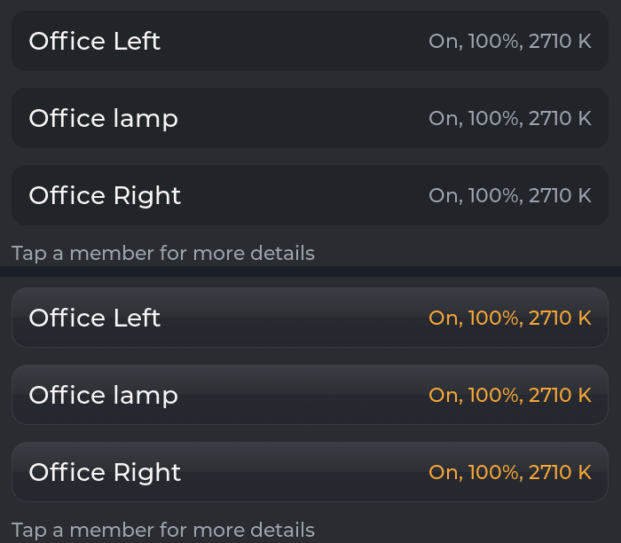

# The component kit and the Sheet (2.12 P3, P4)

**Status: built and verified 2026-10-13** - the card window is built from it, and the harness found
no tree or pixel difference against 2.12 P2 (`ui-foundation.md` §6). Companion to `tokens.md` (the
values the kit reads) and `card-sheet.md` (what the window is).

The kit is `include/UI/Kit.h`, `include/UI/Sheet.h` and `src/UI/Kit/`. It is the layer between the
tokens and a screen: a screen asks for a dialog, a row of chips, a panel of rows or a whole window
(the Sheet, §3), and the kit builds it in the house style. The card window is its first client,
"About this board" its second; #92's chart options can be the next.

---

## 1. How it works

**A component takes a role; a role is a few shared styles.** Every role's look is one `lv_style_t`
per part and state it styles (`Kit::KitStyle`), filled from the tokens by `KitStyles.cpp`. The
styles are filled once at `GUIManager::begin()` (`Kit::begin()`) and again on every repaint - a
scheme or accent change - through `UI::onRepaint()`, after which LVGL restyles every object using
them. That is `UI::paint()`'s mechanism (#64), so a component follows the scheme without a restyle
of its own.

**The caller places it and owns what changes.** A component never sizes or positions itself
beyond its own insides; the caller does (`lv_obj_set_size`, flex, align). Anything that changes
while it shows - a value, a ring round the chosen one, a greyed state that comes and goes - stays
a LOCAL property set by the caller, which beats a shared style in LVGL. A paused window's quiet
colours are set that way too, over the role's.

**The same objects, the same events.** Each component builds exactly the objects its code built
before it was a component, in the same order, with the same flags and the same event codes and
user data - which is what let the harness prove the move changed nothing. Where a component needs
its own state (the selector), it keeps it in the caller's struct and finds it through the
object's user data, so the events carry what they always carried.

**What it costs.** An object using a shared style holds one 8-byte entry in its style list
instead of a copy of every property: a window costs ~180 B less of LVGL's pool, and an open panel
or History view 1-2.5 KB less (§5). The styles themselves take ~880 B of the pool once, at boot.

**Where styles may be set.** In the kit, and in the builders of what no component draws yet -
the card window's hero (toggle, slider, disc), its chart and its activity list.
`scripts/structure_check.py` (P6) reports any other `lv_obj_set_style_*` call.

---

## 2. The components

### Basics - `plain()`, `label()`, label roles, `textW()`

`Kit::plain(parent)` is the bare object everything starts from: no theme styles, not scrollable,
not clickable. `Kit::label(parent, font, colour)` is a label with its own (local) look, for a
colour worked out at the call; `Kit::label(parent, role)` takes a shared look instead.

| Label role | Face | Colour | Used for |
|---|---|---|---|
| `KS_LABEL_NAME` | `NAME` | `TEXT` | a title, a row's words, a state |
| `KS_LABEL_NAME_DIM` | `NAME` | `TEXT_DIM` | a greyed row's words, a note, a day heading |
| `KS_LABEL_TAG` | `TAG` | `TEXT` | a value in a list, a chip, a chart reading |
| `KS_LABEL_TAG_DIM` | `TAG` | `TEXT_DIM` | "Changed 3m ago", a property's name, an axis |
| `KS_LABEL_TAG_ACCENT` | `TAG` | `ACCENT` | a lit chip, "Show more" |

### Button - `Kit::button(parent, role, text, w, h, cb)`

A plain object with words, its look by role: **CANCEL** (the surface, a faint edge) and
**DESTRUCTIVE** (`ST_BAD`, the words in the surface colour). Radius `R_CONTROL`, edge `LINE_MID`,
pressed: 20% of `TEXT` mixed in. The words are the role's ink (`NAME`).

The brief listed PRIMARY and QUIET too. No button in the house is either today - the row button is
a row control (below), a scene is a pill - so they wait for their first user rather than ship
untested.

### Dialog - `Kit::dialog(spec)`

A question over everything, on the top layer, the rest dimmed (`GROUND` at 60%): a title, up to
two centred paragraphs, and up to two buttons side by side; a tap outside the box calls the spec's
`outside`. Returns the dim; deleting it closes the dialog. One role so far, **DESTRUCTIVE** (the
box's edge in `ST_BAD`, `LINE_HEAVY`). The box: the scheme's card radius, `SURFACE_ALT`, padding
`S9`, rows `S7`. The buttons are `W_DIALOG_BTN` wide where that fits; in a narrower row they share
it, `S7` between and beside them (#96). `countdown` in the spec shows the countdown of the sheet
under it, on the box's bottom edge, for a dialog that closes with that sheet (#23). "Remove card"
(K66, K69) is its first client.

### Chip row - `Kit::chipRow(parent, words, n, lit, room, cb)`

Small round-ended buttons side by side, the chosen one lit: `SURFACE` unlit; lit, 25% of the
accent mixed in with a `LINE_MID` accent edge and the words in the accent. Height `H_CHIP`, radius
`R_CHIP`, sides `S7`, gaps `S4` - both shrinking to fit `room`, as far as half. Each
chip's tap carries its index. History's spans were its client until #92 gave them the compact
selector; it stays in the kit for a choice that wants plain chips (#92's chart options can be).

### List item - `Kit::item(parent)`

A tappable surface in a list - a member, an activity row, "Show more": the card's radius and
`SURFACE`, 15% of `TEXT` mixed in while pressed. The caller sizes it, lays out what it holds and
says what a tap does.

### Rows - `Kit::rows(body, specs, n)` and its parts

A panel's rows from one list of `Kit::RowSpec` - words, kind, choices, the chosen one, live or
greyed, a callback, where to keep the control - so a panel's size (`Kit::rowsNeedW()`) and its
contents cannot disagree. A row is `H_ROW` tall, its words on the left (`KS_LABEL_NAME`, dim when
greyed), its control on the right, `H_CONTROL` tall:

- **Dropdown** (`ROW_DROP`): `SURFACE`, radius `R_CONTROL`, a `LINE_HAIR` accent edge (greyed: 25%
  of `TEXT` in `SURFACE_ALT`, and disabled); its list the same, every choice in sight (the screen
  limits it), the chosen line in the accent.
- **Checkbox** (`ROW_CHECK`): a box as tall as a dropdown, a `LINE_MID` accent edge, the accent
  when ticked.
- **Row button** (`ROW_BUTTON`): a dropdown's frame with words; greyed, no accent and nothing to tap.

### Folder panel - `Kit::folder(F, spec)`

A pane of rows with a tab rising from its top edge, the join curving in like a file folder's
(owner, rounds 7-11), built below the bottom of the screen in a track it can be dragged in. The
spec says the window it belongs to, which side its tab is on, its title, its widest row, its row
count, the tab's width and the callbacks; `Folder` returns its objects, its height, the strip its
tab shows folded (`head`) and how much stays below the screen open (`hide`). Sliding it, dragging
it and what its carets mean are the caller's (`PopupPanels.cpp`). The face: `SURFACE_ALT`, the
scheme's border, radius `R_PANEL`, the scheme's lift.

### Selector - `Kit::selector(S, parent, spec)`

Choices on a ribbon and a metal selector that slides between them (owner, 2026-10-07, after HTC's
TouchFLO 3D): dragged, or glided to a tapped choice, snapping to the nearest; its icon a size up in
the accent. An ACTION (the window's Power) sits on a ribbon of its own before the choices, and the
selector never lands on it. The spec gives the choices' icons, the chosen one, the action, whether
it is quiet (a paused window), what to ask before anything moves (`blocked`) and what to call when
the selector arrives (`onChosen`). `Kit::Selector` is its state, kept by the caller while it shows.
Up to four choices (`SELECTOR_MAX`).

**Compact** (`spec.compact`, #92): the same selector a span chip's height (`H_CHIP`), its choices
**words** in the label face (`TAG`; the chosen one on the selector in `NAME`, a size up) and no
action - one option chosen from a short list on a line of text. Each choice is as wide as the
widest word and its sides (`S7`); `spec.room` makes the sides shrink to fit, as far as `S1`.
History's span buttons are its first user (the chart's 24 / 12 / 6 / 1 h, activity's 24 h / 7 d),
in place of the chip row; "Show span buttons" still turns them off.

Its **four looks** (Black or Silver, Square or Round) are per scheme and saved (K36, K45):
`Kit::selectorLook()`, `Kit::keepSelectorLook()`; since 2.8 round 3 a card's own look overrides the
scheme's while its window is open (`Kit::selectorLookOverride()`, Card UI, D-28), and UI Tweaks'
Reset all clears every scheme's (`Kit::forgetSelectorLooks()`). Its face, and a lit icon button's,
is a **face drawn by hand** - a raised metal face or a soft dent, painted into PSRAM once
(`KitFaces.cpp`). Up to five choices since round 3 (`SELECTOR_MAX`), and `spec.slotW` makes every
compact choice one width (`Kit::selectorSlotW(words, n)`), so stacked selectors line up.

### Choice rows - `Kit::choiceRows(parent, w, rows, n, S)`, `Kit::buttonRow(list)` (2.8 round 3)

**A list of choices, each its words and a compact selector** - UI Tweaks' and Card UI's rows (D-27:
"a choice is the kit's selector, not a row of chips, wherever it fits"). Every choice is the width
of the widest word in ANY row, so the rows line up choice for choice; where the words and the widest
selector will not fit side by side (the 4B's window, Card UI's five choices on the P4_5), each row's
words stand above its selector, centred. The list fills its parent's height and scrolls when it
must. `Kit::ChoiceRow` is a row's words, choices, chosen one and `onChosen`; the caller keeps one
`Kit::Selector` per row. `buttonRow()` adds a centred row of buttons after them (Tokens, Reset all).

### Icon button - `Kit::iconButton(parent, glyph, font, cb)`

A round button at the minimum touch size with an icon: a soft dent in the surface, tinted while
pressed. `Kit::iconButtonLit(b, lit)` lights it as the selector is - the same metal, the icon a
size up in the accent: the window's corner icons work as tabs that way.

### Pill, swatch and badge (styles)

 

`KS_PILL` / `KS_PILL_PRESSED`: a round button with words (a scene) - satin, glass while it is the
scene loaded (below; it had a ring until #99). `KS_SWATCH`: a round colour swatch with a hairline
edge (the colour is the caller's). `KS_BADGE_PAUSED`: the card's own PAUSED badge.

### Finishes - `Kit::finish(o, w, h, r, finish, tint)` (#99, K77, K85)

What a surface says about a thing you can tap, decided once for every component:

| Finish | Means | Where |
|---|---|---|
| **Satin** | can be tapped, not chosen | Members' rows, scenes not loaded, the dialog's buttons (a role keeps its colour: Remove's red), Power while off, the header's buttons (close, back, the tabs) |
| **Glass** | chosen or active | the selector, the tab showing, a scene loaded, Power while on |
| **Flat** | information | fact rows, labels - no finish at all |

`Kit::finish()` paints the face into the object (its first child, an image): **satin** - a light
at the top fading by the middle, a faint step, a shade growing below, a soft edge (a shade on a
light scheme); **glass** - the selector's metal (`metalKind()`). Called again, it changes the
finish (a scene loaded and no longer; Power on and off - `Kit::selectorActionLit()`). Pressed:
satin darkens 30 %, glass lightens 20 %, and the object sinks 1 px (`KS_SINK`) - the tint a
**veil**, a rounded object in the face's shape over it, because LVGL drops the corner clip of an
image it recolours (LESSONS). Colour still carries
state: a member's "On, 100%, 2710 K" is in `KS_LABEL_TAG_ACTIVE`, "Off" white, Paused dimmed. A
colour drawn on glass goes through `Kit::glassInk()`, which moves it away from the metal's tone
(Linen's olive was lost on its silver). **The selector's glass shows the rail through it** (owner,
#99): a band a fifth taller than the rail outside, the rail's colour a quarter darker, half faded
into the metal, edge to edge behind the icon (`setFace(..., band)`).

**Painted by hand and dithered to the 16-bit grid**, as the metal is: LVGL's own gradients band
pink and green on these panels (LESSONS). **Satin is painted in 16 bits** - no alpha, its corners cut
by LVGL from the image's radius - and **floats** (`LV_OBJ_FLAG_FLOATING`), so an object sized to its
content does not grow by the face. Faces are kept in 16 slots in PSRAM (12 before #99), per size,
kind and colour. What it costs, WS_P4_5, a full redraw with the window open (`/bench what=full`,
20 frames): Members 113.1 -> 124.1 ms, Scenes 115.8 -> 121.1, the dialog 165.9 -> 170.3, the
controls 127.3 -> 128.0; the first window after a boot opens ~35 ms slower, painting Power's two
faces once. Not yet measured on an S3 (W6).

The pictures are WS_P4_5 in Midnight, cut from the harness's screenshots
(`scripts/ui_golden.py crop`).

### Facts - `Kit::factList(parent)`, `Kit::factRow(list, what, value)`, `Kit::factColumns(list)`

A read-only list: an entity's Properties, "About this board". `factList()` makes the list (the
whole of its parent, scrolling if it must, `S10` sides, `S5` between rows); `factRow()` adds what
something is, dim, and its value beside it, wrapping if long ("-" when there is none); once the
rows are in, `factColumns()` makes the words' column as wide as the longest words in that list (at
most half of it) and **centres the two columns**: both left aligned, and the room the longest words
and the longest value leave is shared equally - the same space from each wall and between the
columns (owner, TEST_2.12 and this branch's first build; #97). Values too long for that get `S5`
each way, and wrap in their column, their words at the first line. A fact list holds fact rows
only.

### The page header - `Kit::headerBar()`, `Kit::headerSlot()`, `Kit::glyphFrame()` (2.8)

**The bar** (`KS_HDR_BAR`): full width, the header's height, `SURFACE_ALT` with the accent line
along its bottom (`LINE`) and the scheme's drop shadow - the look `Panel_Header` set locally before
it had slots; it lays nothing out itself - **where each slot stands is the header plan's**
(`Layout/HeaderPlan.h`, round 2: the sides at the bar's ends `EDGE` in, `SPACE` between slots, the
middle on the centre, `CLEAR` kept between a side and the middle). **A slot** (`KS_HDR_SLOT`): the
bar's height, its x and width the plan's - what it holds, measured - its contents centred in a row
`SLOT_GAP` apart, `SLOT_PAD` at its sides; tinted while
pressed (`KS_HDR_SLOT_PRESSED`), and in the drawer's face while `LV_STATE_CHECKED` - its panel open
- so the slot opens into its panel like a folder's tab (`KS_HDR_SLOT_OPEN`). Its words are
`KS_HDR_TEXT` (the header's face) and `KS_HDR_TEXT_DIM` (am / pm, "3 / 15"); a sensor's icon
`KS_HDR_ICON`; the clock's row `KS_HDR_CLOCK` (bottoms together), the dots' row `KS_HDR_DOTS`, the
dots `KS_HDR_DOT_ON` (this page: larger, filled) and `KS_HDR_DOT_OFF` (a ring); the error mark
beside a slot's dashes `KS_HDR_MARK` ("!" on a disc in `ST_WARN`).

**A glyph's frame** (#19's open question, built as a setting): `GLYPH_BARE` an empty holder the
glyph's own size; `GLYPH_SQUARE` the rounded square (`KS_GLYPH_SQUARE`, `FRAME` square, `FRAME_R`
corners, `FRAME_MIX`% of `TEXT` over the bar); `GLYPH_CIRCLE` the circle (`KS_GLYPH_CIRCLE`), its
colour the glyph's state - set by the glyph - and the glyph drawn in the bar's colour. **A frame
never shrinks a glyph** (round 3, D-24): the glyph is `GLYPH` bare or framed, the frame `FRAME`
round it. What a slot holds is `Panel_Header`'s, by its kind (`UI/HeaderSlots.h`).

**A stroke glyph** (`Kit::strokeGlyph(g, parent, shape, px)`, round 3, D-27): the status glyphs are
**numbers**, not a font - each stroke of the mocks' glyphs (an arc, a line or a dot on a 24-unit
grid, `UI/GlyphShapes.h`, seven tests on the PC) drawn with LVGL's own round-capped arcs and lines,
one object a stroke so each PART takes its own colour (`strokeGlyphPaint()`; the Wi-Fi fan lights
arc by arc), shown or hidden by part (`strokeGlyphShow()`), and struck through on a halo of the
ground (`strokeGlyphStrike()`, switched off on purpose). `Kit::StrokeGlyph` is its state.

**One shape** (round 3, D-23): an open slot (`KS_HDR_SLOT_OPEN`, an accent border on its left, top
and right, its box `FRAME_R` taller than the bar and clipped by it) and its panel share one accent
outline that breaks through the bar's line. **Joins** round every corner where that outline meets
the line: `Kit::joinCorner(parent, flare)` - a **cove** beside the tab, in the bar
(`coveAt()`), a **flare** beside the panel, below the line (`flareAt()`) - `JOIN_R` round, filled
with the shape's face and ringed in the accent over the bar or the ground (`KS_JOIN_FILL`,
`KS_JOIN_RING_BAR`, `KS_JOIN_RING_GROUND`).

### A drawer - `Kit::drawer(D, parent, w)`, `drawerPlace()`, `drawerOpen()`, `drawerClose()` (2.8)

**A panel that slides down from a header slot**: the system panel's shape and motion, which it was
built to match - square where it meets the bar, `DRAWER_R` below, `DRAWER_LINE` edge, 350 ms
ease-out, its face riding the growing edge (#81). `drawerPlace()` centres it under its slot and
keeps it on the screen; `drawerOpen()` measures the face and grows to it (at most the screen below);
`drawerClose()` takes it back to nothing and hides it. `drawerWidth()` is the system panel's width
rule capped at `DRAWER_W`. Its lines: `drawerItem()` (full width, a finger tall, a dot - filled or
a ring - and words; `KS_DRAWER_ITEM`), `drawerNote()` (dim, wrapping) and `drawerBig()` (a time, a
reading; `KS_DRAWER_BIG`). **The system panel is a drawer too** since 2.8 round 2 (D-20): its frame
is `Kit::drawer()` at its own width rule (half a wide screen, three quarters of a middling one, all
of a narrow one), hung under the status slot. `drawerOpen(d, tabL, tabR)` takes its tab's span, and
places a **flare** each side where the panel reaches past it (one shape, above); `drawerPlace()`
keeps a panel `EDGE` from the screen's sides, where a tab stands, so a panel at an edge shares that
side with its tab. The face's edge is the accent at `LINE`.

**Its rows, round 3** (the system panel's new layout, D-22 / D-25): `drawerTitle()` a section's
title (CONNECTIVITY); `drawerRow()` things side by side, the panel's width, `DRAWER_GAP` apart;
`statusRow(face, what, &glyphRoom)` room for a glyph, what it is, and its live value dim, a face
smaller, on one line and ellipsised - returns the value's label; `vrule(row, h)` a short upright rule
setting one choice apart from another (`KS_RULE`); `toggleButton(parent, words, w, h, on, cb)` and
`toggleButtonSet()` - glass while on, satin while off (#99's finishes); `selectorSet(S, i)` a
selector's choice set from outside, with no `onChosen` (the scheme changed elsewhere).

---

## 3. The Sheet - `include/UI/Sheet.h` (2.12 P4)

**A window over the page, from a spec.** It is the card window's frame, made a component: placed
in the middle of the screen (under the system header, over the panels' tabs, up to twice as wide
as tall, at most `W_WINDOW_MAX`, clear of the sides - `Kit::sheetPlace()`), with a header row (a
close or back button, a title in two parts, tabs on the right), a stage, the countdown bar, sparks
now and then along its edge, and two folder panels under it - SETTINGS on the right and the view's
own options on the left. It is modal: a tap outside closes it (the tap catcher, made once at
`Kit::sheetBegin()`), and while a panel is open a tap in the window only folds the panel. It is
built in one quiet pass (invalidation off, then exactly the window and its shadow's bands asked
for), so its first frame draws only itself - card-sheet 14, "Usable first".

**The spec says what is the client's** (`Kit::SheetSpec`): the left button's and the title link's
callbacks, the tabs (glyphs and callbacks; the last one made sits in the corner) and a floating tab
under them, the first view's builder, a tick every 250 ms, what to do as it closes and once it has
gone, whether it sparks, SETTINGS' title and row specs, and what to forget when either panel's
rows go. The left panel is shown per view with `Kit::sheetSide(S, kind, title, rows)`.

**Its state is a `Kit::Sheet`**, kept by the client: the card window's own state extends it
(`struct Popup : Kit::Sheet`), so the window's code reads `s.win`, `s.stage`, `s.right` as before.
One sheet shows at a time (`Kit::sheetShowing()`).

**The countdown bar** (`Kit::countdownBar(box, boxW)`, `Kit::countdownSet(bar, sheet)`; #97,
#23): how long until the sheet closes itself (`Kit::sheetLeftMs()`). A line
`H_BAR` thin - 2 px at 294 and 255 PPI, 1 px at 170 - in the accent (`KS_SHEET_BAR`), on the box's
bottom edge inside its border and between its rounded corners, shrinking toward its middle. The
window has one; the Remove dialog, which closes with the window, shows the same over it.
**The timeout and the bar are system settings** (K79), read as each sheet opens into
`Sheet::closeMs`: 60 s untouched (D6) unless set to 30, 10 or never; with never, or the bar off,
there is no bar (`Sheet::autoBar` is null) and the dialog shows none either. Set in UI Tweaks since
2.8 round 3 (and from a PC, `/settings?window_close=`, `window_bar=`); `Kit::windowCloseMs()` and
`Kit::windowBarShown()` read them - **the header's panels close on the same timeout** (D-22). A
client may override both for its window (`SheetSpec::closeMs`, `SheetSpec::bar`): a card's Card UI.

**Beside the window** (`Kit::sheetBeside()`, round 3, D-25): the catcher lets presses through to the
children of one holder outside the window - the deck's panels, risen under UI Tweaks - and while
one of them is open the window is out of reach as it is under the sheet's own panel: a press there
only folds it. Forgotten when the sheet closes.

| Client | What it adds to the frame |
|---|---|
| The card window (`CardPopup`) | its views (controls, History, Members, a member's own, Scenes, Properties, Card UI), which tabs are lit, the titles and the back rules, SETTINGS' rows, the left panel per view, following the entity; its own timeout, bar and selector look (Card UI, D-28) |
| "About this board" (`UI/AboutSheet`; every build, from the About button on the system panel, K74, #97; debug builds also `GET /popup?about=1`) | one view of fact rows - the board, its screen and chip, the firmware, how long it has run, free memory and LVGL's pool, updated each second; no tabs, no panels |
| "UI Tweaks" (`UI/TweaksSheet`, 2.8 round 3; the system panel's UI Tweaks button, a swipe down on the left half, debug builds `GET /popup?tweaks=1`) | one view of choice rows, then Tokens and Reset all (asked in a dialog); what each row sets is `GUIManagerTweaks.cpp`'s; the deck rises beside it (`sheetBeside()`) |

The second client is ~130 lines and owns no frame code: that is the point of it.

---

## 4. Not in the kit

What only the card window draws stays in `src/Cards/Popup/`: the hero (the toggle and its knob,
the light's slider, a sensor's disc), the history chart and the activity list's layout.

## 5. Measured

LVGL's pool per window opened, WS_P4_5, median of 7 (`scripts/ui_golden.py measure`):

| Window | 2.12 P2 | With the kit |
|---|---|---|
| Desk (HA light group) | 10,176 B | 10,004 B |
| Deck (temperature) | 7,188 B | 6,992 B |
| North (garage door) | 7,200 B | 7,004 B |
| Overhead (switch) | 7,460 B | 7,280 B |
| All Lamps (group here) | 10,928 B | 10,756 B |
| Lamp 1 (virtual light) | 8,800 B | 8,628 B |

And the whole pool in use, P2 against the kit, from the same house state (the harness's A/B):

| State | P2 | With the kit | |
|---|---|---|---|
| The dashboard, no window | 86,088 B | 86,964 B | +876: the kit's styles, once |
| Desk, SETTINGS open | 105,488 B | 105,212 B | -276 |
| Desk, History | 117,672 B | 116,504 B | -1,168 |
| Deck, its CHART panel open | 115,872 B | 114,256 B | -1,616 |
| North, its ACTIVITY panel open | 113,956 B | 113,076 B | -880 |

The window's build time did not move: the fastest of 7 opens within 0.3 ms of `v0.2.12` on every
window.
